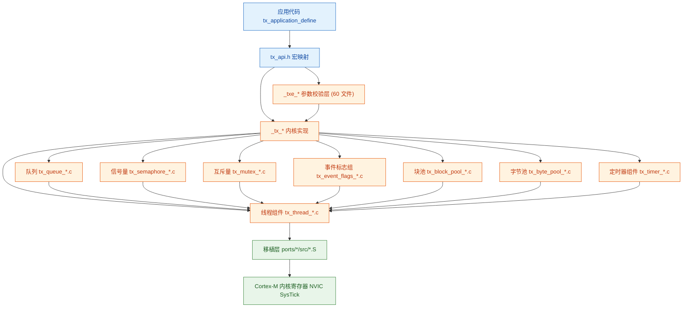

# ThreadX 源码详解 00：总览与架构

> 涉及文件（本地仓库 `/Users/theo-richard/workspace/01-RTOS操作系统/ThreadX/`）：
> - `common/inc/tx_api.h`（2359 行）—— 唯一对应用公开的头文件：全部控制块结构体、常量、API 映射
> - `common/inc/tx_port.h`（由 `ports/<arch>/<toolchain>/inc/tx_port.h` 提供）—— 数据类型、临界区宏、移植常量
> - `common/src/*.c`（185 个文件，38123 行）—— 内核实现
> - `common/src/txe_*.c`（60 个文件）—— 带参数校验的 API 前置层
> - `ports/`（49 个架构目录）—— 每个目录下按编译器再分 `gnu/ iar/ ac6/ ac5/ keil/ ghs/`
> - `common_smp/src/*.c`（194 个文件）、`common_modules/`、`utility/` —— SMP 版、模块版与工具
>
> **版本基线：** `tx_api.h:91-95` 给出 `THREADX_MAJOR_VERSION 6` / `MINOR 5` / `PATCH 2` / `BUILD 202603`，
> 即 **Eclipse ThreadX 6.5.2**（master 分支快照，2026-03 构建号）。

---

## 1. 一句话定位

ThreadX 是一个**没有内核堆、没有中间层、系统调用直达数据结构**的抢占式实时内核。
它的"picokernel"（pico 内核）不是营销词，而是可验证的工程事实：

- 内核**不使用任何动态内存分配**：所有控制块（`TX_THREAD`、`TX_QUEUE`…）和栈都由应用在
  `tx_application_define()` 里静态给出，内核只在调用者提供的内存上做链表操作。
- 内核**没有"系统调用门"**：`tx_thread_suspend()` 这类 API 编译后就是一次普通函数调用，
  内部 `TX_DISABLE` 关中断 → 改链表 → `TX_RESTORE`，不存在用户态/内核态切换。
- 内核**没有统一的"内核对象基类"**：每种对象是一套独立的 C 结构体 + 一组以对象名打头的函数，
  靠 `tx_*_id` 魔数做运行时类型校验。

这三点直接决定了 ThreadX 的代码形态：文件多（185 个 .c）、单文件小（平均 206 行）、
函数短、宏多、几乎没有抽象层。读它不像读 Linux 内核，更像读一份"把 RTOS 教科书拆成函数"的实现。

---

## 2. 仓库全景

### 2.1 目录职责

| 目录 | 文件数 | 职责 | 是否必读 |
|---|---|---|---|
| `common/inc/` | 12 个头文件 | `tx_api.h` + 每个组件一个内部头（`tx_thread.h`、`tx_queue.h`…） | **必读** |
| `common/src/` | 185 个 `.c` | 单核内核全部实现 | **必读** |
| `common/src/txe_*.c` | 60 个 | `TX_DISABLE_ERROR_CHECKING` 未定义时生效的参数校验层 | 选读 |
| `common_smp/src/` | 194 个 `.c` | SMP 版实现（多核自旋锁、核间调度） | 单核不用 |
| `common_modules/` | — | ThreadX Modules（MPU 隔离的可加载模块） | 不用 |
| `ports/` | 49 个架构 | 上下文切换汇编、`tx_initialize_low_level`、`tx_port.h` | **Cortex-M 必读** |
| `ports_smp/` | 23 个架构 | SMP 移植 | 不用 |
| `ports_module/` | — | 模块版移植 | 不用 |
| `utility/` | 4 个子目录 | benchmark、execution profile kit、low power、兼容层 | 调优时看 |
| `samples/demo_threadx.c` | 1 个文件 | 8 线程演示全部对象类型 | **建议先读** |

### 2.2 `common/inc/` 的头文件分工

| 头文件 | 行数 | 内容 |
|---|---|---|
| `tx_api.h` | 2359 | **唯一应用头文件**：常量、控制块结构体、API 映射、外部声明 |
| `tx_thread.h` | 519 | 线程组件内部宏（位图运算、栈检查）、全局变量 extern |
| `tx_timer.h` | 207 | 定时器内部结构、`TX_TIMER_ENTRIES`、链表指针 extern |
| `tx_queue.h` | 167 | 队列内部宏与 extern |
| `tx_mutex.h` | 154 | 互斥量内部宏与 extern |
| `tx_event_flags.h` | 141 | 事件标志组内部声明 |
| `tx_block_pool.h` | 140 | 块池内部声明 |
| `tx_byte_pool.h` | 171 | 字节池内部声明 |
| `tx_semaphore.h` | 138 | 信号量内部声明 |
| `tx_initialize.h` | 105 | 初始化阶段状态常量、`_tx_initialize_unused_memory` extern |
| `tx_trace.h` | 562 | TraceX 事件记录结构 |
| `tx_user_sample.h` | 305 | **配置模板**（复制成 `tx_user.h` 使用） |

注意一个容易踩的坑：**应用代码只 `#include "tx_api.h"` 就够了**，内部头文件在文件开头
`#define TX_SOURCE_CODE` 之后才允许包含。`tx_api.h` 靠这个宏区分"给应用看的"和"给内核看的"两套声明：

```c
/* tx_api.h:1057 */
#ifndef TX_SOURCE_CODE
```

也就是说，`tx_api.h` 里 1057 行之后那一大段 `#define tx_thread_create ... _txe_thread_create(...)`
对内核源码是**不可见**的——内核里写的 `tx_thread_create` 不会被宏替换掉。这是 ThreadX 能用
"一个头文件同时服务应用与内核"的关键技巧。

---

## 3. picokernel 到底"pic"在哪

### 3.1 对象即结构体，没有虚表

`tx_api.h:423-599` 定义 `TX_THREAD`。开头一段注释直接说明了设计约束：

```c
/* tx_api.h:425-428 */
    /* The first section of the control block contains critical
       information that is referenced by the port-specific
       assembly language code.  Any changes in this section could
       necessitate changes in the assembly language.  */
```

紧随其后的字段顺序不是随便排的，而是**被汇编按固定偏移量硬编码**的：

| 偏移 | 字段 | 谁在用 |
|---|---|---|
| +0 | `tx_thread_id` | C 层校验 |
| +4 | `tx_thread_run_count` | `tx_thread_schedule.S` 里 `LDR r7,[r1,#4]` 自增 |
| +8 | `tx_thread_stack_ptr` | 汇编里 `STR r12,[r1,#8]` 保存栈顶 |
| +16 | `tx_thread_stack_end` | `tx_thread_stack_build.S` 取栈底 |
| +24 | `tx_thread_time_slice` | `LDR r5,[r1,#24]` 恢复时间片 |

（偏移推导：32 位机上一个 `ULONG`/指针 4 字节，`id` 0、`run_count` 4、`stack_ptr` 8、
`stack_start` 12、`stack_end` 16、`stack_size` 20、`time_slice` 24。）

这种"结构体布局即 ABI"的做法，省掉了任何 getter/setter，代价是**改结构体顺序 = 改汇编**。
`tx_port.h` 里预留了 `TX_THREAD_EXTENSION_0..3` 四个扩展点，正是为了让移植层加字段时
不必动这段"神圣区"。

### 3.2 没有内核堆

全仓库 `common/src/` 里没有 `malloc`。所有对象的创建都是"你给内存，我初始化"：

```c
/* common/src/tx_thread_create.c:81 */
UINT  _tx_thread_create(TX_THREAD *thread_ptr, TX_NAME_CONST CHAR *name_ptr, VOID (*entry_function)(ULONG id), ULONG entry_input,
```

第一个参数就是调用者提供的控制块地址；栈地址和大小是第 5、6 个参数。唯一的"内存分配器"
是字节池 `tx_byte_pool`——而它本身也是建立在调用者提供的一块 `UCHAR` 数组上的。

这带来的直接后果：**链接期就能算出 RAM 用量**，没有堆碎片、没有分配失败路径（创建时就知道够不够）。
代价是对象数量在编译期基本固定。

### 3.3 单头文件 + 宏映射

`tx_api.h` 里的 API 名字全部是宏，映射到三个不同实现之一：

| 条件 | 映射目标 | 例子 |
|---|---|---|
| 未定义 `TX_DISABLE_ERROR_CHECKING` | `_txe_*`（带校验，60 个文件） | `tx_thread_create` → `_txe_thread_create`（`tx_api.h:1377`） |
| 定义了 `TX_DISABLE_ERROR_CHECKING` | `_tx_*`（直接实现） | `tx_thread_create` → `_tx_thread_create` |
| `TX_ENABLE_MISRA` 相关 | `_txr_*`（MISRA 变体） | `tx_thread_create` → `_txr_thread_create`（`tx_api.h:1266`） |

`_txe_` 版本会做三件事：空指针检查、`tx_*_id` 魔数校验、参数范围检查，然后才调 `_tx_` 本体。
**发布版可以整体关掉，代码尺寸和调用开销立刻下降**——这是 ThreadX 敢说自己 2KB 的原因之一。

---

## 4. 模块依赖关系

ThreadX 的组件之间**没有统一的中介层**。队列在需要唤醒线程时直接调 `_tx_thread_system_resume()`，
互斥量在需要改优先级时直接调 `_tx_mutex_priority_change()`。依赖方向是"上层组件 → 线程/定时器核心"：



图中所有箭头都是**编译期函数调用**，没有函数指针跳转（除了三个刻意保留的钩子：
`_tx_thread_mutex_release`、`_tx_thread_application_stack_error_handler`、
`tx_thread_schedule_hook`）。这决定了 ThreadX 的调用开销是可静态分析的：
从 `tx_queue_send` 到 `_tx_thread_system_resume` 的路径上没有间接跳转。

---

## 5. 与 FreeRTOS 的对照

两者都是 MIT 许可的抢占式 RTOS，但设计取向几乎是镜像的：

| 维度 | ThreadX 6.5.2 | FreeRTOS V11 |
|---|---|---|
| 源码组织 | 185 个 `tx_<对象>_<动作>.c`，一函数一文件 | 十几个大文件（`tasks.c` 9398 行、`queue.c`、`timers.c`） |
| 对象内存 | **应用静态提供**，内核零 malloc | `pvPortMalloc`，heap_1..heap_5 五套策略 |
| 优先级数值 | **0 最高**，默认 32 级（`TX_MAX_PRIORITIES`） | 数值越大越高，`configMAX_PRIORITIES` |
| 中断 API | **无 FromISR 版本**，同一套 API 在 ISR 里可直接调 | 必须用 `xQueueSendFromISR` 等，且要传 `pxHigherPriorityTaskWoken` |
| 临界区 | `TX_DISABLE`/`TX_RESTORE` 保存 PRIMASK 或 BASEPRI | `taskENTER_CRITICAL`/`taskEXIT_CRITICAL`（嵌套计数） |
| 抢占控制 | 优先级 + **抢占阈值**（preemption threshold） | 只有优先级 |
| 时间片 | 每线程独立设置，`TX_NO_TIME_SLICE` 关闭 | 同优先级轮转，全局 `configUSE_TIME_SLICING` |
| 定时器 | 单个系统定时器线程（默认优先级 0）+ 32 槽时间轮 | 守护任务 + 有序链表 |
| 事件标志 | 一组 32 位，支持 AND/OR + clear + **延迟清除** | `EventGroup` 24 位可用，不支持 clear-on-wait |
| 错误处理 | 返回 `UINT` 状态码 + `tx_*_id` 魔数 | 返回 `BaseType_t`，`configASSERT` |
| 内核对象校验 | 每个对象首字段是 4 字节 ID | 无（靠句柄类型） |

三点值得单独说：

1. **无 FromISR 是架构差异，不是 API 糖**。ThreadX 的 `_tx_thread_system_resume()` 内部会检查
   `_tx_thread_system_state`（中断嵌套计数），值非 0 就只更新 `_tx_thread_execute_ptr` 而**不**做
   上下文切换；等 ISR 退出、最外层中断返回时，移植层的 PendSV 才真正切换。FreeRTOS 把这段
   判断拆成了两套 API。ThreadX 的做法代码更少，但要求移植层严格实现"中断退出时检查重调度"。

2. **抢占阈值是 ThreadX 独有**。`tx_thread_preemption_change()` 允许一个线程声明"我被高于
   阈值 X 的线程抢占，但 X 以下的别来烦我"。它解决的问题是：低优先级线程持锁做长操作时，
   不想被中等优先级线程打断（减少无谓切换），但又必须让最高优先级线程能进来。
   FreeRTOS 没有等价物，只能用临界区或互斥量模拟。

3. **对象数量编译期固定**。ThreadX 没有"运行时创建任意多线程"的能力，`TX_THREAD` 数组要自己定义。
   这换来了确定性：`tx_thread_create` 不会失败（除非参数非法），也不存在内存耗尽路径。

---

## 6. 一次完整的数据流：从 API 到硬件

以 `tx_queue_send()` 唤醒一个等待线程为例，数据在组件间的流动是：

```mermaid
flowchart LR
    A["应用: tx_queue_send(q, msg, wait)"] -->|"宏映射"| B["_txe_queue_send 校验"]
    B -->|"通过"| C["_tx_queue_send 本体"]
    C -->|"TX_DISABLE 关中断"| D["队列控制块 TX_QUEUE"]
    D -->|"有挂起线程: 直接拷消息"| E["线程控制块 TX_THREAD"]
    C -->|"TX_QUEUE_MESSAGE_COPY"| F["ULONG 环形缓冲区"]
    E -->|"_tx_thread_system_resume"| G["就绪位图 + 就绪链表"]
    G -->|"_tx_thread_execute_ptr = 更高优先级"| H["_tx_thread_system_return"]
    H -->|"置 PendSV"| I["PendSV_Handler 汇编"]
    I -->|"保存/恢复 r4-r11 s16-s31"| J["Cortex-M 硬件栈 PSP"]
    J -->|"BX LR"| K["新线程继续执行"]

    classDef app fill:#E3F2FD,stroke:#1565C0,color:#0D47A1
    classDef kern fill:#FFF3E0,stroke:#E65100,color:#BF360C
    classDef hw fill:#E8F5E9,stroke:#2E7D32,color:#1B5E20
    class A,B app
    class C,D,E,F,G,H kern
    class I,J,K hw
```



关键观察：**消息本体不经过线程控制块**。当队列里有挂起线程时，`_tx_queue_send` 直接把消息从
发送者缓冲区拷到接收者提供的 `destination_ptr`（存在 `tx_thread_additional_suspend_info` 里），
消息**根本不进队列缓冲区**。这是一次"零拷贝捷径"，也是 ThreadX 队列比"先入队再唤醒"少一次
内存写的直接原因（见 `tx_queue_send.c:227-232`）。

---

## 7. 代码规模与阅读顺序

`common/src/` 38123 行按组件拆分（行数取 `wc -l` 汇总）：

| 组件 | 代表文件 | 大致行数 | 阅读优先级 |
|---|---|---|---|
| 初始化 | `tx_initialize_*.c`（3 个） | 398 | ★★★★★ |
| 线程 | `tx_thread_*.c`（28 个） | 约 9200 | ★★★★★ |
| 定时器 | `tx_timer_*.c`（13 个） | 约 2400 | ★★★★ |
| 队列 | `tx_queue_*.c`（15 个） | 约 3400 | ★★★★ |
| 互斥量 | `tx_mutex_*.c`（13 个） | 约 2900 | ★★★★ |
| 信号量 | `tx_semaphore_*.c`（11 个） | 约 1600 | ★★★ |
| 事件标志 | `tx_event_flags_*.c`（10 个） | 约 2200 | ★★★ |
| 块池 | `tx_block_pool_*.c`（9 个） | 约 1500 | ★★★ |
| 字节池 | `tx_byte_pool_*.c`（9 个） | 约 2000 | ★★★ |

建议路径（约 12 小时）：

1. `samples/demo_threadx.c` —— 先看应用怎么用（1 小时）
2. 本系列 01 篇 —— 初始化链，搞清"谁在什么时候被创建"（2 小时）
3. 02 篇 —— 调度器与 `TX_THREAD`（3 小时，最硬的部分）
4. 03/04 篇 —— 同步与通信，注意它们全都收敛到 `_tx_thread_system_suspend/resume`（3 小时）
5. 05 篇 —— 时间轮与定时器线程（1.5 小时）
6. 06 篇 —— Cortex-M 汇编，把 02 篇的调度逻辑和寄存器对上（1.5 小时）

---

## 8. 本系列文章地图

| 篇号 | 主题 | 核心源文件 |
|---|---|---|
| 00 | 总览与架构 | 本文 |
| 01 | 初始化与启动链 | `tx_initialize_kernel_enter.c`、`tx_initialize_high_level.c`、port 的 `tx_initialize_low_level.S` |
| 02 | 线程与调度 | `tx_thread_create.c`、`tx_thread_system_resume.c`、`tx_thread_system_suspend.c`、`tx_thread_time_slice.c` |
| 03 | 同步原语 | `tx_semaphore_*.c`、`tx_mutex_*.c`、`tx_event_flags_*.c` |
| 04 | 通信机制 | `tx_queue_*.c`、`tx_block_pool_*.c`、`tx_byte_pool_*.c` |
| 05 | 定时器与时间管理 | `tx_timer_initialize.c`、`tx_timer_system_activate.c`、`tx_timer_thread_entry.c` |
| 06 | 中断与移植层 | `ports/cortex_m4/gnu/src/*.S`、`tx_port.h` |
| 07 | 移植与调优指南 | `tx_user_sample.h`、`utility/`、CMake |

配套 KB 条目在 `Knowledge-Base/threadx/`，每篇文档末尾会指向对应条目。

---

## 9. 陷阱与实测建议

**陷阱 1：把 `TX_MAX_PRIORITIES` 当成"优先级个数上限"随便改。**
它必须是 32 的倍数（`tx_api.h:2111-2112` 有 `#error` 保护），因为位图按 32 位一组组织。
改成 64 会同时激活 `_tx_thread_priority_map_active` 和两套 `MAP_INDEX`/`DIV32` 宏分支，
所有位图代码走另一条路径。**不是改个数字那么简单**。

**陷阱 2：在 `tx_application_define()` 里调用了会阻塞的 API。**
此时 `_tx_thread_system_state == TX_INITIALIZE_IN_PROGRESS`，任何带 `wait_option != TX_NO_WAIT`
的调用都会返回 `TX_WAIT_ERROR`（见各 `_txe_*` 的校验）。初始化阶段只能创建、不能等待。

**陷阱 3：以为 `tx_thread_sleep(1)` 就是睡 1ms。**
默认 `TX_TIMER_TICKS_PER_SECOND` 是 100（`tx_api.h:272`），1 tick = 10ms。
`tx_thread_sleep(1)` 实际睡眠 0~10ms（取决于调用时刻与 tick 边界的相位），平均 5ms。
要精确延时必须改 tick 频率或用硬件定时器。

**陷阱 4：忽略 `TX_DISABLE_ERROR_CHECKING` 的代价。**
打开它能把 `.text` 减小 10%~20%，但同时**关掉了 ID 魔数校验**——把一个已删除对象的指针
再传给 API，行为是未定义的（大概率改坏内存）。只在量产后、且确认无野指针时开。

**陷阱 5：在 Cortex-M 上找 `_tx_thread_context_save` 的实现。**
它在 `ports/cortex_m4/gnu/src/tx_thread_context_save.S:76-87` 里**只有一条 `BX lr`**，
注释明说"only needed for legacy applications"。Cortex-M 的硬件异常入栈已经保存了 r0-r3/r12/lr/pc/xPSR，
剩下的 r4-r11 由 PendSV 保存。找不到"保存上下文的代码"不是你看漏了，是它被硬件接走了。

---

## 10. 读码路径小结

```
tx_api.h 结构体（423-1049）
   ↓ 搞清每个对象有哪些字段、哪些字段被汇编硬编码
tx_thread_initialize.c（317）+ tx_timer_initialize.c（197）
   ↓ 搞清全局变量初值和系统定时器线程的诞生
tx_thread_create.c（81）+ tx_thread_stack_build.S（68）
   ↓ 搞清一个线程的"出生"：假中断帧怎么造
tx_thread_schedule.S（78）+ PendSV_Handler（121）
   ↓ 搞清"第一次跑"和"以后每次切换"是两条不同入口
tx_thread_system_resume.c（194-215）/ tx_thread_system_suspend.c（268-269）
   ↓ 搞清就绪位图与链表的增删
各同步/通信组件的 _get/_put/_send/_receive
   ↓ 它们只是"改计数 + 调 suspend/resume"的壳
```

下一篇：[01-初始化与启动链.md](01-初始化与启动链.md)
