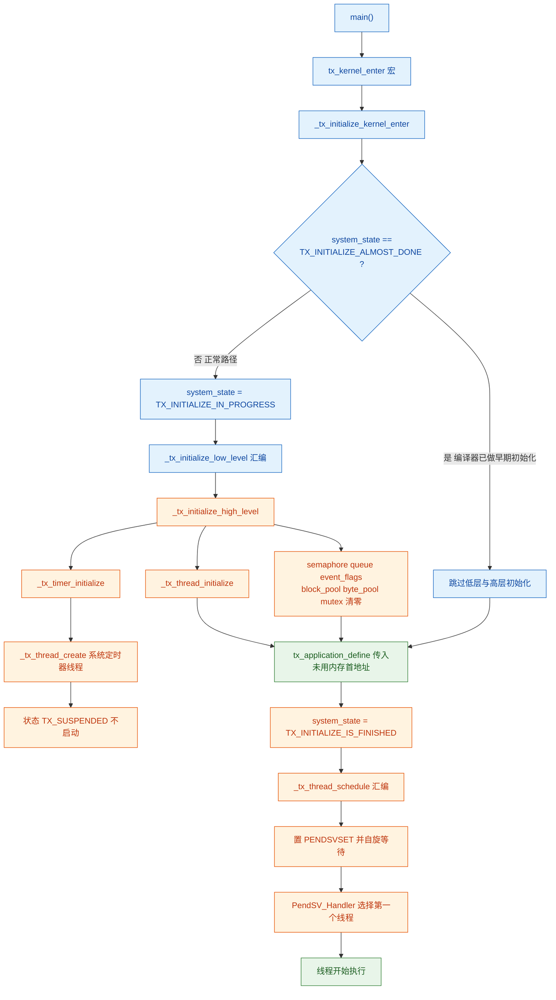
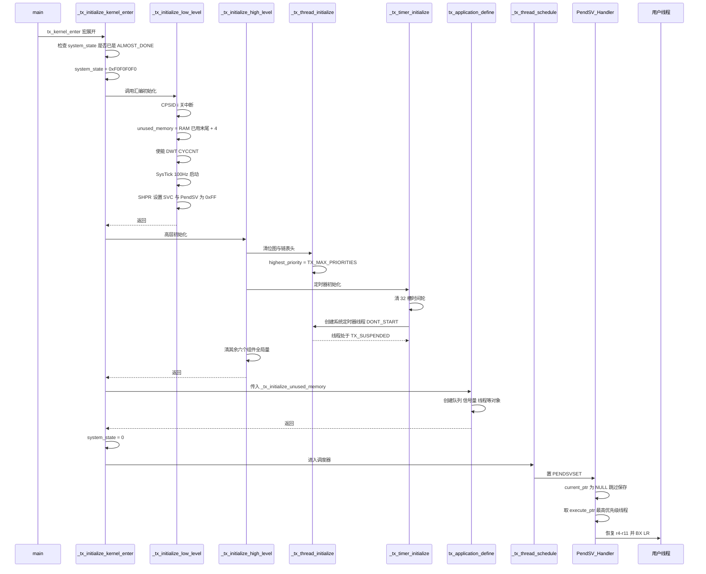

# ThreadX 源码详解 01：初始化与启动链

> 涉及文件：
> - `common/src/tx_initialize_kernel_enter.c`（155 行）—— 唯一的对外入口 `_tx_initialize_kernel_enter`
> - `common/src/tx_initialize_high_level.c`（149 行）—— 各组件初始化调度
> - `common/src/tx_initialize_kernel_setup.c`（94 行）—— 编译器启动代码可选的早期初始化
> - `common/inc/tx_initialize.h`（105 行）—— 初始化状态魔数
> - `ports/cortex_m4/gnu/example_build/tx_initialize_low_level.S`（218 行）—— 时钟、SysTick、向量优先级
> - `common/src/tx_thread_initialize.c`（452 行）、`common/src/tx_timer_initialize.c`（298 行）

---

## 1. 全景：从 `main()` 到第一个线程

`tx_kernel_enter()` 是一个宏，不是函数：

```c
/* common/inc/tx_api.h:1070 */
#define tx_kernel_enter                             _tx_initialize_kernel_enter
```

应用里 `main()` 唯一要做的事就是调它，而它**永不返回**：

```c
/* common/src/tx_initialize_kernel_enter.c:133-148 */
    tx_application_define(_tx_initialize_unused_memory);

    /* Set the system state in preparation for entering the thread
       scheduler.  */
    _tx_thread_system_state =  TX_INITIALIZE_IS_FINISHED;

    /* Call any port specific pre-scheduler processing.  */
    TX_PORT_SPECIFIC_PRE_SCHEDULER_INITIALIZATION

#if defined(TX_ENABLE_EXECUTION_CHANGE_NOTIFY) || defined(TX_EXECUTION_PROFILE_ENABLE)
    /* Initialize Execution Profile Kit.  */
    _tx_execution_initialize();
#endif

    /* Enter the scheduling loop to start executing threads!  */
    _tx_thread_schedule();
```

`_tx_thread_schedule()` 在 Cortex-M 上是汇编里的一个**死循环 + PendSV 等待**，
控制权交出去之后就不会再回到这里（见第 5 节）。所以 `tx_application_define` 是应用的
"最后一段单线程代码"。

### 1.1 初始化链条自上而下



---

## 2. 三个初始化状态魔数

`tx_initialize.h:48-50` 定义了三个值：

```c
#define TX_INITIALIZE_IN_PROGRESS               ((ULONG) 0xF0F0F0F0UL)
#define TX_INITIALIZE_ALMOST_DONE               ((ULONG) 0xF0F0F0F1UL)
#define TX_INITIALIZE_IS_FINISHED               ((ULONG) 0x00000000UL)
```

它们被写进同一个变量 `_tx_thread_system_state`，而这个变量**在系统跑起来之后会改行做中断嵌套计数**：

```c
/* common/src/tx_thread_initialize.c:84 */
volatile ULONG  _tx_thread_system_state =  TX_INITIALIZE_IN_PROGRESS;
```

这是 ThreadX 里最"省变量"的一个设计：一个 `ULONG` 同时承担三种语义。

| 取值 | 语义 | 谁在判断 |
|---|---|---|
| `0xF0F0F0F0` | 初始化进行中 | `_tx_thread_create` 判断是否处于初始化 |
| `0xF0F0F0F1` | 低层+高层已由编译器启动代码完成 | `_tx_initialize_kernel_enter:91` |
| `0` | 无中断嵌套，正在跑线程 | `_tx_thread_system_preempt_check`、`tx_thread_interrupt_control` |
| `1..N` | 处于第 N 层中断嵌套中 | 所有 API 判断"我是不是在 ISR 里" |

`0xF0F0F0F0` 这个值不是随便选的：它高半字节和低半字节对称，从十六进制 dump 里一眼能认出"系统还没起来"。
而 `TX_INITIALIZE_IS_FINISHED` 直接等于 0，让"是否在中断里"的判断退化成一次和 0 的比较——
这是热路径上最常见的判断，必须最便宜。

### 2.1 为什么要区分"接近完成"

```c
/* common/src/tx_initialize_kernel_enter.c:87-99 */
VOID  _tx_initialize_kernel_enter(VOID)
{

    /* Determine if the compiler has pre-initialized ThreadX.  */
    if (_tx_thread_system_state != TX_INITIALIZE_ALMOST_DONE)
    {

        /* No, the initialization still needs to take place.  */

        /* Ensure that the system state variable is set to indicate
           initialization is in progress.  Note that this variable is
           later used to represent interrupt nesting.  */
        _tx_thread_system_state =  TX_INITIALIZE_IN_PROGRESS;
```

某些工具链（IAR、Green Hills）的启动代码会在 `main()` **之前**调用
`_tx_initialize_kernel_setup()`，目的是让 C 库（`printf`、`malloc`）能用上 ThreadX 的互斥量。
这个函数（`tx_initialize_kernel_setup.c:68`）做的事和 `_tx_initialize_kernel_enter` 的前半段完全一样，
只是最后把状态设成 `TX_INITIALIZE_ALMOST_DONE` 而不是继续往下走。

于是 `_tx_initialize_kernel_enter` 进门先看这个标志：**已经被初始化过就跳过，避免重复初始化**
（重复 `_tx_thread_initialize` 会清零已创建的线程链表，是致命的）。

---

## 3. 低层初始化：移植层到底做了什么

`_tx_initialize_low_level()` 不在 `common/` 里，它是每个 port 必须提供的汇编函数。
以 Cortex-M4/GNU 为例（`tx_initialize_low_level.S:91-138`）：

```asm
_tx_initialize_low_level:
    CPSID   i

    LDR     r0, =_tx_initialize_unused_memory       @ Build address of unused memory pointer
    LDR     r1, =__RAM_segment_used_end__           @ Build first free address
    ADD     r1, r1, #4
    STR     r1, [r0]                                @ Setup first unused memory pointer
```

```asm
    LDR     r0, =0xE0001000                         @ Build address of DWT register
    LDR     r1, [r0]
    ORR     r1, r1, #1                              @ Set the CYCCNTENA bit
    STR     r1, [r0]                                @ Enable the cycle count register
```

```asm
    MOV     r0, #0xE000E000                         @ Build address of NVIC registers
    MOV     r1, #0
    STR     r1, [r0, #0x10]                         @ Reset SysTick Control
    STR     r1, [r0, #0x18]                         @ Reset SysTick Counter Value
    LDR     r1, =SYSTICK_CYCLES
    STR     r1, [r0, #0x14]                         @ Setup SysTick Reload Value
    MOV     r1, #0x7                                @ Build SysTick Control Enable Value
    STR     r1, [r0, #0x10]                         @ Setup SysTick Control
```

它做了四件事，每件都不可省：

| 步骤 | 动作 | 为什么必须在这里 |
|---|---|---|
| 1 | 关中断 `CPSID i` | 后面所有初始化都不能被打断 |
| 2 | `_tx_initialize_unused_memory = __RAM_segment_used_end__ + 4` | 告诉内核"堆从哪里开始"，这个地址会传给 `tx_application_define` |
| 3 | 使能 DWT `CYCCNT` | 给 `TX_TRACE_TIME_SOURCE`（`tx_port.h:161` 指向 `0xE0001004`）提供纳秒级时间戳 |
| 4 | 配置 SysTick 并启动 | 内核的心跳从这里开始跳 |

`SYSTICK_CYCLES` 在 `tx_initialize_low_level.S:47` 定义为：

```asm
SYSTICK_CYCLES    =   ((SYSTEM_CLOCK / 100) -1)
```

即 `SYSTEM_CLOCK` 时钟下 **100Hz** 中断，tick = 10ms，与 `tx_api.h:272` 的
`TX_TIMER_TICKS_PER_SECOND (100UL)` 对齐。注意这里是**编译期常量**：改了 `SYSTEM_CLOCK` 却忘了改
`TX_TIMER_TICKS_PER_SECOND`，会导致所有超时时间按错误比例换算，而且没有任何运行时报错。

### 3.1 SysTick 控制寄存器的 `0x7`

`STR r1, [r0, #0x10]` 写入的是 SysTick->CTRL：

| 位 | 名称 | 值 0x7 的含义 |
|---|---|---|
| 0 | ENABLE | 1 = 启动计数 |
| 1 | TICKINT | 1 = 计数到 0 产生异常 |
| 2 | CLKSOURCE | 1 = 使用处理器时钟（不是外部参考时钟） |
| 16 | COUNTFLAG | 只读 |

`0x7` = 三位全开，最常规的配置。用外部参考时钟（`CLKSOURCE=0`）时 reload 值要按参考频率算，
ThreadX 的官方 port 一律用处理器时钟以简化换算。

### 3.2 中断优先级：为什么 PendSV 必须是 0xFF

```asm
    LDR     r1, =0x00000000                         @ Rsrv, UsgF, BusF, MemM
    STR     r1, [r0, #0xD18]                        @ Setup System Handlers 4-7 Priority Registers

    LDR     r1, =0xFF000000                         @ SVCl, Rsrv, Rsrv, Rsrv
    STR     r1, [r0, #0xD1C]                        @ Setup System Handlers 8-11 Priority Registers
                                                    @ Note: SVC must be lowest priority, which is 0xFF

    LDR     r1, =0x40FF0000                         @ SysT, PnSV, Rsrv, DbgM
    STR     r1, [r0, #0xD20]                        @ Setup System Handlers 12-15 Priority Registers
                                                    @ Note: PnSV must be lowest priority, which is 0xFF
```

`SHPR2`（0xE000ED1C）管 SVC，`SHPR3`（0xE000ED20）管 SysTick 和 PendSV。
`0x40FF0000` 拆开是：SysTick = 0x40（优先级 64），PendSV = 0xFF（优先级 255，最低）。

**PendSV 必须是全系统最低优先级**，因为它是"延迟切换"机制：任何时刻任何 ISR 都可以置 PendSV
挂起位，但真正切换必须等到**所有**中断都退出后才执行。如果 PendSV 比某个中断优先级高，
就会出现"在中断嵌套中间切换线程"——硬件栈里会混入中断帧，`PSP` 指向的栈结构被破坏。

SysTick 用 0x40（中间值）而不是最低，是为了让高优先级外设中断能抢占 tick 处理。
代价是 tick 处理可能被延迟，但 ThreadX 的 timer 处理是基于"当前时间槽"而不是"精确时刻"，
几微秒的抖动不影响正确性。

---

## 4. 高层初始化：顺序是有讲究的

```c
/* common/src/tx_initialize_high_level.c:105-148 */
VOID    _tx_initialize_high_level(VOID)
{

    /* Initialize event tracing, if enabled.  */
    TX_TRACE_INITIALIZE

    /* Initialize the event log, if enabled.  */
    TX_EL_INITIALIZE


    /* Call the thread control initialization function.  */
    _tx_thread_initialize();


#ifndef TX_NO_TIMER


    /* Call the timer control initialization function.  */
    _tx_timer_initialize();

#endif

#ifndef TX_DISABLE_REDUNDANT_CLEARING
```

顺序是 **线程 → 定时器 → 其余六个组件**，这个顺序不能换：

1. **线程必须先于定时器**：`_tx_timer_initialize()` 内部会调用 `_tx_thread_create()` 创建
   系统定时器线程（`tx_timer_initialize.c:250`）。如果 `_tx_thread_initialize()` 还没跑，
   `_tx_thread_priority_maps` 还是未初始化状态，`_tx_thread_create` 会往位图里 OR 进垃圾。
2. **定时器必须先于其余组件**：所有带超时的 API（`tx_semaphore_get(..., 100)`）都依赖
   `_tx_timer_system_activate()`，而它依赖 `_tx_timer_list` 已经清空、`_tx_timer_current_ptr` 已定位。
3. **其余六个放在最后**：它们只清自己的全局变量，彼此无依赖，顺序无关。

### 4.1 为什么六个组件包在 `TX_DISABLE_REDUNDANT_CLEARING` 里

`TX_DISABLE_REDUNDANT_CLEARING` 的语义是"**我已经把 .bss 清零了，别再清一遍**"。
C 启动代码本来就会把 `.bss` 段清零，而 `_tx_semaphore_initialize()` 这类函数做的唯一事情
就是把几个全局链表头置 NULL——在已经清零的 `.bss` 上再置一次 NULL 是纯浪费。

打开这个宏能省下启动时的几百条 `STR` 指令，但有个前提：**链接脚本必须真的把 ThreadX 的
全局变量放进 `.bss` 并清零**。如果用了 `--no-init-array`、自定义 scatter file 或把变量放到
不初始化的段，就必须关掉这个优化，否则会出现"未初始化链表头 = 随机值"的随机崩溃。

### 4.2 线程组件初始化

```c
/* common/src/tx_thread_initialize.c:317-343 */
VOID  _tx_thread_initialize(VOID)
{

    /* Note: the system stack pointer and the system state variables are
       initialized by the low and high-level initialization functions,
       respectively.  */

#ifndef TX_DISABLE_REDUNDANT_CLEARING

    /* Set current thread pointer to NULL.  */
    TX_THREAD_SET_CURRENT(TX_NULL)

    /* Initialize the execute thread pointer to NULL.  */
    _tx_thread_execute_ptr =  TX_NULL;

    /* Initialize the priority information.  */
    TX_MEMSET(&_tx_thread_priority_maps[0], 0, (sizeof(_tx_thread_priority_maps)));
```

```c
/* common/src/tx_thread_initialize.c:340-342 */
    /* Setup the highest priority variable to the max, indicating no thread is currently
       ready.  */
    _tx_thread_highest_priority =  ((UINT) TX_MAX_PRIORITIES);
```

`_tx_thread_highest_priority = TX_MAX_PRIORITIES` 是一个哨兵值。它的用途在
`tx_thread_system_resume.c:218` 的判断里：

```c
if (priority < _tx_thread_highest_priority)
```

用"最大值"表示"没有任何线程就绪"，这样第一个被创建的线程一定能通过这个比较，
把 `_tx_thread_highest_priority` 更新成自己的优先级。如果初始化为 0，第一个线程
（优先级通常不是 0）就无法触发"更新最高优先级"分支。

### 4.3 系统定时器线程的诞生

```c
/* common/src/tx_timer_initialize.c:250-255 */
        status =  _tx_thread_create(&_tx_timer_thread,
                                    TX_CONST_CHAR_TO_CHAR_POINTER_CONVERT("System Timer Thread"),
                                    _tx_timer_thread_entry,
                                    ((ULONG) TX_TIMER_ID),
                                    _tx_timer_stack_start, _tx_timer_stack_size,
                                    _tx_timer_priority, _tx_timer_priority, TX_NO_TIME_SLICE, TX_DONT_START);
```

注意最后两个参数：

- `TX_NO_TIME_SLICE`（0）—— 系统线程不做时间片轮转，它会一直跑到主动挂起。
- `TX_DONT_START`（0）—— **创建但不启动**。此时它处于 `TX_SUSPENDED` 状态，
  等第一次 tick 中断里 `_tx_timer_expiration_process()` 调用 `_tx_thread_system_resume(&_tx_timer_thread)`
  才真正开始跑。

栈和优先级来自 port 的 `tx_port.h`：

```c
/* ports/cortex_m4/gnu/inc/tx_port.h:130 */
#define TX_TIMER_THREAD_STACK_SIZE              1024        /* Default timer thread stack size  */
/* ports/cortex_m4/gnu/inc/tx_port.h:134 */
#define TX_TIMER_THREAD_PRIORITY                0           /* Default timer thread priority    */
```

**优先级 0 = 最高**。这是 ThreadX 的一条重要设计约定：定时器线程必须是系统里优先级最高的线程，
否则超时处理会被普通线程延迟，破坏"超时时间误差不超过 1 个 tick"的承诺。
代价是这个 1024 字节的栈和最高优先级永远被占用——这也是 `TX_TIMER_PROCESS_IN_ISR`
（把超时处理直接放进 tick 中断，省掉线程）这个编译选项存在的原因。

---

## 5. 启动的最后一步：`_tx_thread_schedule`

```asm
/* ports/cortex_m7/gnu/src/tx_thread_schedule.S:86-107 */
    MOV     r0, #0                                  // Build value for TX_FALSE
    LDR     r2, =_tx_thread_preempt_disable         // Build address of preempt disable flag
    STR     r0, [r2, #0]                            // Clear preempt disable flag
```

```asm
    MRS     r0, CONTROL                             // Pickup current CONTROL register
    BIC     r0, r0, #4                              // Clear the FPCA bit
    MSR     CONTROL, r0                             // Setup new CONTROL register
#endif

    /* Enable interrupts */
    CPSIE   i

    /* Enter the scheduler for the first time.  */

    MOV     r0, #0x10000000                         // Load PENDSVSET bit
    MOV     r1, #0xE000E000                         // Load NVIC base
    STR     r0, [r1, #0xD04]                        // Set PENDSVBIT in ICSR
    DSB                                             // Complete all memory accesses
    ISB                                             // Flush pipeline
```

然后是一个**故意写出来的死循环**：

```asm
/* ports/cortex_m7/gnu/src/tx_thread_schedule.S:111-112 */
__tx_wait_here:
    B       __tx_wait_here                          // Wait for the PendSV to happen
```

为什么不用 `WFI`？因为此刻中断刚被 `CPSIE i` 打开，`PendSV` 已经挂起，
处理器会在执行完 `ISB` 后立刻进入 PendSV 异常——`B .` 只是兜底。
真正"没有线程可跑时睡觉"的逻辑在 PendSV handler 的 `__tx_ts_wait` 标号里（见 06 篇）。

### 5.1 第一次调度与后续调度的区别

| | 第一次（`_tx_thread_schedule`） | 后续（`_tx_thread_system_return`） |
|---|---|---|
| 触发方式 | 写 `ICSR.PENDSVSET` 后自旋 | 写 `ICSR.PENDSVSET` 后返回调用者 |
| 当前线程 | `_tx_thread_current_ptr == NULL`，无需保存 | 非 NULL，需要保存 r4-r11 与 PSP |
| 返回值 | 永不返回 | `BX lr` 回到调用点 |
| 代码位置 | `tx_thread_schedule.S:78-113` | `tx_thread_system_return.S:70-96` |

两者最终都落到同一个 `PendSV_Handler`（`tx_thread_schedule.S:121`），
靠 `_tx_thread_current_ptr` 是否为 NULL 来分支。这是"一条路径两种入口"的典型写法，
省掉了一份重复的上下文恢复代码。

---

## 6. 时序图：一次冷启动的完整顺序



---

## 7. 数据流：`first_unused_memory` 去哪了


这条链有一个**容易忽略的事实**：`_tx_initialize_unused_memory` 只是一个地址，内核**不知道它有多大**。
剩余 RAM 的边界完全由应用自己掌握（通常在链接脚本里定义 `__RAM_segment_used_end__` 与栈顶符号，
相减得到长度）。传错长度会让字节池覆盖到栈区或外设空间，且不会立刻报错。

---

## 8. 陷阱与实测建议

**陷阱 1：`tx_application_define` 里返回值被忽略。**
原型是 `VOID tx_application_define(VOID *first_unused_memory)`（`tx_api.h:1424`），没有返回值。
所有 `tx_*_create` 的错误码必须自己检查，否则"创建失败但系统照跑"会在很久以后以野指针形式爆出来。

**陷阱 2：在 `tx_application_define` 里开中断或等中断。**
此时 `_tx_thread_system_state == 0xF0F0F0F0`，`_tx_thread_schedule` 还没跑，PendSV 优先级虽已设好
但没有任何线程可切。任何 `wait_option != TX_NO_WAIT` 的调用都会走
`_tx_thread_suspend` 路径把"当前线程"挂起——而当前线程是 NULL，结果是未定义行为。
`_txe_*` 层会拦住大部分，但 `TX_DISABLE_ERROR_CHECKING` 打开后就没这层保护了。

**陷阱 3：改 `SYSTEM_CLOCK` 不同步改 `TX_TIMER_TICKS_PER_SECOND`。**
`SYSTICK_CYCLES` 是汇编常量，`TX_TIMER_TICKS_PER_SECOND` 是 C 宏，两者没有任何编译期关联。
症状是"`tx_thread_sleep(100)` 本该 1 秒，实际跑了 2 秒"——因为 tick 变成 50Hz 了。
建议在 `tx_user.h` 里用同一个宏推导两者，或加 `_Static_assert` 保护。

**陷阱 4：`TX_DISABLE_REDUNDANT_CLEARING` 与自定义链接脚本冲突。**
如果 `.bss` 没被启动代码清零（比如用了 `--no_zero_init` 或把变量放进了 `NOINIT` 段），
打开这个宏会让 `_tx_thread_priority_list[]` 里全是随机值。第一次 `_tx_thread_system_resume`
就会解引用野指针。**验证方法**：启动后在 `tx_application_define` 里打印
`_tx_thread_created_count`，正常应为 1（只有系统定时器线程）。

**陷阱 5：`_tx_initialize_low_level` 里忘了设 `_tx_thread_system_stack_ptr`。**
Cortex-M 的 port 用 PSP 跑线程、MSP 跑中断，`_tx_thread_system_stack_ptr` 在 Cortex-M 上
实际未被使用（它主要为 ARM7/ARM9 这类没有双栈的架构服务）。但如果你移植到 Cortex-R 或
旧架构，漏掉它会导致第一次中断返回时栈指针错乱。查 `ports/<arch>/` 下是否有对它的赋值。

**实测建议：** 在 `_tx_initialize_kernel_enter` 的 `_tx_thread_schedule()` 之前插一个
GPIO 拉高/拉低，用示波器量"上电到第一个线程开始执行"的时间。这个值对启动时间敏感的产品
（如汽车 ECU）是关键指标，典型 Cortex-M4 @168MHz + 8 个线程的项目在 2~5ms 量级。

---

## 9. 读码路径小结

```
tx_api.h:1070                    确认 tx_kernel_enter 是宏
tx_initialize_kernel_enter.c:87  主入口，注意 91 行的分支
  ├─ tx_initialize_low_level.S:91   汇编，四个动作
  ├─ tx_initialize_high_level.c:105 顺序：线程→定时器→其余
  │    ├─ tx_thread_initialize.c:317
  │    └─ tx_timer_initialize.c:197 → tx_thread_create（定时器线程）
  ├─ tx_initialize_kernel_enter.c:133  tx_application_define
  └─ tx_initialize_kernel_enter.c:148  _tx_thread_schedule
tx_thread_schedule.S:78          自旋等 PendSV
```

上一篇：[00-总览与架构.md](00-总览与架构.md) ｜ 下一篇：[02-线程与调度.md](02-线程与调度.md)
