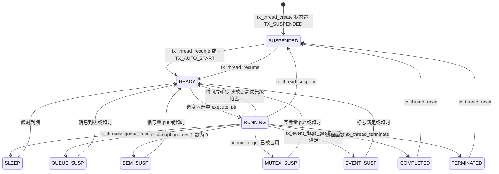
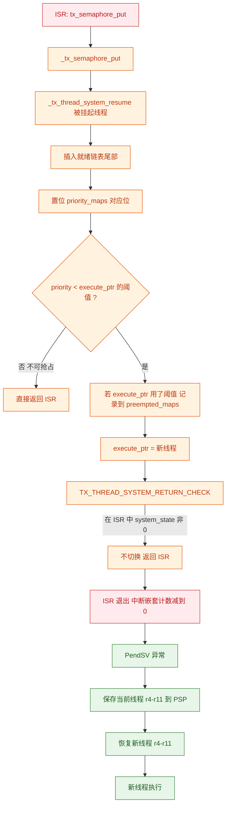
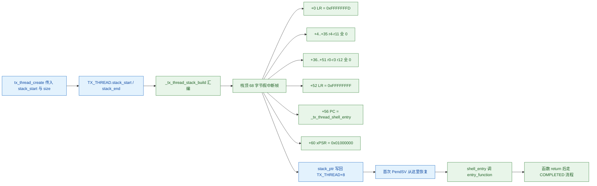

# ThreadX 源码详解 02：线程与调度

> 涉及文件：
> - `common/inc/tx_api.h:423-599`（`TX_THREAD` 结构体）
> - `common/inc/tx_thread.h`（519 行，位图宏、全局变量 extern）
> - `common/src/tx_thread_create.c`（452 行）
> - `common/src/tx_thread_system_resume.c`（1001 行）—— 线程进就绪表
> - `common/src/tx_thread_system_suspend.c`（1218 行）—— 线程出就绪表
> - `common/src/tx_thread_time_slice.c`（180 行）
> - `common/src/tx_thread_preemption_change.c`（274 行）
> - `common/src/tx_thread_relinquish.c`（163 行）
> - `common/src/tx_thread_terminate.c`（323 行）
> - `ports/cortex_m7/gnu/src/tx_thread_schedule.S`（339 行，含 PendSV handler）

---

## 1. 调度器要回答的三个问题

任何一个 RTOS 调度器都在反复回答：

1. **谁该跑** —— 从"就绪线程集合"里选出优先级最高的那个；
2. **什么时候换** —— 有更高优先级就绪、时间片耗尽、当前线程主动放弃；
3. **换的时候存什么** —— 寄存器、栈指针、浮点上下文。

ThreadX 的答案分别是：**位图 + 数组**、**改 `_tx_thread_execute_ptr` 然后置 PendSV**、
**只存 r4-r11（+ s16-s31）**。三个答案都指向同一个目标——把最坏情况延迟压到常数。

---

## 2. `TX_THREAD`：结构体布局就是 ABI

```c
/* common/inc/tx_api.h:423-442 */
typedef struct TX_THREAD_STRUCT
{
    /* The first section of the control block contains critical
       information that is referenced by the port-specific
       assembly language code.  Any changes in this section could
       necessitate changes in the assembly language.  */

    ULONG               tx_thread_id;                   /* Control block ID         */
    ULONG               tx_thread_run_count;            /* Thread's run counter     */
    VOID                *tx_thread_stack_ptr;           /* Thread's stack pointer   */
    VOID                *tx_thread_stack_start;         /* Stack starting address   */
    VOID                *tx_thread_stack_end;           /* Stack ending address     */
    ULONG               tx_thread_stack_size;           /* Stack size               */
    ULONG               tx_thread_time_slice;           /* Current time-slice       */
    ULONG               tx_thread_new_time_slice;       /* New time-slice           */

    /* Define pointers to the next and previous ready threads.  */
    struct TX_THREAD_STRUCT
                        *tx_thread_ready_next,
                        *tx_thread_ready_previous;
```

32 位机上每个字段 4 字节，于是偏移量是：

| 偏移 | 字段 | 汇编访问点 |
|---|---|---|
| +0 | `tx_thread_id` | C 层 `TX_THREAD_ID` 校验 |
| +4 | `tx_thread_run_count` | `tx_thread_schedule.S:213` `LDR r7,[r1,#4]` |
| +8 | `tx_thread_stack_ptr` | `tx_thread_schedule.S:174` `STR r12,[r1,#8]` |
| +12 | `tx_thread_stack_start` | 栈溢出检查 |
| +16 | `tx_thread_stack_end` | `tx_thread_stack_build.S:94` `LDR r2,[r0,#16]` |
| +20 | `tx_thread_stack_size` | C 层 |
| +24 | `tx_thread_time_slice` | `tx_thread_schedule.S:215` `LDR r5,[r1,#24]` |
| +28 | `tx_thread_new_time_slice` | C 层 |
| +32 | `tx_thread_ready_next` | C 层链表 |

**这 8 个字段是"神圣区"**，后面的字段可以随便加（加在 `TX_THREAD_EXTENSION_*` 里），
但动前 8 个就必须同步改所有 port 的汇编。ThreadX 用注释把这条规则写在结构体里，
而不是靠文档——因为它太容易被违反。

### 2.1 控制块里到底有多少东西

`TX_THREAD` 在默认配置下约 180 字节（32 位机）。逐段拆开：

| 区段 | 字段 | 字节数 | 说明 |
|---|---|---|---|
| 汇编可见区 | id…ready_prev | 40 | 8 个 ULONG + 2 个指针 |
| 标识与状态 | name / priority / state / delayed_suspend / suspending / preempt_threshold / schedule_hook | 28 | 调度决策的输入 |
| 入口信息 | entry / entry_parameter | 8 | 线程函数与参数 |
| 内嵌定时器 | `TX_TIMER_INTERNAL tx_thread_timer` | 28 | 睡眠/超时用，见 05 篇 |
| 挂起信息 | suspend_cleanup / control_block / next / previous / info / additional_info / option / status | 32 | 被谁挂起、怎么清理 |
| 链表 | created_next / created_previous | 8 | 全局线程清单 |
| 优先级继承 | user_priority / user_preempt_threshold / inherit_priority | 12 | 见 03 篇 |
| 互斥量 | owned_mutex_count / owned_mutex_list | 8 | 持有锁清单 |
| 栈监控 | stack_highest_ptr | 4 | `TX_ENABLE_STACK_CHECKING` 用 |
| 通知回调 | entry_exit_notify | 4 | `TX_DISABLE_NOTIFY_CALLBACKS` 可去掉 |
| 其他 | filex_ptr / suspension_sequence / 扩展 | 8+ | 可裁剪 |

一个 32 线程的系统，光控制块就是 **32 × 180 ≈ 5.6KB RAM**，这还没算栈。
做 RAM 预算时这一步经常被漏掉。

---

## 3. O(1) 调度：位图 + 数组

### 3.1 三个全局数据结构

```c
/* common/src/tx_thread_initialize.c:92 */
ULONG           _tx_thread_priority_maps[TX_MAX_PRIORITIES/32];
```

```c
/* common/src/tx_thread_initialize.c:136 */
TX_THREAD *     _tx_thread_priority_list[TX_MAX_PRIORITIES];
```

```c
/* common/src/tx_thread_initialize.c:128 */
UINT            _tx_thread_highest_priority;
```

三者的关系：

- `_tx_thread_priority_maps[]` 是**位图**，第 N 位为 1 表示"优先级 N 上至少有一个就绪线程"。
  默认 `TX_MAX_PRIORITIES == 32`，所以只有一个 `ULONG`。
- `_tx_thread_priority_list[N]` 是**同优先级线程的循环链表头**。链表是循环的（尾指向头），
  所以"取下一个同优先级线程"就是 `head = head->ready_next`，不需要遍历。
- `_tx_thread_highest_priority` 缓存当前最高就绪优先级，避免每次都重新扫位图。

### 3.2 找最高优先级：一条 RBIT+CLZ

`tx_thread_system_suspend.c:391` 调用：

```c
/* Type: TX_LOWEST_SET_BIT_CALCULATE(priority_map, priority_bit) */
```

在 Cortex-M 上这个宏被 port 覆盖成两条指令：

```c
/* ports/cortex_m4/gnu/inc/tx_port.h:517-519 */
#elif defined(__GNUC__) /* GCC and AC6 Compiler */
#define TX_LOWEST_SET_BIT_CALCULATE(m, b)       __asm__ volatile (" RBIT %0,%1 ": "=r" (m) : "r" (m) ); \
                                                __asm__ volatile (" CLZ  %0,%1 ": "=r" (b) : "r" (m) );
```

`RBIT` 把 32 位反转，`CLZ` 数前导零个数——组合起来就是"最低置位位的下标"，
**2 条指令、常数周期**（Cortex-M3/M4 上 RBIT 1 周期、CLZ 1 周期）。

如果 port 没提供这个宏，就退回 `tx_thread.h:141-200` 的通用 C 版本：一棵四层二叉树，
最多 4 次比较 + 移位，也是常数时间，只是慢几倍。**两条路径都不是 O(n)**——
这就是"调度时间与线程数无关"的实现依据。

### 3.3 位图与链表的同步

**线程进就绪态**（`tx_thread_system_resume.c:194-215`）：

```c
                head_ptr =  _tx_thread_priority_list[priority];
                if (head_ptr == TX_NULL)
                {

                    /* First thread at this priority ready.  Add to the front of the list.  */
                    _tx_thread_priority_list[priority] =       thread_ptr;
                    thread_ptr -> tx_thread_ready_next =       thread_ptr;
                    thread_ptr -> tx_thread_ready_previous =   thread_ptr;
```

```c
                    /* Or in the thread's priority bit.  */
                    TX_MOD32_BIT_SET(priority, priority_bit)
                    _tx_thread_priority_maps[MAP_INDEX] =  _tx_thread_priority_maps[MAP_INDEX] | priority_bit;
```

**同优先级已有线程时**（`tx_thread_system_resume.c:388-392`）：

```c
                    tail_ptr =                                 head_ptr -> tx_thread_ready_previous;
                    tail_ptr -> tx_thread_ready_next =         thread_ptr;
                    head_ptr -> tx_thread_ready_previous =     thread_ptr;
                    thread_ptr -> tx_thread_ready_previous =   tail_ptr;
                    thread_ptr -> tx_thread_ready_next =       head_ptr;
```

注意这里插到**尾部**（`head->previous` 之后）。这个细节决定了同优先级线程的轮转语义：
新就绪的线程排在队尾，当前跑的线程继续跑完它的时间片，然后才轮到新线程。
这是 FIFO 公平性，也是"后创建的线程不会抢占同优先级先创建的线程"的原因。

**线程出就绪态**（`tx_thread_system_suspend.c:259-269`）：

```c
            /* This is the only thread at this priority ready to run.  Set the head
               pointer to NULL.  */
            _tx_thread_priority_list[priority] =    TX_NULL;
```

```c
            /* Clear this priority bit in the ready priority bit map.  */
            TX_MOD32_BIT_SET(priority, priority_bit)
            _tx_thread_priority_maps[MAP_INDEX] =  _tx_thread_priority_maps[MAP_INDEX] & (~(priority_bit));
```

### 3.4 `TX_MAX_PRIORITIES > 32` 时多出来的两级

当优先级超过 32，位图变成数组，需要"两级查找"：

```c
#if TX_MAX_PRIORITIES > 32
                TX_DIV32_BIT_SET(priority, priority_bit)
                _tx_thread_priority_map_active =  _tx_thread_priority_map_active | priority_bit;
#endif
```

`_tx_thread_priority_map_active` 的第 K 位表示"`_tx_thread_priority_maps[K]` 非零"。
查找过程变成：先在 `map_active` 里找最低组号 → `base_priority = map_index * 32` →
再在该组位图里找最低位 → `highest = base_priority + bit`。仍然是常数时间（最多 2 次 RBIT/CLZ），
代价是多一个全局变量和每个位图操作多一次判断。

---

## 4. 线程的出生：`_tx_thread_create`

### 4.1 参数校验与实际创建

应用调 `tx_thread_create(...)`，宏先展开成 `_txe_thread_create(..., sizeof(TX_THREAD))`
（`tx_api.h:1377`），校验通过后调 `_tx_thread_create`（`tx_thread_create.c:81`）。
最后一个 `sizeof(TX_THREAD)` 参数是 `_txe_` 层用来校验控制块对齐的——它期待调用者传一个
`TX_THREAD` 变量或数组元素，而不是随便一段内存。

### 4.2 栈的预处理

```c
/* common/src/tx_thread_create.c:161 */
    TX_MEMSET(thread_ptr, 0, (sizeof(TX_THREAD)));
```

先清控制块（`TX_DISABLE_REDUNDANT_CLEARING` 打开时跳过）。然后填基本字段：

```c
    thread_ptr -> tx_thread_priority =          priority;
    thread_ptr -> tx_thread_user_priority =     priority;
    thread_ptr -> tx_thread_time_slice =        time_slice;
    thread_ptr -> tx_thread_new_time_slice =    time_slice;
    thread_ptr -> tx_thread_inherit_priority =  ((UINT) TX_MAX_PRIORITIES);
```

`tx_thread_inherit_priority = TX_MAX_PRIORITIES` 又是一个哨兵值：表示"没有被继承抬升过"。
互斥量的优先级继承会把它改小，`tx_mutex_put` 时靠它判断要不要恢复（见 03 篇）。

### 4.3 抢占阈值的默认值

```c
/* common/src/tx_thread_create.c:191 */
    thread_ptr -> tx_thread_preempt_threshold =       preempt_threshold;
```

`tx_thread_create` 的第 8 个参数 `preempt_threshold` 合法范围是 **`[0, priority]`**——
`_txe_thread_create()` 在 `preempt_threshold > priority` 时直接返回 `TX_THRESH_ERROR`
（`common/src/txe_thread_create.c:248-253`），所以"阈值比优先级大"的写法根本创建不出线程。

**阈值 == 优先级 意味着"普通抢占"**：任何优先级数值更小的线程都能抢占我。
**阈值 < 优先级 意味着"选择性保护"**：只有优先级数值**小于阈值**的线程才能抢占我，
优先级落在 `[阈值, 优先级)` 区间的线程被挡住。**阈值越小，保护越强**。

举例：优先级 10、阈值 5 的线程，能被优先级 0~4 的线程抢占；
优先级 6~9 的线程（本来能抢占它）被挡住。若把阈值改成 8，则 6~7 仍被挡、8~9 恢复可抢占。

### 4.4 造一个假的中断帧

```c
/* common/src/tx_thread_create.c:214-225 */
    /* Now fill in the values that are required for thread initialization.  */
    thread_ptr -> tx_thread_state =  TX_SUSPENDED;

    /* Setup the necessary fields in the thread timer block.  */
    TX_THREAD_CREATE_TIMEOUT_SETUP(thread_ptr)

    /* Perform any additional thread setup activities for tool or user purpose.  */
    TX_THREAD_CREATE_INTERNAL_EXTENSION(thread_ptr)

    /* Call the target specific stack frame building routine to build the
       thread's initial stack and to setup the actual stack pointer in the
       control block.  */
    _tx_thread_stack_build(thread_ptr, _tx_thread_shell_entry);
```

关键点：**新线程不是从 `entry_function` 开始的，而是从 `_tx_thread_shell_entry` 开始的**。
`tx_thread_stack_build` 把 `pc` 设成 `_tx_thread_shell_entry` 的地址，
shell entry 再调用真正的 `entry_function`。这一层"壳"负责三件事：

1. 调用 `TX_THREAD_STARTED_EXTENSION`（端口/工具钩子）；
2. 调用 `tx_thread_entry_exit_notify(thread_ptr, TX_THREAD_ENTRY)`；
3. 线程函数返回后，释放它持有的所有互斥量，把状态设为 `TX_COMPLETED` 并挂起自己。

第 3 点非常重要：**ThreadX 允许线程函数 `return`**，不像很多 RTOS 要求线程函数永不返回。
`tx_thread_shell_entry.c:111` 直接调用 `(thread_ptr -> tx_thread_entry)(...)`，
返回后走清理流程。

### 4.5 创建即启动

```c
/* common/src/tx_thread_create.c:344 */
        _tx_thread_system_resume(thread_ptr);
```

`auto_start == TX_AUTO_START` 时，创建完立刻 resume。注意这里有个特殊处理：
如果创建发生在初始化阶段（`TX_THREAD_GET_SYSTEM_STATE() >= TX_INITIALIZE_IN_PROGRESS`），
会**临时把当前最高优先级线程的阈值改成它的优先级**，保证初始化结束后最高优先级的线程
一定先跑，创建完再恢复原阈值。

为什么需要这个补丁？因为初始化时 `_tx_thread_execute_ptr` 可能已经指向一个低优先级线程
（先创建的那个），而阈值机制会让"后来创建的高优先级线程"因为阈值限制无法抢占。
临时把阈值拉到与优先级相等，等于强制"未受阈值保护"，让抢占正常发生。

---

## 5. 上下文切换：两条路径一个终点

### 5.1 主动让出时的三条路

ThreadX 里"我要换线程"有三种触发方式，最终都收敛到 `_tx_thread_system_return()`：

| 触发 | 代码位置 | 条件 |
|---|---|---|
| 显式让出 | `tx_thread_relinquish.c:151` | 应用调 `tx_thread_relinquish()` |
| 时间片耗尽 | `tx_timer_interrupt.S:221-233` | tick 中断里发现 `execute_ptr != current_ptr` |
| 服务内部抢占 | `tx_thread_system_resume.c:361-372` | 唤醒了一个更高优先级线程 |

```c
/* common/src/tx_thread_relinquish.c:129-140 */
    if (_tx_thread_highest_priority < priority)
    {

        /* Yes, there is a higher priority thread ready to execute.  Make
           it visible to the thread scheduler.  */
        _tx_thread_execute_ptr =  _tx_thread_priority_list[_tx_thread_highest_priority];

        /* No need to clear the preempted bit in this case, since the currently running
           thread must already have its preempted bit clear.  */
    }
```

注意 `relinquish` 的两个分支：先看同优先级有没有别人（有就把链表头后移一位），
再看有没有更高优先级（有就直接指向它）。**两个 if 是并列的，不是 else**——
因为同优先级轮转和更高优先级抢占可以同时成立，后者优先。

### 5.2 `system_return` 只做一件事：置 PendSV

```asm
/* ports/cortex_m4/gnu/src/tx_thread_system_return.S:75-79 */
    MOV     r0, #0x10000000                         // Load PENDSVSET bit
    MOV     r1, #0xE000E000                         // Load NVIC base
    STR     r0, [r1, #0xD04]                        // Set PENDSVBIT in ICSR
    DSB     #0xF                                    // Ensure memory access is complete
    ISB     #0xF                                    // Flush pipeline
```

`0xE000ED04` 是 `SCB->ICSR`，写 bit28（`PENDSVSET`）就挂起 PendSV 异常。
`DSB`/`ISB` 保证写操作完成且流水线刷新——少了这两条，Cortex-M7 的乱序执行可能让
后续指令先于 PendSV 生效，导致切换时读到旧的 `_tx_thread_execute_ptr`。

```asm
/* ports/cortex_m4/gnu/src/tx_thread_system_return.S:80-94 */
    MRS     r0, IPSR                                // Pickup IPSR
    CMP     r0, #0                                  // Is it a thread returning?
    BNE     _isr_context                            // If ISR, skip interrupt enable
#ifdef TX_PORT_USE_BASEPRI
    MRS     r1, BASEPRI                             // Thread context returning, pickup BASEPRI
    MOV     r0, #0
    MSR     BASEPRI, r0                             // Enable interrupts
    MSR     BASEPRI, r1                             // Restore original interrupt posture
    ISB     #0xF                                    // Flush pipeline
```

`IPSR` 低 9 位是当前异常号，0 表示"线程模式"。这段代码的意图是：
**从线程调用时，先短暂开中断再恢复原状**，给挂起的中断一个执行窗口。
从 ISR 调用时跳过——ISR 里本来就该保持中断屏蔽到退出。

这个"短暂开窗"是 ThreadX 中断延迟优化的关键：`tx_queue_send` 内部关中断的时间被压缩到
只覆盖链表操作，退出时立刻开窗，让高优先级中断能插进来。代价是这段代码必须在
"关中断 → 开 → 再恢复"之间保证没有状态依赖，否则会引入竞态。

### 5.3 PendSV handler 的五个阶段

```asm
/* ports/cortex_m7/gnu/src/tx_thread_schedule.S:148-175 */
    LDR     r0, =_tx_thread_current_ptr             // Build current thread pointer address
    LDR     r2, =_tx_thread_execute_ptr             // Build execute thread pointer address
    MOV     r3, #0                                  // Build NULL value
    LDR     r1, [r0]                                // Pickup current thread pointer

    /* Determine if there is a current thread to finish preserving.  */

    CBZ     r1, __tx_ts_new                         // If NULL, skip preservation

    /* Recover PSP and preserve current thread context.  */

    STR     r3, [r0]                                // Set _tx_thread_current_ptr to NULL
    MRS     r12, PSP                                // Pickup PSP pointer (thread's stack pointer)
    STMDB   r12!, {r4-r11}                          // Save its remaining registers
```

五个阶段：

| 阶段 | 标号 | 动作 |
|---|---|---|
| 1 | `_tx_ts_handler` | （可选）执行 profile 的 exit 钩子 |
| 2 | 保存 | `current_ptr` 非 NULL 时，把 r4-r11（+ s16-s31）压到 PSP，更新 `stack_ptr` |
| 3 | 选择 | `execute_ptr` 为 NULL 就进 `__tx_ts_wait` 空转，否则设为 `current_ptr` |
| 4 | 恢复 | 从新线程 `stack_ptr` 弹 r4-r11（+ s16-s31），`MSR PSP` |
| 5 | 返回 | `BX lr`，`lr` 是栈里保存的 `0xFFFFFFFD`（线程模式 + PSP） |

阶段 2 的 `STMDB r12!, {r4-r11}` 一次存 8 个寄存器（32 字节），
`VSTMDB r12!,{s16-s31}` 存 16 个（64 字节）。后者只在 `__ARM_FP` 且扩展帧存在时执行：

```asm
    TST     LR, #0x10                               // Determine if the VFP extended frame is present
    BNE     _skip_vfp_save
    VSTMDB  r12!,{s16-s31}                          // Yes, save additional VFP registers
```

`LR` 的 bit4 是 `EXC_RETURN` 的 "Stack Frame Type" 位：0 表示用了扩展帧（含 FP 上下文），
1 表示标准帧。这个判断让"不用浮点的线程"不为浮点寄存器付出 64 字节栈空间。

### 5.4 时间片的保存与恢复时机

```asm
/* ports/cortex_m7/gnu/src/tx_thread_schedule.S:173-183 */
    LDR     r5, [r4]                                // Pickup current time-slice
    STR     r12, [r1, #8]                           // Save the thread stack pointer
    CBZ     r5, __tx_ts_new                         // If not active, skip processing

    /* Time-slice is active, save the current thread's time-slice and clear the global time-slice variable.  */

    STR     r5, [r1, #24]                           // Save current time-slice

    /* Clear the global time-slice.  */

    STR     r3, [r4]                                // Clear time-slice
```

注意顺序：**先存 `stack_ptr`，再判断时间片**。如果时间片为 0（线程没设时间片），
直接跳到选下一个线程，不浪费写操作。恢复时相反（`tx_thread_schedule.S:213-221`）：

```asm
__tx_ts_restore:
    LDR     r7, [r1, #4]                            // Pickup the current thread run count
    LDR     r4, =_tx_timer_time_slice               // Build address of time-slice variable
    LDR     r5, [r1, #24]                           // Pickup thread's current time-slice
    ADD     r7, r7, #1                              // Increment the thread run count
    STR     r7, [r1, #4]                            // Store the new run count

    /* Setup global time-slice with thread's current time-slice.  */

    STR     r5, [r4]                                // Setup global time-slice
```

`run_count` 在**每次真正开始执行时**自增，而不是在创建时。所以它是"被调度次数"，
可以用来做简单的公平性观测。

---

## 6. 时间片轮转

### 6.1 tick 中断里只做减法

```asm
/* ports/cortex_m4/gnu/src/tx_timer_interrupt.S:97-119 */
    LDR     r3, =_tx_timer_time_slice               // Pickup address of time-slice
    LDR     r2, [r3, #0]                            // Pickup time-slice
    CBZ     r2, __tx_timer_no_time_slice            // Is it non-active?

    SUB     r2, r2, #1                              // Decrement the time-slice
    STR     r2, [r3, #0]                            // Store new time-slice value

    CBNZ    r2, __tx_timer_no_time_slice            // Has it expired?

    LDR     r3, =_tx_timer_expired_time_slice       // Pickup address of expired flag
    MOV     r0, #1                                  // Build expired value
    STR     r0, [r3, #0]                            // Set time-slice expiration flag
```

tick 中断只做"减一、到零置标志"，**不做任何线程选择**。真正的选择在
`_tx_thread_time_slice()` 里，由 C 代码处理。这是典型的"ISR 只置标志、软处理做决策"分层，
目的是把中断关断时间压到最短。

### 6.2 C 层的时间片处理

```c
/* common/src/tx_thread_time_slice.c:99-113 */
    /* Clear the expired time-slice flag.  */
    _tx_timer_expired_time_slice =  TX_FALSE;

    /* Make sure the thread pointer is valid.  */
    if (thread_ptr != TX_NULL)
    {

        /* Make sure the thread is still active, i.e. not suspended.  */
        if (thread_ptr -> tx_thread_state == TX_READY)
        {

            /* Setup a fresh time-slice for the thread.  */
            thread_ptr -> tx_thread_time_slice =  thread_ptr -> tx_thread_new_time_slice;

            /* Reset the actual time-slice variable.  */
            _tx_timer_time_slice =  thread_ptr -> tx_thread_time_slice;
```

注意它**重置时间片用的是 `tx_thread_new_time_slice` 而不是 `tx_thread_time_slice`**。
这两个字段的区别：

- `tx_thread_time_slice` 是"当前剩余"，每次 tick 减 1；
- `tx_thread_new_time_slice` 是"每次重置到的值"，由 `tx_thread_time_slice_change()` 改。

如果用 `tx_thread_time_slice` 重置，时间片会越跑越短（因为它已经被减过了）。

```c
/* common/src/tx_thread_time_slice.c:117-133 */
            if (thread_ptr -> tx_thread_ready_next != thread_ptr)
            {

                /* Check to see if preemption-threshold is not being used.  */
                if (thread_ptr -> tx_thread_priority == thread_ptr -> tx_thread_preempt_threshold)
                {

                    /* Preemption-threshold is not being used by this thread.  */

                    /* There is another thread at this priority, make it the highest at
                       this priority level.  */
                    _tx_thread_priority_list[thread_ptr -> tx_thread_priority] =  thread_ptr -> tx_thread_ready_next;

                    /* Designate the highest priority thread as the one to execute.  Don't use this
                       thread's priority as an index just in case a higher priority thread is now
                       ready!  */
                    _tx_thread_execute_ptr =  _tx_thread_priority_list[_tx_thread_highest_priority];
```

三个条件必须同时成立才轮转：

1. 同优先级有别的线程（`ready_next != self`）；
2. 该线程**没有**使用抢占阈值（`priority == preempt_threshold`）；
3. 当前线程状态是 `TX_READY`（不是挂起中）。

第 2 条是 ThreadX 的一个明确语义：**抢占阈值与时间片互斥**。设计理由很直接——
阈值的作用是"保护一段临界工作不被中等优先级打断"，如果还允许同优先级轮转，
那这段工作照样会被打断，阈值就失去意义了。

第 133 行的注释值得注意："Don't use this thread's priority as an index just in case a higher
priority thread is now ready!"。它说明作者踩过坑：如果写
`execute_ptr = priority_list[thread_ptr->priority]`，当恰好有一个更高优先级线程在
刚才那一瞬间就绪时，会错误地继续选同优先级线程。用 `_tx_thread_highest_priority` 做索引
才是安全的。

---

## 7. 抢占阈值：ThreadX 的独门武器

### 7.1 语义

`tx_thread_preemption_change(thread, new_threshold, &old_threshold)` 改变的是
**"谁能抢占我"**，不是"我能不能抢占别人"。

```c
/* common/src/tx_thread_preemption_change.c:161-178 */
        /* Return the user's preemption-threshold.   */
        *old_threshold =  thread_ptr -> tx_thread_user_preempt_threshold;

        /* Setup the new threshold.  */
        thread_ptr -> tx_thread_user_preempt_threshold =  new_threshold;

        /* Determine if the new threshold represents a higher priority than the priority inheritance threshold.  */
        if (new_threshold < thread_ptr -> tx_thread_inherit_priority)
        {

            /* Update the actual preemption-threshold with the new threshold.  */
            thread_ptr -> tx_thread_preempt_threshold =  new_threshold;
        }
        else
        {

            /* Update the actual preemption-threshold with the priority inheritance.  */
            thread_ptr -> tx_thread_preempt_threshold =  thread_ptr -> tx_thread_inherit_priority;
        }
```

这里有个不显然的交互：**实际生效的阈值取 `min(用户阈值, 继承阈值)`**。
因为优先级继承会把线程的优先级临时抬高，如果阈值不跟着抬，被抬高的线程仍然会被
"原本不该抢占它"的线程打断，继承就白做了。

### 7.2 被抢占时记一笔

当阈值生效、一个线程被"优先级数值小于阈值"的线程抢占时，ThreadX 要在位图里记住这件事：

```c
/* common/src/tx_thread_system_resume.c:249-265 */
                                if (execute_ptr -> tx_thread_preempt_threshold != execute_ptr -> tx_thread_priority)
                                {

#if TX_MAX_PRIORITIES > 32

                                    /* Calculate the index into the bit map array.  */
                                    map_index =  (execute_ptr -> tx_thread_priority)/((UINT) 32);
```

```c
                                    /* Remember that this thread was preempted by a thread above the thread's threshold.  */
                                    TX_MOD32_BIT_SET(execute_ptr -> tx_thread_priority, priority_bit)
                                    _tx_thread_preempted_maps[MAP_INDEX] =  _tx_thread_preempted_maps[MAP_INDEX] | priority_bit;
```

`_tx_thread_preempted_maps` 是第二套位图，记录"哪些优先级的线程是**因为阈值保护被绕过**
才被抢占的"。等那个抢占者结束时，`tx_thread_system_suspend.c:461` 会检查：

```c
                if (_tx_thread_highest_priority >= (_tx_thread_priority_list[priority] -> tx_thread_preempt_threshold))
                {

                    /* Thread not allowed to execute until earlier preempted thread finishes or lowers its
                       preemption-threshold.  */
                    _tx_thread_execute_ptr =  _tx_thread_priority_list[priority];
```

含义：如果当前最高优先级线程的**数值** `>=` 被抢占线程的阈值（即它没有资格抢占对方），
说明那个被抢占的线程本该继续跑，于是把它恢复成 execute 指针。这套"抢占记账"机制是
ThreadX 能在使用阈值的同时保持调度正确性的核心，也是它比 FreeRTOS 多出的一整套状态。

### 7.3 什么时候真的有用

典型场景：线程 A（优先级 10）要连续做 5ms 的传感器读取，中间不能被线程 B（优先级 8）
打断，但必须让线程 C（优先级 2）的硬实时处理能进来。

- 不用阈值：只能 `TX_DISABLE` 关中断 5ms → 线程 C 被延迟 5ms，硬实时性破坏。
- 用阈值：A 把阈值设为 **5**（`5 ≤ 10` 合法），于是优先级 5~9 的线程（含 B=8）无法抢占 A，
  而 C（2 < 5）仍可抢占。**阈值必须小于等于自身优先级**，否则创建时就报 `TX_THRESH_ERROR`。
  中断全程开着，C 的响应时间不受影响。

这不是"关中断"的替代品，而是**"选择性关抢占"**——比关中断精细一个维度。
注意阈值与时间片互斥：只有 `priority == preempt_threshold`（即未启用阈值保护）的线程
才参与时间片轮转（`tx_thread_system_resume.c` 的三条件判断，见 5.2 节）。

---

## 8. 线程状态机

`tx_api.h:139-153` 定义了 15 个状态值，但真正在调度器里被判断的只有几个：

| 值 | 名称 | 是否在就绪链表 | 谁能把它改回 READY |
|---|---|---|---|
| 0 | `TX_READY` | 是 | — |
| 1 | `TX_COMPLETED` | 否 | 只能 `tx_thread_reset` |
| 2 | `TX_TERMINATED` | 否 | 只能 `tx_thread_reset` |
| 3 | `TX_SUSPENDED` | 否 | `tx_thread_resume` |
| 4 | `TX_SLEEP` | 否 | 定时器超时 |
| 5 | `TX_QUEUE_SUSP` | 否 | 队列有消息 |
| 6 | `TX_SEMAPHORE_SUSP` | 否 | 信号量 put |
| 7 | `TX_EVENT_FLAG` | 否 | 事件标志满足 |
| 8 | `TX_BLOCK_MEMORY` | 否 | 块释放 |
| 9 | `TX_BYTE_MEMORY` | 否 | 字节释放 |
| 13 | `TX_MUTEX_SUSP` | 否 | 互斥量 put |
| 14 | `TX_PRIORITY_CHANGE` | 否 | 优先级改回后自动恢复 |



注意 `RUNNING` 在 ThreadX 里**不是一个真实状态值**：处于运行态的线程
`tx_thread_state` 仍然是 `TX_READY`（0）。判断"谁在跑"要看 `_tx_thread_current_ptr`，
而不是看状态字段。这是初读源码时最容易困惑的一点——`tx_thread_time_slice.c:106`
的 `if (thread_ptr -> tx_thread_state == TX_READY)` 检查的其实是"当前线程仍在就绪态"。

### 8.1 延迟挂起

```c
/* common/src/tx_thread_suspend.c:176-186 */
    else if (thread_ptr -> tx_thread_state == TX_SUSPENDED)
    {
...
        thread_ptr -> tx_thread_delayed_suspend =  TX_TRUE;
```

对一个已经处于 `TX_SUSPENDED` 的线程再调 `tx_thread_suspend`，不会报错，而是置
`tx_thread_delayed_suspend` 标志。等它被 resume 时，`tx_thread_system_resume.c:397-403`
会检查这个标志：

```c
            /* Else, delayed suspend flag was set.  */
            else
            {

                /* Clear the delayed suspend flag and change the state.  */
                thread_ptr -> tx_thread_delayed_suspend =  TX_FALSE;
                thread_ptr -> tx_thread_state =            TX_SUSPENDED;
            }
```

即"**resume 之后立刻又挂起**"。这个语义解决了竞态：线程 A 正在被 B resume 的过程中
（还没真正进就绪表），C 又调 suspend——如果没有延迟挂起，C 的请求会丢失。

---

## 9. 执行流：一次抢占的完整路径



关键在 `CHK` 那一步：**中断里绝不切换上下文**。`_tx_thread_system_resume` 只负责
把 `_tx_thread_execute_ptr` 指对，切换动作留给 PendSV。PendSV 的优先级是 0xFF，
保证它一定在所有 ISR 都退出后才执行。这就是 ThreadX "ISR 里可以调用任何 API"的实现基础。

---

## 10. 数据流：一个线程的栈上有什么



68 字节的来历：8 字节（LR + r4）+ 7 × 4（r5-r11）= 36，硬件帧 8 × 4 = 32，
合计 68。**没有 8 字节对齐填充**，因为 `tx_thread_stack_build.S:95` 先做了
`BIC r2, r2, #0x7` 把栈顶按 8 字节对齐，再减 68（68 是 4 的倍数但不是 8 的倍数，
所以对齐后的栈顶减 68 会变成 4 字节对齐——ARM 的 AAPCS 只要求 8 字节对齐在
公共接口处，异常帧本身是 8 字节对齐的，这里减 68 后 PSP 是 4 对齐，
但硬件入栈时按 8 对齐调整，所以实际没问题）。

> 想验证这一点，可以在 `_tx_thread_stack_build` 之后打印 `stack_ptr`，
> 它应该等于 `(stack_end & ~7) - 68`。

---

## 11. 陷阱与实测建议

**陷阱 1：把 `tx_thread_state == TX_READY` 当作"正在运行"。**
运行中的线程状态就是 `TX_READY`。要判断"我是不是当前线程"，用
`tx_thread_identify()`（内部就是 `_tx_thread_current_ptr`）。

**陷阱 2：以为 `tx_thread_sleep(n)` 至少睡 n 个 tick。**
实际是"插入 n 个 tick 后的时间槽"，如果调用时刚好在槽边界，可能只睡 1 个 tick 的尾巴。
最坏情况误差接近 1 个 tick。要精确周期用 `tx_thread_sleep` 累加会漂移，
应该用固定周期 + 补偿，或直接用硬件定时器。

**陷阱 3：线程函数里用了大量浮点，但没开 FPU 上下文保存。**
Cortex-M4F 的 port 里 `#ifdef __ARM_FP` 才保存 s16-s31。如果编译时没定义
`__ARM_FP`（比如用 `-mfloat-abi=soft`），而代码里又有浮点运算，切换后浮点寄存器会被
下一个线程踩坏。检查编译选项，不要只看芯片有没有 FPU。

**陷阱 4：创建线程时栈大小刚好等于 `TX_MINIMUM_STACK`。**
`TX_MINIMUM_STACK` 在 Cortex-M4 上是 200（`tx_port.h:122`），但这是"最小值"不是"够用值"。
`tx_thread_stack_build` 要占 68 字节，`TX_ENABLE_STACK_CHECKING` 还要在头尾各留一个 ULONG。
200 字节的栈留给应用函数的空间不到 120 字节，一个 `printf` 就溢出了。
经验值：不含浮点/printf 的线程 ≥ 512 字节，含 printf ≥ 1024 字节。

**陷阱 5：在中断里调用 `tx_thread_suspend` 挂起自己。**
ISR 没有"自己的线程控制块"，`tx_thread_identify()` 在 ISR 里返回的是**被中断的线程**
（或 NULL）。`tx_thread_suspend(NULL)` 会挂起当前线程——但此时 `_tx_thread_current_ptr`
可能为 NULL（如果中断发生在 idle），结果是 `TX_THREAD_ERROR`。ISR 里只能做
"唤醒别人"的操作，不能"挂起自己"。

**陷阱 6：`tx_thread_terminate` 之后没有 `tx_thread_delete`。**
`terminate` 只是把线程从调度中摘除并置 `TX_TERMINATED`，控制块和栈仍然占用。
要回收必须再调 `tx_thread_delete`，而且**只能由其他线程调用**（不能自己删自己，
因为删除后当前栈就没了）。`tx_thread_delete` 要求线程已终止或已完成，
否则返回 `TX_DELETE_ERROR`。

**实测建议：** 用 `tx_thread_performance_system_info_get()`（需定义
`TX_THREAD_ENABLE_PERFORMANCE_INFO`）拿到 `resume_count`、`solicited_preemption_count`、
`interrupt_preemption_count`。如果 `interrupt_preemption_count` 远大于
`solicited_preemption_count`，说明系统大部分切换由中断驱动，可以考虑合并中断源或
提高中断处理阈值；反之说明线程间同步过于频繁，值得检查锁粒度。

---

## 12. 读码路径小结

```
tx_api.h:423-442            TX_THREAD 前 8 个字段 = 汇编 ABI
tx_thread.h:141-200         通用版最低位计算（port 会用 RBIT+CLZ 覆盖）
tx_thread_create.c:81       创建流程
  ├─ :191                   阈值默认 = 优先级
  ├─ :214                   状态 TX_SUSPENDED
  └─ :225                   stack_build 造假中断帧
tx_thread_system_resume.c:194-215   进就绪表 + 置位图
tx_thread_system_resume.c:218-265   抢占判断 + 阈值记账
tx_thread_system_suspend.c:259-269  出就绪表 + 清位图
tx_thread_system_suspend.c:399-466  选下一个 execute_ptr + 阈值恢复
tx_thread_time_slice.c:99-133       时间片重置与轮转
tx_thread_preemption_change.c:161-178  阈值三字段同步
tx_thread_schedule.S:121            PendSV 五阶段
```

上一篇：[01-初始化与启动链.md](01-初始化与启动链.md) ｜ 下一篇：[03-同步原语.md](03-同步原语.md)
