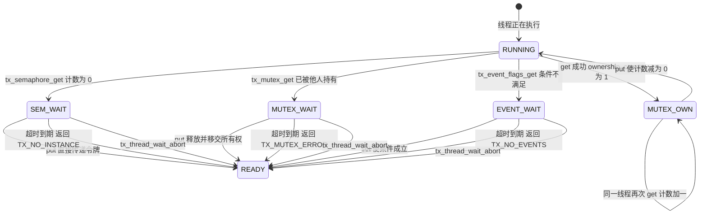
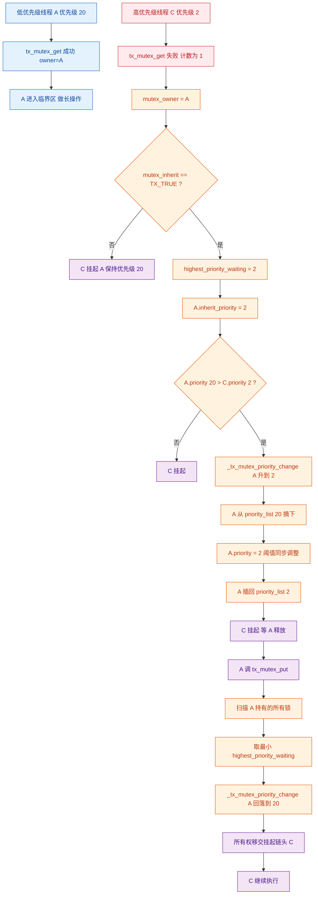
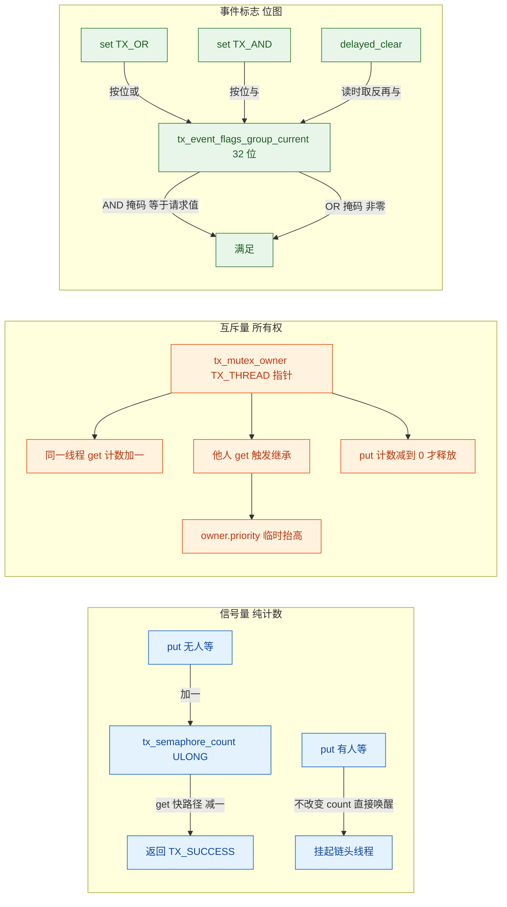

# ThreadX 源码详解 03：同步原语

> 涉及文件：
> - `common/src/tx_semaphore_get.c`（约 260 行）、`tx_semaphore_put.c`、`tx_semaphore_ceiling_put.c`、`tx_semaphore_create.c`
> - `common/src/tx_mutex_get.c`（约 420 行）、`tx_mutex_put.c`（约 520 行）、`tx_mutex_priority_change.c`（约 230 行）
> - `common/src/tx_event_flags_get.c`、`tx_event_flags_set.c`、`tx_event_flags_create.c`
> - `common/inc/tx_api.h:761-1049`（三个控制块结构体）
> - `common/src/tx_thread_system_suspend.c`、`tx_thread_system_resume.c` —— 三个原语最终都收敛到这里

---

## 1. 三种原语，一张表看清区别

| 维度 | 信号量 `TX_SEMAPHORE` | 互斥量 `TX_MUTEX` | 事件标志组 `TX_EVENT_FLAGS_GROUP` |
|---|---|---|---|
| 内核对象大小（32 位） | 约 32 字节 | 约 52 字节 | 约 40 字节 |
| 核心字段 | `ULONG count` | `owner` + `ownership_count` + `inherit` | `ULONG current` 位图 |
| 是否有"所有者" | **无** | **有**（`tx_mutex_owner`） | 无 |
| 可重入 | 否（get 一次减一） | **是**（同一线程可嵌套 get） | 否 |
| 优先级继承 | 无 | **有**（`TX_INHERIT`） | 无 |
| 唤醒粒度 | 每次 put 唤醒 1 个 | 每次 put 唤醒 1 个 | 一次 set 可唤醒**多个** |
| 条件表达式 | 计数 > 0 | 无人持有 | 32 位任意 AND/OR 组合 |
| 典型用途 | 计数事件、ISR→线程通知 | 保护共享资源 | 多事件组合等待、状态广播 |
| ISR 中可用 | get/put 均可 | **get 不可**（会阻塞） | get 不可，set 可 |

一句话概括三者的分工：**信号量数数，互斥量管所有权，事件标志组管条件**。

---

## 2. 信号量：一个 `ULONG` 加一条挂起链

### 2.1 结构体

```c
/* common/inc/tx_api.h:999-1016 */
typedef struct TX_SEMAPHORE_STRUCT
{

    /* Define the semaphore ID used for error checking.  */
    ULONG               tx_semaphore_id;

    /* Define the semaphore's name.  */
    TX_NAME_CONST CHAR *tx_semaphore_name;

    /* Define the actual semaphore count.  A zero means that no semaphore
       instance is available.  */
    ULONG               tx_semaphore_count;

    /* Define the semaphore suspension list head along with a count of
       how many threads are suspended.  */
    struct TX_THREAD_STRUCT
                        *tx_semaphore_suspension_list;
    UINT                tx_semaphore_suspended_count;
```

就这么点东西。没有 owner、没有递归计数、没有继承字段——**信号量是"纯计数"语义**。

### 2.2 get：先减计数，减不到就挂起

```c
/* common/src/tx_semaphore_get.c:106-115 */
    /* Determine if there is an instance of the semaphore.  */
    if (semaphore_ptr -> tx_semaphore_count != ((ULONG) 0))
    {

        /* Decrement the semaphore count.  */
        semaphore_ptr -> tx_semaphore_count--;

        /* Restore interrupts.  */
        TX_RESTORE
    }
```

这是"快路径"：**关中断 → 判断 → 减一 → 开中断**，四条指令量级。
没有排队、没有唤醒、没有调度器介入。信号量在无竞争时几乎零成本。

竞争路径（`wait_option != TX_NO_WAIT`）要做的事就多了：

```c
/* common/src/tx_semaphore_get.c:167-175 */
                semaphore_ptr -> tx_semaphore_suspension_list =         thread_ptr;
                thread_ptr -> tx_thread_suspended_next =        thread_ptr;
                thread_ptr -> tx_thread_suspended_previous =    thread_ptr;
```

```c
/* common/src/tx_semaphore_get.c:211 */
            _tx_thread_system_suspend(thread_ptr);
```

挂起链是**双向循环链表**，`tx_thread_suspended_next/previous` 两个字段被**所有**同步对象复用——
一个线程同时只能等一个对象，所以两个指针够用。

### 2.3 put：有人等就直接给，没人等才加计数

```c
/* common/src/tx_semaphore_put.c:104-112 */
    /* Determine if there are any threads suspended on the semaphore.  */
    if (suspended_count == TX_NO_SUSPENSIONS)
    {

        /* Increment the semaphore count.  */
        semaphore_ptr -> tx_semaphore_count++;
```

```c
/* common/src/tx_semaphore_put.c:134-137 */
        /* Pickup the pointer to the first suspended thread.  */
        thread_ptr =  semaphore_ptr -> tx_semaphore_suspension_list;
```

这两段合起来说明 ThreadX 的**"直接传递"语义**：如果队列（这里是挂起链）里有人等，
put 不会把 count 加到 1 再让别人减，而是**直接把"令牌"交给等待者**——
count 保持不变（本来就是 0），等待者被唤醒后从 get 返回 `TX_SUCCESS`。

这个语义有个可观测的后果：**`tx_semaphore_info_get()` 读到的 `current_value` 在
"有人等待"时永远是 0**，即使你刚 put 了。想看真实吞吐量要看 performance info 的
`put_count` / `get_count`。

### 2.4 ceiling_put：给 ISR 用的有界 put

```c
/* common/src/tx_semaphore_ceiling_put.c:69 */
UINT  _tx_semaphore_ceiling_put(TX_SEMAPHORE *semaphore_ptr, ULONG ceiling)
```

```c
/* common/src/tx_semaphore_ceiling_put.c:113-114 */
        /* Determine if the ceiling has been exceeded.  */
        if (semaphore_ptr -> tx_semaphore_count >= ceiling)
```

普通 `tx_semaphore_put` 无上限——ISR 疯狂 put 会把 `ULONG` 加到溢出（回绕到 0，信号量"消失"）。
`ceiling_put` 多一个上限判断，超过就返回 `TX_CEILING_EXCEEDED`。
**这是 ISR 里唯一安全的 put 变体**，尤其是在"中断可能丢失/重复触发"的硬件上。

### 2.5 信号量不能做什么

- **不能表达所有权**：线程 A get 的信号量，线程 B 也能 put。这在某些协议里是优点
  （生产者/消费者天然如此），但也意味着**不能用信号量做互斥**——A 拿了锁，B 可以"帮它"解锁。
- **不能防优先级反转**：低优先级线程持有信号量时，高优先级线程会一直等，
  中等优先级线程可以无限插队。
- **不能重入**：同一线程 get 两次会消耗两个计数，put 一次只还一个。

---

## 3. 互斥量：所有权 + 优先级继承

### 3.1 结构体多出来的字段都是为继承服务的

```c
/* common/inc/tx_api.h:847-888 */
typedef struct TX_MUTEX_STRUCT
{

    /* Define the mutex ID used for error checking.  */
    ULONG               tx_mutex_id;

    /* Define the mutex's name.  */
    TX_NAME_CONST CHAR *tx_mutex_name;

    /* Define the mutex ownership count.  */
    UINT                tx_mutex_ownership_count;

    /* Define the mutex ownership pointer.  This pointer points to the
       the thread that owns the mutex.  */
    TX_THREAD           *tx_mutex_owner;

    /* Define the priority inheritance flag.  If this flag is set, priority
       inheritance will be in effect.  */
    UINT                tx_mutex_inherit;

    /* Define the save area for the owning thread's original priority.  */
    UINT                tx_mutex_original_priority;
```

| 字段 | 作用 |
|---|---|
| `ownership_count` | 同一线程重复 get 时递增；只有减到 0 才真正释放 |
| `tx_mutex_owner` | 谁持有。用于"同一线程重入"判断和继承目标定位 |
| `tx_mutex_inherit` | 创建时 `TX_INHERIT` / `TX_NO_INHERIT` 决定 |
| `tx_mutex_original_priority` | 抢占时保存的"原优先级"，用于 put 后恢复 |
| `tx_mutex_highest_priority_waiting` | 当前等待者中的最高优先级（数值最小） |

### 3.2 快路径：无人持有 / 自己已持有

```c
/* common/src/tx_mutex_get.c:111-118 */
    if (mutex_ptr -> tx_mutex_ownership_count == ((UINT) 0))
    {

        /* Set the ownership count to 1.  */
        mutex_ptr -> tx_mutex_ownership_count =  ((UINT) 1);

        /* Set the mutex owner to the current thread.  */
        mutex_ptr -> tx_mutex_owner =  thread_ptr;
```

```c
/* common/src/tx_mutex_get.c:176-181 */
    else if (mutex_ptr -> tx_mutex_owner == thread_ptr)
    {
        ...
        /* Increment the ownership count.  */
        mutex_ptr -> tx_mutex_ownership_count++;
```

两个快路径都不涉及调度器：无人持有就记上名字，自己已持有就加计数。
**递归锁是内建的**，不需要额外 API。

### 3.3 慢路径：优先级继承的三段逻辑

线程 C（优先级 2）来 get 一个被线程 A（优先级 20）持有的互斥量。此时：

```c
/* common/src/tx_mutex_get.c:350-386 */
                if (mutex_ptr -> tx_mutex_inherit == TX_TRUE)
                {

                    /* Determine if this is the highest priority to raise for this mutex.  */
                    if (mutex_ptr -> tx_mutex_highest_priority_waiting > thread_ptr -> tx_thread_priority)
                    {

                        /* Remember this priority.  */
                        mutex_ptr -> tx_mutex_highest_priority_waiting =  thread_ptr -> tx_thread_priority;
                    }

                    /* Determine if we have to update inherit priority level of the mutex owner.  */
                    if (thread_ptr -> tx_thread_priority < mutex_owner -> tx_thread_inherit_priority)
                    {

                        /* Remember the new priority inheritance priority.  */
                        mutex_owner -> tx_thread_inherit_priority =  thread_ptr -> tx_thread_priority;
                    }

                    /* Priority inheritance is requested, check to see if the thread that owns the mutex is lower priority.  */
                    if (mutex_owner -> tx_thread_priority > thread_ptr -> tx_thread_priority)
                    {

                        /* Yes, raise the suspended, owning thread's priority to that
                           of the current thread.  */
                        _tx_mutex_priority_change(mutex_owner, thread_ptr -> tx_thread_priority);
```

三段判断各管一件事：

1. **`highest_priority_waiting` 取最小值**：记录这个互斥量上等过的最高的优先级。
   put 时要用它来算"释放后该恢复到多少"。
2. **`inherit_priority` 取最小值**：这是**线程级**的继承记录，跨多个互斥量。
   一个线程可能同时持有 3 把锁，3 个不同的等待者，继承优先级要取所有等待者的最小值。
3. **`owner->priority > waiter->priority` 才真改**：如果持有者优先级本来就比等待者高，
   不需要继承（等待者会自己等，不会造成反转）。

### 3.4 改优先级为什么要"先摘下再插回"

`_tx_mutex_priority_change()` 里最反直觉的一段：

```c
/* common/src/tx_mutex_priority_change.c:169-186 */
        /* Increment the preempt disable flag.  */
        _tx_thread_preempt_disable =  _tx_thread_preempt_disable + ((UINT) 2);

        /* Set the state to priority change.  */
        thread_ptr -> tx_thread_state =    TX_PRIORITY_CHANGE;

        /* Set the suspending flag. */
        thread_ptr -> tx_thread_suspending =  TX_TRUE;

        /* Setup the timeout period.  */
        thread_ptr -> tx_thread_timer.tx_timer_internal_remaining_ticks =  ((ULONG) 0);

        /* Restore interrupts.  */
        TX_RESTORE

        /* The thread is ready and must first be removed from the list.  Call the
           system suspend function to accomplish this.  */
        _tx_thread_system_suspend(thread_ptr);
```

原因：**就绪链表是按优先级索引的**。线程 A 从优先级 20 升到 2，它必须从
`_tx_thread_priority_list[20]` 摘下、挂到 `_tx_thread_priority_list[2]`。
没有"原地改优先级"的办法，只能走一次 suspend → 改字段 → resume。

注意 `_tx_thread_preempt_disable` 加了 **2** 而不是 1：一次是为了 suspend 内部，
一次是为了"改完优先级后不被别人插队"。这个 `+2` / `-2` 的配对是 ThreadX 里少见的
"魔数"，改这段代码时必须数清楚。

`TX_PRIORITY_CHANGE`（状态值 14）是一个**临时状态**，只在 suspend 到 resume 之间存在。
它的作用是让 `tx_thread_info_get` 之类的观测接口能在这一瞬间报告"正在改优先级"，
而不是误报 `TX_SUSPENDED`。

### 3.5 put：恢复优先级要扫一遍自己持有的所有锁

A 释放锁时，不能简单恢复到 `tx_mutex_original_priority`——因为它可能还持有别的锁，
别的锁上还有等待者。

```c
/* common/src/tx_mutex_put.c:255-279 */
                            next_mutex =  thread_ptr -> tx_thread_owned_mutex_list;
                            while (next_mutex != TX_NULL)
                            {

                                /* Does this mutex support priority inheritance?  */
                                if (next_mutex -> tx_mutex_inherit == TX_TRUE)
                                {

                                    /* Determine if highest priority field of the mutex is higher than the priority to
                                       restore.  */
                                    if (next_mutex -> tx_mutex_highest_priority_waiting < inheritance_priority)
                                    {

                                        /* Use this priority to return releasing thread to.  */
                                        inheritance_priority =   next_mutex -> tx_mutex_highest_priority_waiting;
                                    }
                                }
```

```c
/* common/src/tx_mutex_put.c:295-301 */
                            /* Set the inherit priority to that of the highest priority thread waiting on the mutex.  */
                            thread_ptr -> tx_thread_inherit_priority =  inheritance_priority;

                            /* Determine if the inheritance priority is less than the default old priority.  */
                            if (inheritance_priority < old_priority)
                            {

                                /* Yes, update the old priority.  */
                                old_priority =  inheritance_priority;
                            }
```

这是一个 `O(持有的锁数)` 的循环。持有 3 把锁的线程，每次 put 要扫 3 次链表。
复杂度不高，但**在锁竞争激烈的系统里会累积**——这是继承机制的真实成本。

最后：

```c
/* common/src/tx_mutex_put.c:376-380 */
                            if ((mutex_ptr -> tx_mutex_owner) -> tx_thread_priority != old_priority)
                            {

                                /* Yes, restore the priority of thread.  */
                                _tx_mutex_priority_change(mutex_ptr -> tx_mutex_owner, old_priority);
                            }
```

只有"当前优先级 ≠ 应恢复优先级"才真的改。如果 A 从 2 恢复到 20，又是一次
suspend → 改 → resume 的完整流程。

### 3.6 继承的边界：只解一层

ThreadX 的互斥量继承是**直接继承**，不是"链式继承"（chained inheritance）。
考虑：A（20）持有 M1，B（10）持有 M2 并等 M1，C（2）等 M2。

- C 等 M2 → B 升到 2。
- B 等 M1 → B 是"等待者"，A 是持有者，A 升到 **B 当前的优先级 2**。
- 结果 A 和 B 都是 2，C 仍在等。这**恰好**解决了问题。

但如果 B 在等 M1 时**没有**触发继承（比如 M1 创建时用了 `TX_NO_INHERIT`），
A 就一直是 20，C 被 B 挡、B 被 A 挡，反转仍然存在。
**继承不是万能的，它依赖每一层锁都开启继承。**

### 3.7 互斥量的四条使用规则

1. **绝不在 ISR 里 get**：`_tx_mutex_get` 在 `_tx_thread_preempt_disable != 0` 时返回
   `TX_NOT_AVAILABLE`（`tx_mutex_get.c:197-205`）。ISR 里天然满足这个条件。
2. **谁 get 谁 put**：`_tx_mutex_put` 会校验 `tx_mutex_owner == current_thread`，
   否则返回 `TX_NOT_OWNED`。这比信号量安全，但也意味着不能跨线程"移交"。
3. **尽量短持有**：持有期间会抬高优先级，长时间持有会让继承链上的所有线程都被抬到高优先级，
   等于人为制造了一堆高优先级线程。
4. **创建顺序一致**：多个互斥量时，所有线程按相同顺序 get，否则死锁。
   ThreadX 不检测死锁，`tx_thread_sleep(TX_WAIT_FOREVER)` 会永久挂起。

---

## 4. 事件标志组：32 位 + 延迟清除

### 4.1 结构体

```c
/* common/inc/tx_api.h:761-790 */
typedef struct TX_EVENT_FLAGS_GROUP_STRUCT
{

    /* Define the event flags group ID used for error checking.  */
    ULONG               tx_event_flags_group_id;

    /* Define the event flags group's name.  */
    TX_NAME_CONST CHAR *tx_event_flags_group_name;

    /* Define the actual current event flags in this group. A zero in a
       particular bit indicates the event flag is not set.  */
    ULONG               tx_event_flags_group_current;

    /* Define the reset search flag that is set when an ISR sets flags during
       the search of the suspended threads list.  */
    UINT                tx_event_flags_group_reset_search;
```

```c
    /* Define the delayed clearing event flags.  */
    ULONG               tx_event_flags_group_delayed_clear;
```

`tx_event_flags_group_current` 是一个 32 位位图，**没有分组、没有层级**。
要等多个条件同时满足，就在一次 `tx_event_flags_get` 里用 AND 把多个位组合起来。

### 4.2 AND / OR 的判定

```c
/* common/src/tx_event_flags_get.c:132-142 */
        flags_satisfied =  (current_flags & requested_flags);

        /* Determine if they satisfy the AND request.  */
        if (flags_satisfied != requested_flags)
        {

            /* No, not all the requested flags are present. Clear the flags present variable.  */
            flags_satisfied =  ((ULONG) 0);
        }
```

```c
/* common/src/tx_event_flags_get.c:146 */
        flags_satisfied =  (current_flags & requested_flags);
```

AND 的判定是"掩码后是否等于请求值"；OR 的判定是"掩码后是否非零"。
两种都只需要一次 AND + 一次比较。

### 4.3 set 的两种模式

```c
/* common/src/tx_event_flags_set.c:120 */
    if ((set_option & TX_EVENT_FLAGS_AND_MASK) == TX_AND)
```

```c
/* common/src/tx_event_flags_set.c:159-160 */
            group_ptr -> tx_event_flags_group_current =
                group_ptr -> tx_event_flags_group_current & flags_to_set;
```

```c
/* common/src/tx_event_flags_set.c:180-181 */
        group_ptr -> tx_event_flags_group_current =
            group_ptr -> tx_event_flags_group_current | flags_to_set;
```

| 模式 | 操作 | 用途 |
|---|---|---|
| `TX_OR` | `current |= flags` | 置位，最常用 |
| `TX_AND` | `current &= flags` | **清零**除 flags 之外的位（注意不是"与上 flags 置位"） |

`TX_AND` 的语义容易误解：它不是"把 flags 里的位置 1"，而是"**只保留** flags 里为 1 的位，
其他位全清"。要清某几位应该用 `TX_AND` 加一个"除了那几位全 1"的掩码，
或者直接 `TX_AND` 传 `~flags`。

### 4.4 延迟清除：为什么需要它

问题场景：线程 A 正在 `tx_event_flags_get(TX_AND_CLEAR)` 的**挂起链遍历过程中**
（已经关中断、正在逐个检查等待者），一个 ISR 调 `tx_event_flags_set` 改了
`tx_event_flags_group_current`。如果 A 继续用旧的遍历状态做 clear，会清掉不该清的位。

ThreadX 的解法是引入 `tx_event_flags_group_delayed_clear`：

```c
/* common/src/tx_event_flags_set.c:142-150 */
        if (interrupted_set_request == TX_TRUE)
        {

            /* A previous set operation was interrupted, we need to defer the
               event clearing until the set operation is complete.  */

            /* Remember the events to clear.  */
            group_ptr -> tx_event_flags_group_delayed_clear =
                                        group_ptr -> tx_event_flags_group_delayed_clear | ~flags_to_set;
        }
```

被中断的 set 不直接改 `current`，而是把"要清的位"记在 `delayed_clear` 里。
读的一方：

```c
/* common/src/tx_event_flags_get.c:116-118 */
    /* Return the actual event flags and apply delayed clearing.  */
    *actual_flags_ptr =  current_flags & ~group_ptr -> tx_event_flags_group_delayed_clear;
```

**读的时候把 pending 的清除"假装"已经生效**，但物理上不清，直到 set 操作完成。
这是一个"延迟提交"（deferred commit）模式，用 4 字节换掉了"set 与 get 互斥"的锁。

### 4.5 一次 set 唤醒多个线程

信号量和互斥量每次 put 只唤醒**一个**等待者（挂起链头）。事件标志组不同：
如果多个线程等的是同一组标志的不同子集，一次 set 可能同时满足多个线程。

这也是事件标志组比"多个信号量"更高效的地方：**广播语义**。
典型用途是"系统状态变化"——一个线程置 `SYS_READY`，所有等这个位的线程同时被唤醒。

---

## 5. 状态机：一个线程在同步原语上的完整生命周期



三条挂起路径的**结构完全相同**：进挂起链 → 设状态 → 调 `_tx_thread_system_suspend` →
被唤醒后读 `tx_thread_suspend_status`。区别只在"谁能唤醒我"和"唤醒后返回什么状态码"。

---

## 6. 执行流：一次优先级继承的完整过程



第 12 步（`RM` 从链表摘下）是整条路径上唯一"会调用调度器"的地方——
它内部走了一次 `_tx_thread_system_suspend`。这意味着**优先级继承的代价是一次完整的线程切换**
（如果被继承的线程正在跑，它会被暂停再恢复）。这也是为什么继承只在真正发生反转时才触发。

---

## 7. 数据流：三种原语的数据载体



---

## 8. 陷阱与实测建议

**陷阱 1：用信号量做互斥。**
`tx_semaphore_create(&s, "s", 1)` 看起来像一个二值锁，但任何线程都能 put。
更严重的是**没有优先级继承**：高优先级线程等锁时不会抬高低优先级持有者的优先级，
中等优先级线程可以无限插队。要互斥就用 `tx_mutex`。

**陷阱 2：`TX_INHERIT` 传成了 `TX_NO_INHERIT`。**
`tx_mutex_create` 的第 3 个参数容易被当成"是否可重入"。
`TX_NO_INHERIT` 的锁**完全不做继承**，一旦发生反转就是永久性的（直到持有者自己让出）。
默认值应该是 `TX_INHERIT`，除非你明确知道不需要。

**陷阱 3：在 ISR 里调用 `tx_mutex_get`。**
返回 `TX_NOT_AVAILABLE`（`tx_mutex_get.c:204`），不是 `TX_WAIT_ERROR`。
这个错误码容易被误判成"锁被占用"，实际是"你根本不该在这里调"。

**陷阱 4：事件标志的 `TX_AND` 当成"置位"。**
`tx_event_flags_set(g, 0x03, TX_AND)` 的结果是 `current &= 0x03`——**清掉其他所有位**，
不是"把 0x03 置 1"。要置位只能用 `TX_OR`。

**陷阱 5：`tx_event_flags_get` 的 `actual_flags` 忘记读。**
即使返回 `TX_SUCCESS`，`*actual_flags_ptr` 里是**调用瞬间**的标志快照。
如果用了 `TX_OR_CLEAR`，其他线程/ISR 可能在这瞬间又置了新的位，那些位**不会**被这次 clear 掉
（这是正确行为），但如果你依赖"读到的一定是最新值"就会出错。要用返回值判断，不要用缓存的旧值。

**陷阱 6：互斥量 put 次数与 get 次数不匹配。**
`ownership_count` 是 `UINT`，多 put 会下溢成 `0xFFFFFFFF`，之后这把锁**永远无法释放**，
且 `tx_mutex_put` 会返回 `TX_NOT_OWNED`（因为 owner 已经被设成 NULL）。
调试时表现为"系统卡死在某把锁上"，但看代码逻辑完全正确。

**实测建议：** 打开 `TX_MUTEX_ENABLE_PERFORMANCE_INFO`，用
`tx_mutex_performance_system_info_get()` 看 `priority_inversions` 与 `priority_inheritances` 的比值。
如果反转次数远大于继承次数，说明有锁没开 `TX_INHERIT`；
如果两者都很大，说明锁粒度太粗，应该拆分临界区。

---

## 9. 读码路径小结

```
tx_api.h:761-818   事件标志组结构体（注意 delayed_clear）
tx_api.h:847-915   互斥量结构体（注意 4 个继承相关字段）
tx_api.h:999-1049  信号量结构体（只有 count）
tx_semaphore_get.c:106-115   快路径：减计数
tx_semaphore_put.c:104-112   无人等则加计数
tx_semaphore_put.c:134-205   有人等则直接移交
tx_mutex_get.c:111-181       两个快路径：空闲 / 重入
tx_mutex_get.c:350-386       继承三段判断
tx_mutex_priority_change.c:169-215  摘下→改→插回
tx_mutex_put.c:255-301       扫描所有持有锁算恢复优先级
tx_event_flags_get.c:132-146 AND/OR 判定
tx_event_flags_set.c:142-160 延迟清除
```

上一篇：[02-线程与调度.md](02-线程与调度.md) ｜ 下一篇：[04-通信机制.md](04-通信机制.md)
