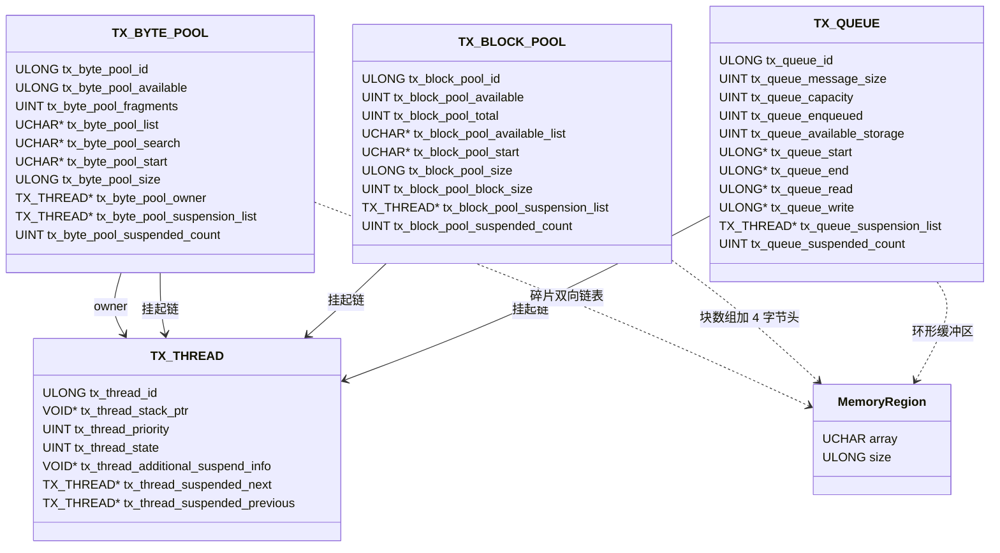
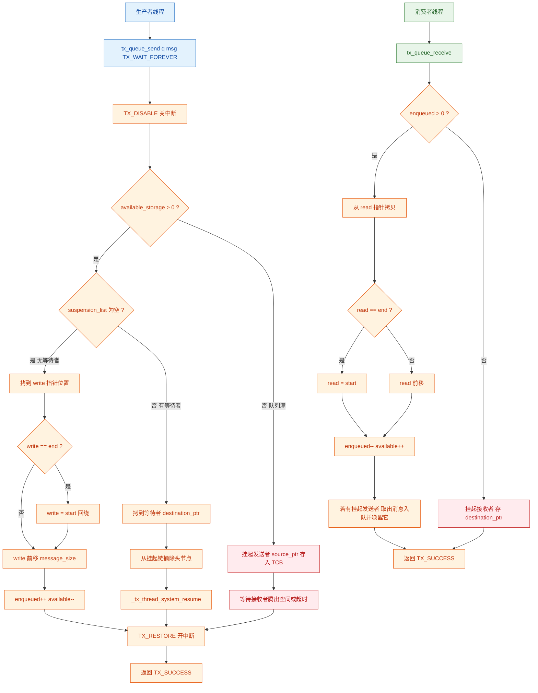
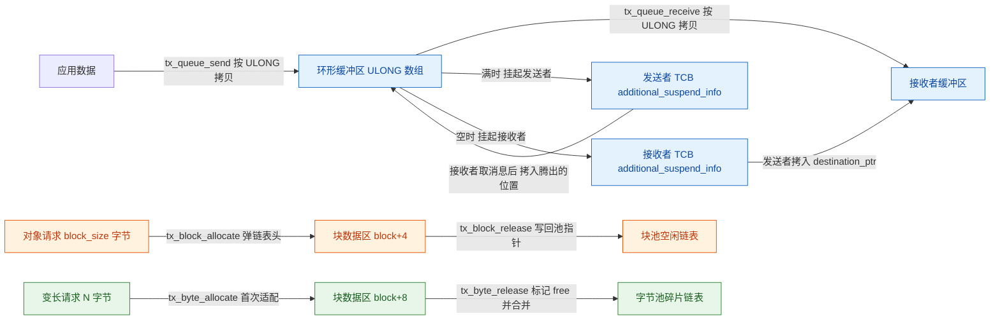

# ThreadX 源码详解 04：通信机制（队列与内存池）

> 涉及文件：
> - `common/src/tx_queue_create.c`、`tx_queue_send.c`、`tx_queue_receive.c`、`tx_queue_front_send.c`、`tx_queue_flush.c`、`tx_queue_cleanup.c`
> - `common/src/tx_block_pool_create.c`、`tx_block_allocate.c`、`tx_block_release.c`、`tx_block_pool_cleanup.c`
> - `common/src/tx_byte_pool_create.c`、`tx_byte_allocate.c`、`tx_byte_release.c`、`tx_byte_pool_search.c`
> - `common/inc/tx_api.h:604-661`（`TX_BLOCK_POOL`）、`:682-756`（`TX_BYTE_POOL`）、`:920-994`（`TX_QUEUE`）

---

## 1. 三个对象的分工

| | `TX_QUEUE` | `TX_BLOCK_POOL` | `TX_BYTE_POOL` |
|---|---|---|---|
| 传输单位 | 定长消息，单位是 **ULONG 个数** | 定长块，单位是**字节** | 变长，单位是**字节** |
| 内部算法 | 环形缓冲区 + 读写指针 | 单链表空闲块（指针嵌在块内） | 首次适配 + 相邻合并 + 分割 |
| 元数据开销 | 0（消息本身无头） | **4 字节/块** | **8 字节/块** |
| 分配复杂度 | O(1) | O(1) | O(碎片数) 最坏 |
| 会碎片化 | 不会 | 不会 | **会** |
| 是否阻塞等待 | 是（空/满均可等） | 是（无可用块可等） | 是（无足够空间可等） |
| 典型用途 | 线程间传数据/命令 | 固定大小对象池（如网络包） | 线程栈、变长缓冲 |

一句话：**队列传数据，块池管定长对象，字节池管变长内存**。

---

## 2. 队列：环形缓冲区

### 2.1 创建时算容量

```c
/* common/src/tx_queue_create.c:92-95 */
    /* Determine how many messages will fit in the queue area and the number
       of ULONGs used.  */
    capacity =    (UINT) (queue_size / ((ULONG) (((ULONG) message_size) * (sizeof(ULONG)))));
    used_words =  capacity * message_size;
```

关键：**`message_size` 的单位是 ULONG，不是字节**。`tx_queue_create(q, "q", 4, buf, 100)`
表示"每条消息 4 个 ULONG（16 字节），缓冲区 100 字节"，于是
`capacity = 100 / (4*4) = 6` 条消息，实际用掉 `6*4 = 24` 个 ULONG = 96 字节，
**剩下 4 字节被浪费**（不够一条消息）。

这是初学者最常算错的地方。要精确控制容量，应该让 `queue_size` 是
`message_size * 4 * N` 的整数倍。

```c
/* common/src/tx_queue_create.c:100-101 */
    queue_ptr -> tx_queue_start =  TX_VOID_TO_ULONG_POINTER_CONVERT(queue_start);
    queue_ptr -> tx_queue_end =    TX_ULONG_POINTER_ADD(queue_ptr -> tx_queue_start, used_words);
```

`tx_queue_end` 指向"最后一条消息之后"，即**一格越界地址**。所有指针比较都用
`== end` 而不是 `>= end`，所以这个越界地址从不被解引用。

### 2.2 结构体

```c
/* common/inc/tx_api.h:920-948 */
typedef struct TX_QUEUE_STRUCT
{

    /* Define the queue ID used for error checking.  */
    ULONG               tx_queue_id;

    /* Define the queue's name.  */
    TX_NAME_CONST CHAR *tx_queue_name;

    /* Define the message size that was specified in queue creation.  */
    UINT                tx_queue_message_size;

    /* Define the total number of messages in the queue.  */
    UINT                tx_queue_capacity;

    /* Define the current number of messages enqueued and the available
       queue storage space.  */
    UINT                tx_queue_enqueued;
    UINT                tx_queue_available_storage;

    /* Define pointers that represent the start and end for the queue's
       message area.  */
    ULONG               *tx_queue_start;
    ULONG               *tx_queue_end;

    /* Define the queue read and write pointers.  Send requests use the write
       pointer while receive requests use the read pointer.  */
    ULONG               *tx_queue_read;
    ULONG               *tx_queue_write;
```

`enqueued + available_storage == capacity` 恒成立（除了零拷贝捷径的瞬间）。
这两个计数器的作用是避免"读指针 == 写指针"的歧义——空队列和满队列的
读写指针都可能相等，靠计数器区分。

### 2.3 发送：三条路径

```c
/* common/src/tx_queue_send.c:119-144 */
    /* Determine if there is room in the queue.  */
    if (queue_ptr -> tx_queue_available_storage != TX_NO_MESSAGES)
    {

        /* There is room for the message in the queue.  */

        /* Determine if there are suspended on this queue.  */
        if (suspended_count == TX_NO_SUSPENSIONS)
        {

            /* No suspended threads, simply place the message in the queue.  */

            /* Reduce the amount of available storage.  */
            queue_ptr -> tx_queue_available_storage--;
```

```c
            /* Increase the enqueued count.  */
            queue_ptr -> tx_queue_enqueued++;

            /* Setup source and destination pointers.  */
            source =       TX_VOID_TO_ULONG_POINTER_CONVERT(source_ptr);
            destination =  queue_ptr -> tx_queue_write;
            size =         queue_ptr -> tx_queue_message_size;

            /* Copy message. Note that the source and destination pointers are
               incremented by the macro.  */
            TX_QUEUE_MESSAGE_COPY(source, destination, size)
```

```c
/* common/src/tx_queue_send.c:147-155 */
            /* Determine if we are at the end.  */
            if (destination == queue_ptr -> tx_queue_end)
            {

                /* Yes, wrap around to the beginning.  */
                destination =  queue_ptr -> tx_queue_start;
            }

            /* Adjust the write pointer.  */
            queue_ptr -> tx_queue_write =  destination;
```

三条路径按优先级排列：

| 条件 | 动作 | 数据落点 |
|---|---|---|
| 队列有空位且**无**挂起线程 | 拷进环形缓冲区，写指针前移（到尾则回绕） | `tx_queue_write` |
| 队列有挂起线程（接收者） | **直接拷到接收者的 `destination_ptr`** | `tx_thread_additional_suspend_info` |
| 队列满 | 挂起发送者，把 `source_ptr` 存进 TCB | 等接收者腾出空间 |

第二条是**零拷贝捷径**，值得单独看：

```c
/* common/src/tx_queue_send.c:225-232 */
            /* Setup source and destination pointers.  */
            source =       TX_VOID_TO_ULONG_POINTER_CONVERT(source_ptr);
            destination =  TX_VOID_TO_ULONG_POINTER_CONVERT(thread_ptr -> tx_thread_additional_suspend_info);
            size =         queue_ptr -> tx_queue_message_size;

            /* Copy message. Note that the source and destination pointers are
               incremented by the macro.  */
            TX_QUEUE_MESSAGE_COPY(source, destination, size)
```

注意这里**既没有改 `enqueued` 也没有改 `available_storage`**——消息根本没进队列。
队列在这个瞬间保持原样（通常是空的），消息从发送者直接进了接收者的缓冲区。

这个设计的精妙之处：**它让"队列有空位但有人等"这种矛盾状态成为常态**。
正常情况下"有人等"意味着"队列空"，但如果一个线程刚被唤醒还没来得及返回，
队列可能已经有空位，此时新的 send 仍然应该直接给等待者（因为等待者的数据目标已经确定）。

### 2.4 接收：镜像逻辑

```c
/* common/src/tx_queue_receive.c:126-148 */
            /* Setup source and destination pointers.  */
            source =       queue_ptr -> tx_queue_read;
            destination =  TX_VOID_TO_ULONG_POINTER_CONVERT(destination_ptr);
            size =         queue_ptr -> tx_queue_message_size;

            /* Copy message. Note that the source and destination pointers are
               incremented by the macro.  */
            TX_QUEUE_MESSAGE_COPY(source, destination, size)

            /* Determine if we are at the end.  */
            if (source == queue_ptr -> tx_queue_end)
            {

                /* Yes, wrap around to the beginning.  */
                source =  queue_ptr -> tx_queue_start;
            }

            /* Setup the queue read pointer.   */
            queue_ptr -> tx_queue_read =  source;

            /* Increase the amount of available storage.  */
            queue_ptr -> tx_queue_available_storage++;

            /* Decrease the enqueued count.  */
            queue_ptr -> tx_queue_enqueued--;
```

接收的"快路径"同样不涉及调度器：**关中断 → 拷贝 → 移动读指针 → 更新计数 → 开中断**。
拷贝长度是编译期已知的 `message_size`，`TX_QUEUE_MESSAGE_COPY` 宏展开成一个
固定次数的 `for` 循环（或者 port 提供的 `memcpy` 优化版），没有运行时分支。

### 2.5 front_send 与 flush

- `tx_queue_front_send()`：把消息插到**读指针位置**，即"下一条被读的消息"。
  实现上是把读指针往回退一格再写。用于实现 LIFO 语义（后进先出）或"紧急消息插队"。
- `tx_queue_flush()`：清空队列，把 `enqueued` 置 0、读写指针复位，
  并**唤醒所有挂起的接收者**（它们会得到 `TX_QUEUE_EMPTY`？不——`flush` 唤醒等待者时
  给的是 `TX_SUCCESS` 但没数据，实际是让它们重新判断）。
  真正要小心的是 `flush` 不会唤醒挂起的**发送者**，那些线程会一直等到超时。

### 2.6 队列的公平性

挂起链是**按优先级排序的**吗？不是。ThreadX 的挂起是**纯 FIFO**：
`tx_queue_send` 总是取 `tx_queue_suspension_list` 的头。

但有一个例外：`tx_queue_prioritize()` 会重新排列挂起链，把最高优先级的等待者移到头部。
**这个函数必须手动调用**，不是自动的。所以默认行为是"先来先得"，
不是"高优先级先得"。

对实时系统来说这是个重要细节：如果高优先级线程和一个低优先级线程都在等同一个空队列，
默认情况下**低优先级线程可能先拿到消息**（如果它先等）。要避免必须显式
调用 `tx_queue_prioritize`，或者用"一个队列只给一个消费者"的设计。

---

## 3. 块池：把链表指针塞进空闲块里

### 3.1 内存布局

`tx_block_pool_create(pool, "p", block_size, pool_start, pool_size)` 之后，
内存被切成 N 个"块 + 4 字节指针"的单元：

```
pool_start
   │
   ├─ [4 字节 next] [block_size 字节数据]   ← 块 0
   ├─ [4 字节 next] [block_size 字节数据]   ← 块 1
   ├─ ...
   └─ [4 字节 next=NULL] [block_size 字节数据] ← 块 N-1
```

```c
/* common/src/tx_block_pool_create.c:92 */
    block_size =  (((block_size + (sizeof(ALIGN_TYPE))) - ((ALIGN_TYPE) 1))/(sizeof(ALIGN_TYPE))) * (sizeof(ALIGN_TYPE));
```

```c
/* common/src/tx_block_pool_create.c:96 */
    pool_size =   (pool_size/(sizeof(ALIGN_TYPE))) * (sizeof(ALIGN_TYPE));
```

```c
/* common/src/tx_block_pool_create.c:105 */
    total_blocks =  pool_size/(block_size + (sizeof(UCHAR *)));
```

三个公式的含义：

1. `block_size` **向上取整**到 `ALIGN_TYPE`（4 字节）的倍数——保证返回给用户的指针
   是 4 字节对齐的。用户要 10 字节，实际占 12 字节。
2. `pool_size` **向下取整**到 4 的倍数——多余 1~3 字节直接丢弃。
3. 每块的总开销是 `block_size + 4`。用户要 16 字节、给 100 字节池：
   `total_blocks = 100 / (16+4) = 5`，用掉 100 字节，刚好。

**注意 `block_size` 的输入是"用户数据大小"，不包含那 4 字节指针**。
这是 ThreadX 文档里容易看漏的一点：`tx_block_pool_create` 的第 3 参数应该填你想要的
数据字节数，内核会自动加 4。

### 3.2 建池：把所有块串成单链表

```c
/* common/src/tx_block_pool_create.c:118 */
        block_link_ptr =  TX_UCHAR_TO_INDIRECT_UCHAR_POINTER_CONVERT(block_ptr);
        *block_link_ptr =  next_block_ptr;
```

```c
/* common/src/tx_block_pool_create.c:144 */
        pool_ptr -> tx_block_pool_available_list =  TX_VOID_TO_UCHAR_POINTER_CONVERT(pool_start);
```

最后一块的 next 设为 `TX_NULL`（`tx_block_pool_create.c:140-142` 区域），
链表就闭合了。**整个池的初始化是 O(N)**，一次性成本。

### 3.3 分配：弹出表头，把池指针写回去

```c
/* common/src/tx_block_allocate.c:148-163 */
        /* Yes, a block is available.  Decrement the available count.  */
        pool_ptr -> tx_block_pool_available--;

        /* Pickup the current block pointer.  */
        work_ptr =  pool_ptr -> tx_block_pool_available_list;

        /* Return the first available block to the caller.  */
        temp_ptr =  TX_UCHAR_POINTER_ADD(work_ptr, (sizeof(UCHAR *)));
        return_ptr =  TX_INDIRECT_VOID_TO_UCHAR_POINTER_CONVERT(block_ptr);
        *return_ptr =  temp_ptr;

        /* Modify the available list to point at the next block in the pool. */
        next_block_ptr =  TX_UCHAR_TO_INDIRECT_UCHAR_POINTER_CONVERT(work_ptr);
        pool_ptr -> tx_block_pool_available_list =  *next_block_ptr;

        /* Save the pool's address in the block for when it is released!  */
        temp_ptr =  TX_BLOCK_POOL_TO_UCHAR_POINTER_CONVERT(pool_ptr);
        *next_block_ptr =  temp_ptr;
```

这段是整篇文档里最值得逐行读的 15 行。它做了三件"用同一块内存做三件不同事"的操作：

| 时刻 | 那 4 字节的内容 | 含义 |
|---|---|---|
| 分配前 | 指向下一个空闲块 | 空闲链表 |
| 分配瞬间 | 读出后**被覆盖成池指针** | 释放时靠它找回归属 |
| 用户使用期间 | `TX_BLOCK_POOL*` | 块里带着"我属于哪个池" |
| 释放时 | 读出来当 `pool_ptr`，然后写回下一个空闲块 | 回到链表 |

**没有额外元数据数组**，没有位图，没有引用计数。池的全部状态就是
`tx_block_pool_available_list` + 每个块头部的 4 字节。

代价：**用户不能越过块边界写**。写坏那 4 字节，释放时 `pool_ptr` 是垃圾，
`tx_block_release` 会解引用野指针。这是"零元数据"设计的必然风险。

### 3.4 释放：优先给等待者，否则回链表

```c
/* common/src/tx_block_release.c:151-153 */
        return_block_ptr =  TX_VOID_TO_INDIRECT_UCHAR_POINTER_CONVERT(thread_ptr -> tx_thread_additional_suspend_info);
        work_ptr =          TX_VOID_TO_UCHAR_POINTER_CONVERT(block_ptr);
        *return_block_ptr =  work_ptr;
```

```c
/* common/src/tx_block_release.c:183-189 */
        *next_block_ptr =  pool_ptr -> tx_block_pool_available_list;
```

```c
        pool_ptr -> tx_block_pool_available_list =  work_ptr;
```

```c
        pool_ptr -> tx_block_pool_available++;
```

和队列一样的分支：**有人等就直接给，没人等才回池**。
直接给的时候 `available` 计数不变（块从未真正"回到池里"）。

---

## 4. 字节池：首次适配 + 合并 + 分割

### 4.1 块头是 8 字节

```
pool_start
   │
   ├─ [4 字节 next] [4 字节 free 标记] [N 字节数据]
```

```c
/* common/src/tx_byte_pool_search.c:136-138 */
            work_ptr =  TX_UCHAR_POINTER_ADD(current_ptr, (sizeof(UCHAR *)));
            free_ptr =  TX_UCHAR_TO_ALIGN_TYPE_POINTER_CONVERT(work_ptr);
            if ((*free_ptr) == TX_BYTE_BLOCK_FREE)
```

每块头 = `sizeof(UCHAR*)` + `sizeof(ALIGN_TYPE)` = 4 + 4 = **8 字节**（32 位机）。
第一个字是"下一块的指针"，第二个字是"是否空闲"标记。

### 4.2 分配决策：先算理论上限

```c
/* common/src/tx_byte_pool_search.c:97-100 */
    /* First, determine if there are enough bytes in the pool.  */
    /* Theoretical bytes available = free bytes + ((fragments-2) * overhead of each block) */
    total_theoretical_available = pool_ptr -> tx_byte_pool_available + ((pool_ptr -> tx_byte_pool_fragments - 2) * ((sizeof(UCHAR *)) + (sizeof(ALIGN_TYPE))));
    if (memory_size >= total_theoretical_available)
    {

        /* Restore interrupts.  */
        TX_RESTORE

        /* Not enough memory, return a NULL pointer.  */
        current_ptr =  TX_NULL;
    }
```

这个公式值得推一遍。假设池里有 F 个碎片（fragments），其中 2 个是"头块"和"尾块"
（永远存在，不参与合并）。中间 F-2 个碎片各有一个 8 字节头。
如果把这些碎片全部合并，能回收 `(F-2) * 8` 字节。所以：

```
理论可用 = 当前记录的空闲字节 + (F-2) * 8
```

只有连"合并后都不够"才直接返回失败。这是一个**乐观预判**：不实际合并，
先看理论上够不够，不够就省掉整个搜索。

注意比较用的是 `>=` 而不是 `>`：`memory_size` 等于理论上限时也失败，
因为合并后刚好够的块还要再切一刀，切完的剩余部分至少要能放一个 8 字节头，
所以实际需要 `memory_size + 8` 字节的空间。

### 4.3 搜索：从上次成功的位置开始

```c
/* common/src/tx_byte_pool_search.c:118-120 */
        /* Walk through the memory pool in search for a large enough block.  */
        current_ptr =      pool_ptr -> tx_byte_pool_search;
        examine_blocks =   pool_ptr -> tx_byte_pool_fragments + ((UINT) 1);
```

`tx_byte_pool_search` 是一个**游标**，记录上次分配成功的位置。
下次从那里开始找，而不是从头开始——这叫 "next-fit"（下次适配）的变体，
目的是减少"每次都从头部扫描"造成的缓存局部性差。

但注释里说的是 "first-fit"：

```c
/* common/src/tx_byte_pool_search.c:162-164 */
                /* If this is large enough, we are done because our first-fit algorithm
                   has been satisfied!  */
```

准确的说法是：**从游标位置开始的 first-fit（循环扫描）**。如果游标处找不到，
会绕回池头继续找，所以不会漏掉任何块。`examine_blocks = fragments + 1` 是循环的
最大步数，防止链表成环导致死循环。

### 4.4 合并：相邻空闲块就地吸收

```c
/* common/src/tx_byte_pool_search.c:176-190 */
                    /* Not enough memory, check to see if the neighbor is
                       free and can be merged.  */
                    work_ptr =  TX_UCHAR_POINTER_ADD(next_ptr, (sizeof(UCHAR *)));
                    free_ptr =  TX_UCHAR_TO_ALIGN_TYPE_POINTER_CONVERT(work_ptr);
                    if ((*free_ptr) == TX_BYTE_BLOCK_FREE)
                    {

                        /* Yes, neighbor block can be merged!  This is quickly accomplished
                           by updating the current block with the next blocks pointer.  */
                        next_block_link_ptr =  TX_UCHAR_TO_INDIRECT_UCHAR_POINTER_CONVERT(next_ptr);
                        *this_block_link_ptr =  *next_block_link_ptr;

                        /* Reduce the fragment total.  We don't need to increase the bytes
                           available because all free headers are also included in the available
                           count.  */
                        pool_ptr -> tx_byte_pool_fragments--;
```

合并只需要一条赋值：把当前块的 `next` 指向"下一块的下一块"。中间那块被"吞掉"，
它的 8 字节头连同数据一起变成当前块的一部分。**没有内存移动，没有拷贝**。

注释里那句 "We don't need to increase the bytes available because all free headers are also
included in the available count" 是个重要约定：`tx_byte_pool_available` 统计的是
**包含块头在内的空闲空间**，不是"用户可用的净空间"。所以合并不会改变这个计数
（总空间没变，只是碎片少了）。

### 4.5 分割：大块切一刀

```c
/* common/src/tx_byte_pool_search.c:276-287 */
                next_ptr =  TX_UCHAR_POINTER_ADD(current_ptr, (memory_size + ((sizeof(UCHAR *)) + (sizeof(ALIGN_TYPE)))));
```

```c
                next_block_link_ptr =   TX_UCHAR_TO_INDIRECT_UCHAR_POINTER_CONVERT(next_ptr);
                this_block_link_ptr =   TX_UCHAR_TO_INDIRECT_UCHAR_POINTER_CONVERT(current_ptr);
```

```c
                /* Increase the total fragment counter.  */
                pool_ptr -> tx_byte_pool_fragments++;
```

切割点 = 当前块 + 用户要的字节数 + 8 字节头。切出来的尾部成为一个新的空闲块，
`fragments` 加一。

**没有"剩余太小就不切"的阈值判断**。哪怕只剩 1 字节，也会切出一个 8 字节头的碎片。
这是字节池碎片化的主要来源：反复 allocate/release 不同大小的块，会切出一堆
8 字节头和 1~3 字节数据的碎片。

### 4.6 分配后的指针调整

```c
/* common/src/tx_byte_pool_search.c:326-327 */
            /* Adjust the pointer for the application.  */
            current_ptr =  TX_UCHAR_POINTER_ADD(current_ptr, (((sizeof(UCHAR *)) + (sizeof(ALIGN_TYPE)))));
```

返回给应用的是"块 + 8"，跳过头部。应用完全看不到那 8 字节，也无法知道自己的块有多大——
**`tx_byte_allocate` 不记录分配大小**，释放时靠块头里的"pool 指针"找回归属，
靠遍历链表找相邻块。所以 `tx_byte_release(ptr)` 不需要传大小，这是它比
`free()` 简单的地方，也意味着**释放时必须传原始指针**，不能传偏移过的指针。

### 4.7 字节池的所有权机制

```c
/* common/src/tx_byte_pool_search.c:115-116 */
        /* Setup ownership of the byte pool.  */
        pool_ptr -> tx_byte_pool_owner =  thread_ptr;
```

```c
/* common/src/tx_byte_allocate.c:154-190 */
    do
    {

        /* Indicate that this thread is the current owner.  */
        pool_ptr -> tx_byte_pool_owner =  thread_ptr;

        /* Restore interrupts.  */
        TX_RESTORE

        /* At this point, the executing thread owns the pool and can perform a search
           for free memory.  */
        work_ptr =  _tx_byte_pool_search(pool_ptr, memory_size);
```

这段是 ThreadX 里少见的一段"锁外搜索"逻辑。因为字节池搜索可能很长
（遍历几十个碎片），如果全程关中断会破坏实时性。所以设计成：

1. 关中断，登记"我是 owner"，开中断；
2. 在**开中断**状态下搜索（可能被中断）；
3. 如果搜索期间 owner 被别人改了（另一个线程也来分配），说明搜索状态可能不一致，
   放弃这次结果，重来。

这是个乐观并发（optimistic concurrency）模式，代价是**高竞争下可能反复重试**。
`tx_byte_pool_owner` 就是这个"版本号"。

---

## 5. 类图：三个对象的关系



三个对象都用**同一套挂起链字段**（`tx_thread_suspended_next/previous`）。
这也是为什么一个线程同时只能阻塞在一个对象上——两个指针只能维持一个链表。

---

## 6. 任务流：一次队列传递的完整路径



图中 `WUP` 那一步是"接收者腾出空间后唤醒发送者"：`tx_queue_receive` 在取出消息后，
如果发现挂起链上有发送者，会**立刻把发送者的消息拷进刚腾出的位置**，然后唤醒它。
这样发送者不会因为"空间被别人抢走"而重新挂起。

---

## 7. 数据流：消息与内存块在三个对象间的走向



注意图中两条"反向"箭头：队列的挂起线程也承载数据（`additional_suspend_info` 存的是
接收者的目标地址或发送者的源地址）。所以**队列的挂起链不只是等待队列，还是数据传输的目的地记录**。

---

## 8. 量化：三种对象的实际开销

### 8.1 队列

`tx_queue_create(q, "q", 4, buf, 100)`：

- 控制块：约 60 字节（`TX_QUEUE` 默认配置）
- 缓冲区：100 字节，实际用 96 字节，容量 6 条消息
- 每消息开销：0 字节元数据
- 发送/接收时间复杂度：O(message_size/4) 次拷贝，无搜索

### 8.2 块池

`tx_block_pool_create(p, "p", 32, mem, 1024)`：

- 控制块：约 48 字节
- 每块实际占用：32 + 4 = 36 字节
- 块数：`1024 / 36 = 28` 块，用掉 1008 字节，浪费 16 字节
- 分配/释放：O(1)，两次指针赋值
- 内存效率：`32/36 = 88.9%`

### 8.3 字节池

`tx_byte_pool_create(p, "p", mem, 1024)`，然后分配 100 字节：

- 控制块：约 52 字节
- 首次分配：1 个 8 字节头 + 100 字节 = 108 字节，剩余 916 字节成为 1 个空闲块
- 再分配 50 字节：从剩余块切出 58 字节，剩余 858 字节
- 此时 fragments = 3（头块 + 已分配块 + 剩余空闲块），**还没碎片化**
- 释放第一个 100 字节块后：fragments = 4，出现"已分配-空闲-已分配-空闲"交错

**碎片化的判据**：`fragments` 远大于 `(已分配块数 + 1)`。
打开 `TX_BYTE_POOL_ENABLE_PERFORMANCE_INFO` 后可以用
`tx_byte_pool_performance_info_get()` 读到 `merges` 和 `splits` 的次数。

### 8.4 选型决策表

| 需求 | 选择 | 理由 |
|---|---|---|
| 固定大小消息、线程间解耦 | 队列 | 零元数据、O(1)、自带阻塞 |
| 固定大小对象、频繁分配释放 | 块池 | 无碎片、O(1)、开销仅 4 字节 |
| 线程栈 | 字节池（初始化时一次性分配） | 大小各异，只分配不释放，不会碎片化 |
| 运行期变长缓冲 | 字节池（谨慎） | 会碎片化，建议配固定大小池分层 |
| 需要"后进先出" | 队列 + `tx_queue_front_send` | 插到读指针位置 |
| 需要"高优先级先得" | 队列 + `tx_queue_prioritize` | 默认是 FIFO 不是优先级 |

---

## 9. 陷阱与实测建议

**陷阱 1：`message_size` 当成字节。**
`tx_queue_create(q, "q", 16, buf, 256)` 不是"16 字节消息"，而是"16 个 ULONG = 64 字节"。
于是 `capacity = 256 / 64 = 4` 条，只用了 256 字节。如果你以为 16 是字节，
会得到 16 条消息、实际只创建 4 条。

**陷阱 2：队列满时 `tx_queue_send` 返回 `TX_QUEUE_FULL` 但没检查。**
在 `TX_DISABLE_ERROR_CHECKING` 关闭时，这个错误码会被返回但很多人不检查，
结果是"消息莫名其妙丢了"。更好的做法是统一用 `TX_WAIT_FOREVER` 或 `TX_NO_WAIT`
并显式处理两种返回值。

**陷阱 3：块池的 `block_size` 传了含指针的大小。**
`tx_block_pool_create(p, "p", 32, mem, 1024)` 里 32 是**用户数据**大小，
内核会额外加 4 字节。如果你按"32 包含指针"来算，实际每块会用 36 字节，
块数比预期少。算块数的正确公式是 `pool_size / (block_size + 4)`。

**陷阱 4：字节池分配后 free 了错误指针。**
`tx_byte_allocate` 返回的是 `block + 8`。如果把它加/减几个字节再 release，
`tx_byte_release` 会按"块头在 ptr-8"去解析，读到垃圾，进而把野指针写进空闲链表。
下一次分配就会返回一个非法地址。**必须原样保存、原样释放**。

**陷阱 5：字节池在运行期反复分配释放不同大小。**
这是碎片化的经典场景。1KB 的池经过几百次 16/32/64 字节的交替分配释放后，
`fragments` 可能上百，最大连续空闲块远小于 1KB，`tx_byte_allocate(512)` 失败但
`tx_byte_pool_info_get` 报告 `available_bytes` 还有 800。
**解法**：用块池替代，或按大小分层建多个池（小/中/大各一个）。

**陷阱 6：`tx_queue_flush` 之后忘了重新同步。**
`flush` 会丢弃队列里所有消息，但不会通知生产者。如果生产者在等"队列有空位"，
flush 后它们会被唤醒（因为 `available_storage` 变大了），但队列里没有它们的消息。
依赖"消息顺序"的协议会因此错乱。

**实测建议：** 用 `tx_queue_info_get()` 周期采样 `enqueued` 和 `available_storage`，
如果长期贴着 0 或 capacity，说明队列深度不够或消费者太慢。
用 `tx_byte_pool_info_get()` 采样 `fragments`，如果单调上升且不回落，说明有泄漏或碎片化，
这时应该 dump 空闲链表看碎片分布（需要自己写遍历代码，ThreadX 不提供）。

---

## 10. 读码路径小结

```
tx_api.h:920-948          TX_QUEUE 结构体（读写指针 + 两个计数）
tx_queue_create.c:92-101  容量计算（message_size 单位是 ULONG）
tx_queue_send.c:119-155   入队快路径 + 回绕
tx_queue_send.c:225-232   有等待者时的零拷贝捷径
tx_queue_receive.c:126-148 出队快路径
tx_api.h:604-661          TX_BLOCK_POOL 结构体
tx_block_pool_create.c:92-105  对齐与块数计算
tx_block_allocate.c:148-163    弹链表头 + 写回池指针
tx_block_release.c:183-189     回链表或直接给等待者
tx_api.h:682-756          TX_BYTE_POOL 结构体
tx_byte_pool_search.c:97-100   理论可用空间公式
tx_byte_pool_search.c:176-190  相邻空闲块合并
tx_byte_pool_search.c:276-287  大块分割
tx_byte_allocate.c:154-190     锁外搜索 + owner 版本号重试
```

上一篇：[03-同步原语.md](03-同步原语.md) ｜ 下一篇：[05-定时器与时间管理.md](05-定时器与时间管理.md)
