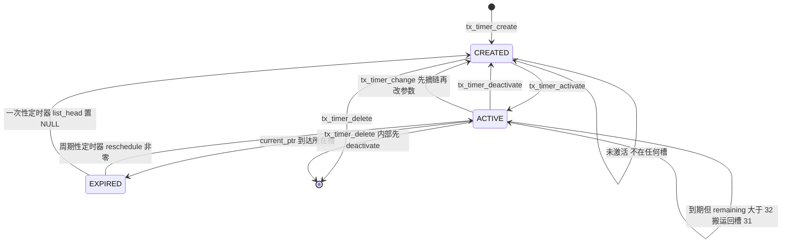
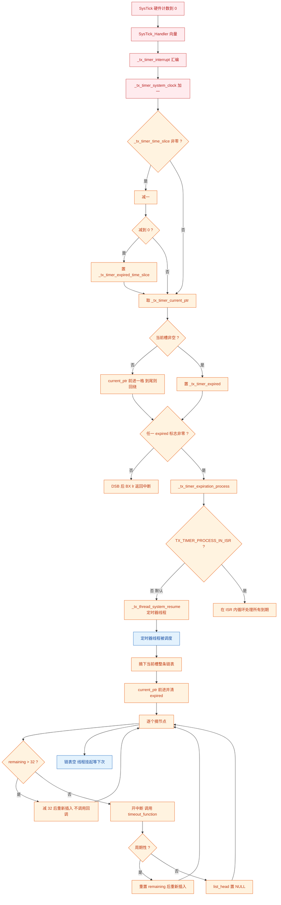
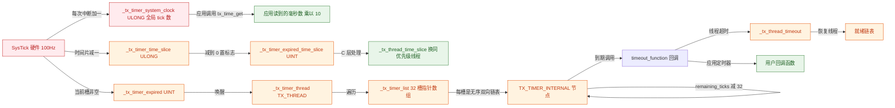

# ThreadX 源码详解 05：定时器与时间管理

> 涉及文件：
> - `common/inc/tx_api.h:326-416`（`TX_TIMER_INTERNAL` 与 `TX_TIMER`）
> - `common/inc/tx_timer.h`（207 行，`TX_TIMER_ENTRIES`、时间轮 extern）
> - `common/src/tx_timer_initialize.c`（298 行）
> - `common/src/tx_timer_system_activate.c`、`tx_timer_system_deactivate.c`
> - `common/src/tx_timer_thread_entry.c`（475 行）
> - `common/src/tx_timer_expiration_process.c`
> - `common/src/tx_timer_activate.c`、`tx_timer_change.c`、`tx_timer_deactivate.c`
> - `ports/cortex_m4/gnu/src/tx_timer_interrupt.S`（250 行）

---

## 1. 时间是怎么"流"起来的

ThreadX 里没有"时钟"这个对象，只有一条链：

```
硬件 SysTick (100Hz)
   → tick 中断 _tx_timer_interrupt (汇编)
       → _tx_timer_system_clock++          全局 tick 计数
       → 时间片减一，到零则置 _tx_timer_expired_time_slice
       → 检查当前时间槽是否有定时器到期，有则置 _tx_timer_expired
   → 若有到期：
       ├─ 默认：唤醒系统定时器线程 _tx_timer_thread
       └─ TX_TIMER_PROCESS_IN_ISR：直接在 ISR 里处理
   → 定时器线程遍历到期链表，逐个调用 timeout_function
```

三个关键设计：

1. **tick 中断只做常数工作**：一次自增、一次减法、一次指针比较。不管有多少个定时器，
   中断里都不会遍历它们。
2. **真正的处理在 C 层**：系统定时器线程（或 ISR 里的 C 函数）才遍历链表。
   这样中断关断时间与定时器数量无关。
3. **32 槽时间轮**：所有定时器按到期时间散列到 32 个槽里，插入和删除都是 O(1) 定位
   + O(槽内数量) 的链表操作。

---

## 2. `TX_TIMER_INTERNAL`：所有定时器的公共核

```c
/* common/inc/tx_api.h:339-364 */
typedef struct TX_TIMER_INTERNAL_STRUCT
{

    /* Define the remaining ticks and re-initialization tick values.  */
    ULONG               tx_timer_internal_remaining_ticks;
    ULONG               tx_timer_internal_re_initialize_ticks;

    /* Define the timeout function and timeout function parameter.  */
    VOID                (*tx_timer_internal_timeout_function)(ULONG id);
    ULONG               tx_timer_internal_timeout_param;


    /* Define the next and previous internal link pointers for active
       internal timers.  */
    struct TX_TIMER_INTERNAL_STRUCT
                        *tx_timer_internal_active_next,
                        *tx_timer_internal_active_previous;

    /* Keep track of the pointer to the head of this list as well.  */
    struct TX_TIMER_INTERNAL_STRUCT
                        **tx_timer_internal_list_head;

    /* Define optional extension to internal timer control block.  */
    TX_TIMER_INTERNAL_EXTENSION

} TX_TIMER_INTERNAL;
```

7 个字段，28 字节（32 位机）。**这个结构被两种完全不同的东西共用**：

| 使用者 | 怎么用 |
|---|---|
| 应用定时器 `TX_TIMER` | 作为 `tx_timer_internal` 字段嵌入，`timeout_function` 指向用户的回调 |
| 线程超时 | 作为 `TX_THREAD.tx_thread_timer` 字段嵌入，`timeout_function` 固定指向 `_tx_thread_timeout` |

线程的睡眠、信号量等待超时、队列接收超时——**全都靠这个内嵌的定时器**。
一个线程控制块里恒定带着 28 字节的定时器开销，哪怕这个线程从不用超时。

`tx_timer_internal_list_head` 是一个**指向指针的指针**，指向"装着我的那个槽的头指针"。
它的用途是让"从链表中删除自己"变成 O(1)：不用从头遍历找前驱，直接
`*list_head = next` 就能把链表头改掉（如果自己是头），或者配合 `active_previous` 改前驱的 next。

---

## 3. 32 槽时间轮

### 3.1 数据结构

```c
/* common/inc/tx_timer.h:49 */
#define TX_TIMER_ENTRIES                        ((ULONG) 32)
```

```c
/* common/inc/tx_timer.h:95 */
TIMER_DECLARE TX_TIMER_INTERNAL *_tx_timer_list[TX_TIMER_ENTRIES];
```

32 个槽，每个槽是一个**无序双向循环链表**的头指针。加上三个游标：

```c
/* common/inc/tx_timer.h:101-103 */
TIMER_DECLARE TX_TIMER_INTERNAL **_tx_timer_list_start;
TIMER_DECLARE TX_TIMER_INTERNAL **_tx_timer_list_end;
```

```c
/* common/inc/tx_timer.h:107 */
TIMER_DECLARE TX_TIMER_INTERNAL **_tx_timer_current_ptr;
```

`_tx_timer_current_ptr` 指向"当前正在处理的槽"。**tick 中断每来一次，它前进一格**
（在汇编里就是 `ADD r0, r0, #4`，见 `tx_timer_interrupt.S:151`）。

### 3.2 插入：算偏移，取模，挂链

```c
/* common/src/tx_timer_system_activate.c:98-120 */
                /* Calculate the amount of time remaining for the timer.  */
                if (remaining_ticks > TX_TIMER_ENTRIES)
                {

                    /* Set expiration time to the maximum number of entries.  */
                    expiration_time =  TX_TIMER_ENTRIES - ((ULONG) 1);
                }
                else
                {

                    /* Timer value fits in the timer entries.  */

                    /* Set the expiration time.  */
                    expiration_time =  (remaining_ticks - ((ULONG) 1));
                }

                /* At this point, we are ready to put the timer on one of
                   the timer lists.  */

                /* Calculate the proper place for the timer.  */
                timer_list =  TX_TIMER_POINTER_ADD(_tx_timer_current_ptr, expiration_time);
```

```c
/* common/src/tx_timer_system_activate.c:121-127 */
                if (TX_TIMER_INDIRECT_TO_VOID_POINTER_CONVERT(timer_list) >= TX_TIMER_INDIRECT_TO_VOID_POINTER_CONVERT(_tx_timer_list_end))
                {

                    /* Wrap from the beginning of the list.  */
                    delta =  TX_TIMER_POINTER_DIF(timer_list, _tx_timer_list_end);
                    timer_list =  TX_TIMER_POINTER_ADD(_tx_timer_list_start, delta);
                }
```

三个细节：

1. **`expiration_time = remaining_ticks - 1`**。为什么减一？因为当前槽是"即将到期"的槽。
   如果要 1 tick 后到期，应该放在 `current_ptr` 本身（偏移 0），而不是下一格。
   这个 `-1` 是整个时间轮正确性的关键，写错一格会导致所有定时器统一提前/延后 1 tick。
2. **超过 32 tick 的定时器被截断到 31**。它们不会一次排到最终位置，而是每绕一圈
   （32 tick）被重新处理一次：`remaining_ticks -= TX_TIMER_ENTRIES` 后重新插入。
   所以一个 1000 tick 的定时器会被"搬运"约 31 次。这是时间轮的代价：**插入 O(1)，
   但长定时器有周期性搬运开销**。
3. **回绕用指针差算**。`timer_list` 超出 `list_end` 时，算出超出多少（`delta`），
   再加到 `list_start` 上。这比用取模运算快，且不需要编译器支持除法。

### 3.3 一个具体例子

假设 `_tx_timer_current_ptr` 指向 `&_tx_timer_list[0]`，现在要插入：

| 定时器 | remaining_ticks | expiration_time | 落在槽 |
|---|---|---|---|
| A | 1 | 0 | 0 |
| B | 5 | 4 | 4 |
| C | 32 | 31 | 31 |
| D | 33 | 31（截断） | 31 |
| E | 64 | 31（截断） | 31 |

A 和 B 是"短定时器"，直接放到位。C/D/E 都挤在槽 31，它们的 `remaining_ticks` 分别是
32/33/64。当 current_ptr 走到槽 31 时：

- C 的 `remaining_ticks == 32`，**不大于** `TX_TIMER_ENTRIES`，所以判定为到期，回调触发。
- D 的 33 > 32，重新插回（`33-32=1`），下次绕回来才到期。
- E 的 64 > 32，重新插回（`64-32=32`），再绕一圈后 32 不再大于 32，到期。

这就是"长定时器每 32 tick 被搬运一次"的具体表现。

### 3.4 tick 中断里的判断

```asm
/* ports/cortex_m4/gnu/src/tx_timer_interrupt.S:129-141 */
    LDR     r1, =_tx_timer_current_ptr              // Pickup current timer pointer address
    LDR     r0, [r1, #0]                            // Pickup current timer
    LDR     r2, [r0, #0]                            // Pickup timer list entry
    CBZ     r2, __tx_timer_no_timer                 // Is there anything in the list?
                                                    // No, just increment the timer

        /* Set expiration flag.  */
        // _tx_timer_expired =  TX_TRUE;

    LDR     r3, =_tx_timer_expired                  // Pickup expiration flag address
    MOV     r2, #1                                  // Build expired value
    STR     r2, [r3, #0]                            // Set expired flag
    B       __tx_timer_done                         // Finished timer processing
```

**只有当前槽非空才置标志**。如果槽是空的（大多数 tick 都是），直接跳到
`__tx_timer_no_timer` 做指针前进：

```asm
/* ports/cortex_m4/gnu/src/tx_timer_interrupt.S:151-169 */
    ADD     r0, r0, #4                              // Move to next timer

    LDR     r3, =_tx_timer_list_end                 // Pickup addr of timer list end
    LDR     r2, [r3]                                // Pickup list end
    CMP     r0, r2                                  // Are we at list end?
    BNE     __tx_timer_skip_wrap                    // No, skip wrap-around logic

    LDR     r3, =_tx_timer_list_start               // Pickup addr of timer list start
    LDR     r0, [r3]                                // Set current pointer to list start

__tx_timer_skip_wrap:

    STR     r0, [r1, #0]                            // Store new current timer pointer
```

注意：**槽为空时也会前进指针**。这一点很关键——如果只在有定时器时前进，
时间轮的"时间"就停住了，所有偏移计算都会失效。指针前进 = 时间流逝。

### 3.5 为什么是 32 而不是 64 或 16

`TX_TIMER_ENTRIES` 在 `tx_timer.h:49` 是 `((ULONG) 32)`，**不可配置**（不是 `#ifndef` 保护的）。
32 这个数字的选择依据：

- **2 的幂**，让"指针 + 偏移 × 4"和回绕计算都能用移位/掩码。
- **一个 `ULONG` 位图刚好覆盖**，如果将来做"非空槽位图"优化可以直接复用位图代码。
- **32 tick @ 100Hz = 320ms**。小于 320ms 的定时器一次到位，超过的按 320ms 搬运。
  这个阈值覆盖了绝大多数 RTOS 的实际定时需求（超时、轮询周期、去抖）。
- **32 个指针对 = 128 字节**，在 2KB 内核的时代是可接受的固定开销。

---

## 4. 系统定时器线程

### 4.1 诞生

```c
/* common/src/tx_timer_initialize.c:250-255 */
        status =  _tx_thread_create(&_tx_timer_thread,
                                    TX_CONST_CHAR_TO_CHAR_POINTER_CONVERT("System Timer Thread"),
                                    _tx_timer_thread_entry,
                                    ((ULONG) TX_TIMER_ID),
                                    _tx_timer_stack_start, _tx_timer_stack_size,
                                    _tx_timer_priority, _tx_timer_priority, TX_NO_TIME_SLICE, TX_DONT_START);
```

优先级 0（最高）、栈 1024 字节（`tx_port.h`）、无时间片、不自动启动。
它是系统里**唯一一个由内核自己创建的线程**——应用不需要（也不应该）创建它。

### 4.2 主循环

```c
/* common/src/tx_timer_thread_entry.c:100-132 */
        while (TX_LOOP_FOREVER)
        {

            /* First, move the current list pointer and clear the timer
               expired value.  This allows the interrupt handling portion
               to continue looking for timer expirations.  */
            TX_DISABLE

            /* Save the current timer expiration list pointer.  */
            expired_timers =  *_tx_timer_current_ptr;

            /* Modify the head pointer in the first timer in the list, if there
               is one!  */
            if (expired_timers != TX_NULL)
            {

                expired_timers -> tx_timer_internal_list_head =  &expired_timers;
            }

            /* Set the current list pointer to NULL.  */
            *_tx_timer_current_ptr =  TX_NULL;

            /* Move the current pointer up one timer entry wrap if we get to
               the end of the list.  */
            _tx_timer_current_ptr =  TX_TIMER_POINTER_ADD(_tx_timer_current_ptr, 1);
            if (_tx_timer_current_ptr == _tx_timer_list_end)
            {

                _tx_timer_current_ptr =  _tx_timer_list_start;
            }

            /* Clear the expired flag.  */
            _tx_timer_expired =  TX_FALSE;
```

这段的关键是"**摘链 + 前移 + 清标志**"三连，而且全在关中断下完成。
它的效果是：把"当前槽里的所有定时器"原子地摘下来，然后**立刻**把时间轮推进一格。

为什么要立刻推进？因为如果不推进，在遍历 `expired_timers` 期间到来的新 tick
会看到同一个槽，导致重复处理。推进之后，新 tick 的 `current_ptr` 已经指向下一格，
与手上的 `expired_timers` 完全解耦。

### 4.3 遍历与回调

```c
/* common/src/tx_timer_thread_entry.c:289-300 */
                /* Set pointer to indicate the expired timer that is currently being processed.  */
                _tx_timer_expired_timer_ptr =  current_timer;

                /* Restore interrupts for timer expiration call.  */
                TX_RESTORE

                /* Call the timer-expiration function, if non-NULL.  */
                if (timeout_function != TX_NULL)
                {

                    (timeout_function) (timeout_param);
                }
```

**回调是在开中断状态下调用的**。这意味着：

- 回调里可以调任何 ThreadX API（包括会阻塞的）；
- 回调可能被中断打断，包括被打断后触发另一个定时器；
- 回调执行时间会**直接延迟同一槽里的后续定时器**。

如果同一个槽里有 10 个定时器，每个回调 1ms，最后一个会比预期晚 9ms。
这是"单定时器线程"架构的固有代价。要避免就让回调尽可能短，或者把工作丢给别的线程。

### 4.4 回绕与重新激活

```c
/* common/src/tx_timer_thread_entry.c:184-215 */
                if (current_timer -> tx_timer_internal_remaining_ticks > TX_TIMER_ENTRIES)
                {

                    /* Timer is bigger than the timer entries and must be
                       rescheduled.  */
...
                    /* Decrement the remaining ticks of the timer.  */
                    current_timer -> tx_timer_internal_remaining_ticks =
                            current_timer -> tx_timer_internal_remaining_ticks - TX_TIMER_ENTRIES;

                    /* Set the timeout function to NULL in order to bypass the
                       expiration.  */
                    timeout_function =  TX_NULL;
```

长定时器被搬运时**不调用回调**（`timeout_function = TX_NULL`），只是重新插回槽 31。
这保证了 1000 tick 的定时器只在第 1000 个 tick 触发一次，而不是每 32 tick 触发一次。

周期性定时器（`reschedule_ticks != 0`）在到期后会把 `remaining_ticks` 重置为
`re_initialize_ticks` 并重新插入（`tx_timer_thread_entry.c:264`），所以它们会一直循环。

### 4.5 `TX_TIMER_PROCESS_IN_ISR`：省掉线程的选项

定义这个宏后，`_tx_timer_thread_entry` 的整个循环被搬进
`_tx_timer_expiration_process()`，在 tick 中断的**最外层**执行。

```c
/* common/src/tx_timer_expiration_process.c:117-127 */
#ifdef TX_NOT_INTERRUPTABLE

    /* Resume the thread!  */
    _tx_thread_system_ni_resume(&_tx_timer_thread);

    /* Restore interrupts.  */
    TX_RESTORE
#else

    /* Increment the preempt disable flag.  */
    _tx_thread_preempt_disable++;

    /* Restore interrupts.  */
    TX_RESTORE

    /* Call the system resume function to activate the timer thread.  */
    _tx_thread_system_resume(&_tx_timer_thread);
#endif
```

| | 默认（定时器线程） | `TX_TIMER_PROCESS_IN_ISR` |
|---|---|---|
| RAM 开销 | 1024 字节栈 + 200 字节 TCB | 0 |
| 中断关断时间 | 短（只置标志） | **长**（遍历所有到期定时器） |
| 回调上下文 | 线程上下文 | ISR 上下文 |
| 回调里能阻塞吗 | 能 | **不能**（在 ISR 里） |
| 回调里的优先级 | 定时器线程优先级 0 | 当前中断优先级 |
| 适用场景 | 通用 | 极度缺 RAM、且回调都是纯计算 |

`tx_api.h:2121-2122` 有一个 `#error` 保护：

```c
#ifdef TX_TIMER_PROCESS_IN_ISR
#error "TX_TIMER_PROCESS_IN_ISR must not be defined."
#endif
```

等等——这个 `#error` 在 `tx_api.h` 里，而 `TX_TIMER_PROCESS_IN_ISR` 在 `tx_port.h` 里是正常选项。
原因：`tx_api.h` 的这段检查只在 **`TX_SOURCE_CODE` 未定义**（即应用代码）时生效，
它想说的是"应用不应该自己定义这个宏，必须在 `tx_user.h` 或编译选项里定义"。
这是 ThreadX 用 `#error` 做"配置入口约束"的一个例子。

---

## 5. 应用定时器 vs 线程超时

两者共用 `TX_TIMER_INTERNAL`，但语义完全不同：

| | 应用定时器 `TX_TIMER` | 线程超时（内嵌定时器） |
|---|---|---|
| 控制块 | 独立的 `TX_TIMER` 变量 | `TX_THREAD.tx_thread_timer` |
| 创建方式 | `tx_timer_create(...)` | 隐式，`tx_thread_create` 时初始化 |
| 回调 | 用户函数 | 固定 `_tx_thread_timeout` |
| 回调参数 | 用户指定 `expiration_input` | 线程控制块指针 |
| 一次性/周期性 | 都可（`reschedule_ticks`） | 一次性 |
| 激活方式 | `tx_timer_activate` | 各 API 的 `wait_option` |
| 可查询 | `tx_timer_info_get` | 不可单独查询 |

线程超时的激活发生在 `_tx_thread_system_suspend`：

```c
/* common/src/tx_thread_system_suspend.c:124-141 */
    if (thread_ptr == current_thread)
    {

        /* Pickup the wait option.  */
        timeout =  thread_ptr -> tx_thread_timer.tx_timer_internal_remaining_ticks;

        /* Determine if an activation is needed.  */
        if (timeout != TX_NO_WAIT)
        {

            /* Make sure the suspension is not a wait-forever.  */
            if (timeout != TX_WAIT_FOREVER)
            {

                /* Activate the thread timer with the timeout value setup in the caller.  */
                _tx_timer_system_activate(&(thread_ptr -> tx_thread_timer));
            }
        }
```

三个分支对应三种 `wait_option`：

- `TX_NO_WAIT`（0）：不挂起，不激活定时器；
- `TX_WAIT_FOREVER`（0xFFFFFFFF）：挂起但不激活定时器——**永远不会超时**；
- 其他值：挂起并激活定时器，N tick 后 `_tx_thread_timeout` 被调用。

`_tx_thread_timeout` 做的事很简单：把线程从挂起链摘掉、设 `tx_thread_suspend_status = TX_NO_INSTANCE`
（或其他超时码）、调 `_tx_thread_system_resume`。**它不区分是队列超时还是信号量超时**——
因为挂起时 `tx_thread_suspend_cleanup` 已经存好了对应的清理函数。

---

## 6. 状态机：一个定时器的一生



“CREATED”不是 ThreadX 的状态值（`TX_TIMER` 没有 state 字段），而是"不在任何槽里"这个
可观测状态的描述。判断方法：`timer_ptr->tx_timer_internal.tx_timer_internal_list_head == TX_NULL`
就是"未激活"。

---

## 7. 执行流：一次 tick 的完整路径



---

## 8. 数据流：tick 与超时信息的载体



---

## 9. 量化：tick、精度与开销

### 9.1 默认时间基准

```c
/* common/inc/tx_api.h:271-273 */
#ifndef TX_TIMER_TICKS_PER_SECOND
#define TX_TIMER_TICKS_PER_SECOND       (100UL)
#endif
```

100Hz → **1 tick = 10ms**。这决定了一切时间相关的精度：

| 操作 | 实际时间 | 误差 |
|---|---|---|
| `tx_thread_sleep(1)` | 0~10ms | 取决于调用时距下一个 tick 的相位 |
| `tx_thread_sleep(100)` | 1000ms ± 10ms | 累积误差不累积（每次都重新排槽） |
| `tx_semaphore_get(s, 50)` | 500ms ± 10ms | 同上 |
| 应用定时器 100 tick | 1000ms ± 10ms | 同上 |

**最坏情况延迟 = 1 tick**，因为定时器是在"槽到达"时触发的，不是"精确时刻"。
一个 1 tick 的定时器如果刚好在 tick 中断前 1 微秒插入，会等到下一个 tick——延迟接近 10ms。

### 9.2 想要更高精度怎么办

| 方案 | 做法 | 代价 |
|---|---|---|
| 提高 tick 频率 | 改 `SYSTICK_CYCLES` + `TX_TIMER_TICKS_PER_SECOND` | 中断频率上升，CPU 开销线性增长 |
| 用硬件定时器 | 独立 TIM 外设 + 自己的 ISR | 不经过 ThreadX 定时器，需要自己管理 |
| 用 DWT 周期计数 | `DWT->CYCCNT` 做微秒级延时 | 忙等，不能睡眠 |

**不要**为了 1ms 精度把 tick 提到 1000Hz 而不评估开销：每次 tick 中断在 Cortex-M4 @168MHz
上约 1~2 微秒（含上下文保存），1000Hz 意味着 0.1%~0.2% 的 CPU 被 tick 吃掉。
如果系统有 20 个定时器，加上线程唤醒的开销，实际可能到 1%。

### 9.3 定时器数量对开销的影响

| 场景 | tick 中断开销 | 定时器线程开销 |
|---|---|---|
| 0 个定时器 | 常数（自增 + 比较 + 指针前移） | 0（线程一直挂起） |
| 5 个短定时器 | 常数（只在到期 tick 置标志） | 5 次回调 |
| 100 个长定时器 | 常数 | 每 32 tick 搬运约 100 次 |

**中断开销与定时器数量无关**，这是 ThreadX 时间轮设计的核心收益。
但**定时器线程的开销与定时器数量线性相关**，且长定时器会被反复搬运。
如果系统有大量长周期定时器（比如 10 秒的心跳），考虑合并成一个定时器 + 软件计数。

### 9.4 RAM 开销

| 项 | 字节数（32 位） |
|---|---|
| `_tx_timer_list[32]` | 128 |
| `TX_TIMER_INTERNAL`（每个定时器/线程） | 28 |
| `TX_TIMER` 控制块（应用定时器） | 约 44 |
| 系统定时器线程栈 | 1024（`tx_port.h`） |
| 系统定时器线程 TCB | 约 180 |

一个 10 线程 + 5 应用定时器的系统：`10×28 + 5×44 + 128 + 1024 + 180 ≈ 1832` 字节。
如果 RAM 紧张，`TX_TIMER_PROCESS_IN_ISR` 能省掉 1204 字节，但换来更长的中断关断时间。

---

## 10. 陷阱与实测建议

**陷阱 1：`tx_thread_sleep(1)` 以为是 1ms。**
是 10ms（默认 100Hz）。而且因为相位关系，实际睡眠 0~10ms 之间任意值。
用它做"短延时"会导致时序完全不可预测。

**陷阱 2：应用定时器回调里做长操作。**
回调在**定时器线程**里执行，优先级 0（最高）。一个 5ms 的回调会阻塞**所有**其他线程
5ms，包括本应在 1ms 时跑的高优先级线程。回调必须是"置标志/发队列"级别的短操作。

**陷阱 3：`tx_timer_change` 之后忘了 `tx_timer_activate`。**
`tx_timer_change` 只是改 `remaining_ticks` 和 `re_initialize_ticks` 字段，
**不会**自动重新插入时间轮。改完必须显式 activate，否则定时器永远不会触发。

**陷阱 4：周期性定时器的 `reschedule_ticks` 设成 0。**
`tx_timer_create(t, "t", cb, 0, 100, 0, TX_AUTO_ACTIVATE)` 里第 6 个参数是
`reschedule_ticks`。设 0 表示"一次性"，触发一次后就不再激活。
要做周期定时器必须传非零值（通常与 `initial_ticks` 相同）。

**陷阱 5：`TX_TIMER_PROCESS_IN_ISR` 下在回调里调阻塞 API。**
此时回调在 ISR 上下文，`tx_thread_sleep`、`tx_semaphore_get(..., TX_WAIT_FOREVER)`
都会返回错误（`TX_WAIT_ERROR` 或 `TX_CALLER_ERROR`）。更糟的是如果没检查返回值，
代码会"看起来跑了但实际什么都没做"。

**陷阱 6：修改 `_tx_timer_system_clock` 做时间校准。**
这个变量是 `volatile ULONG`，在 tick 中断里自增。如果在应用里写它，
下一次 tick 会从你写的值继续加，但**已经在时间轮里的定时器不会跟着调整**——
它们的到期时刻是基于"插入时的 current_ptr 偏移"，不是绝对时钟。
结果是校准后所有定时器的触发时间都乱了。要做时间同步必须重新 activate 所有定时器。

**实测建议：** 用 `tx_time_get()` 在 tick 中断前后打点，测出"从 tick 到定时器线程真正
处理"的延迟。正常应该在 10~30 微秒（Cortex-M4 @168MHz）。
如果超过 100 微秒，检查是否有人把定时器线程优先级调低了，或者有更高优先级的
中断长时间占用 CPU。

---

## 11. 读码路径小结

```
tx_timer.h:49                     TX_TIMER_ENTRIES = 32
tx_api.h:339-364                  TX_TIMER_INTERNAL 七字段
tx_timer_initialize.c:197-232     清 32 槽 + 三个游标
tx_timer_initialize.c:250-255     创建系统定时器线程（DONT_START）
tx_timer_system_activate.c:98-127 插入算法（-1 与截断）
tx_timer_interrupt.S:88-119       tick 自增与时间片
tx_timer_interrupt.S:129-169      当前槽判断与指针前进
tx_timer_expiration_process.c:117 唤醒定时器线程
tx_timer_thread_entry.c:100-132   摘链 + 前移 + 清标志
tx_timer_thread_entry.c:184-215   长定时器搬运（不回调）
tx_timer_thread_entry.c:289-300   开中断调用回调
tx_thread_system_suspend.c:124-141 线程超时的三种分支
```

上一篇：[04-通信机制.md](04-通信机制.md) ｜ 下一篇：[06-中断与移植层.md](06-中断与移植层.md)
