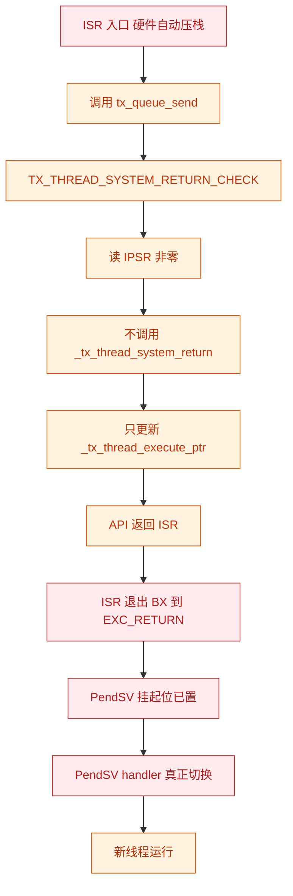
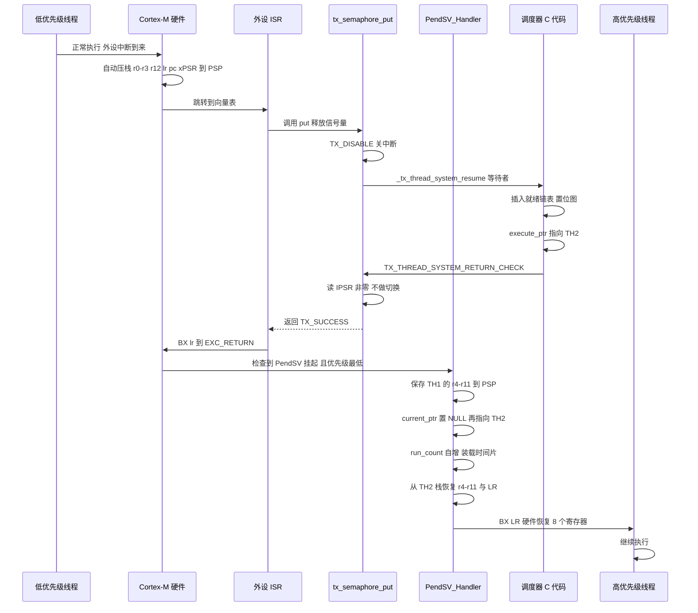

# ThreadX 源码详解 06：中断与移植层

> 涉及文件（以 `ports/cortex_m4/gnu/` 为例，Cortex-M7 同构）：
> - `src/tx_thread_schedule.S`（339 行）—— **含 PendSV handler**，整个移植层的心脏
> - `src/tx_thread_stack_build.S`（131 行）—— 造假中断帧
> - `src/tx_thread_context_save.S`（88 行）、`tx_thread_context_restore.S`（85 行）—— **空壳**
> - `src/tx_timer_interrupt.S`（250 行）—— tick 中断
> - `src/tx_thread_system_return.S`（97 行）—— 置 PendSV
> - `src/tx_thread_interrupt_control.S` / `interrupt_disable.S` / `interrupt_restore.S`
> - `example_build/tx_initialize_low_level.S`（218 行）—— 向量与优先级
> - `inc/tx_port.h`（717 行）—— 临界区宏、内联优化、`TX_THREAD_GET_SYSTEM_STATE`

---

## 1. 先破除一个误解：Cortex-M 上没有"上下文保存函数"

打开 `tx_thread_context_save.S`，全部内容是一条 `BX lr`：

```asm
/* ports/cortex_m4/gnu/src/tx_thread_context_save.S:76-87 */
_tx_thread_context_save:

#if (defined(TX_ENABLE_EXECUTION_CHANGE_NOTIFY) || defined(TX_EXECUTION_PROFILE_ENABLE))
    /* Call the ISR enter function to indicate an ISR is starting.  */
    PUSH    {r0, lr}                                // Save return address
    BL      _tx_execution_isr_enter                 // Call the ISR enter function
    POP     {r0, lr}                                // Recover return address
#endif

    /* Context is already saved - just return.  */

    BX      lr
```

`tx_thread_context_restore.S:75-85` 同样。文件头的英文注释写得很直白：

```
/*    This function is only needed for legacy applications and it should  */
/*    not be called in any new development on a Cortex-M.                 */
```

原因：**ARMv7-M 的异常进入是硬件自动压栈的**。当 ISR 被触发，处理器自动把
`r0-r3, r12, lr, pc, xPSR` 八个寄存器压到当前栈（PSP 或 MSP），并把 `lr` 设成
`EXC_RETURN`（`0xFFFFFFF9` 表示回线程用 MSP，`0xFFFFFFFD` 表示回线程用 PSP）。
软件只需要补存 `r4-r11`——而这一步发生在 **PendSV** 里，不在 ISR 入口。

这是 ThreadX Cortex-M port 与 ARM7/ARM9 port 最大的结构差异：

| | ARM7/ARM9（旧架构） | Cortex-M（ARMv7-M） |
|---|---|---|
| 中断入口保存 | 软件：`_tx_thread_context_save` 手动压全部寄存器 | **硬件自动**压 8 个 |
| 软件补存 | 无（全存了） | 只补 `r4-r11`（+ `s16-s31`） |
| ISR 退出 | 软件判断是否要切换 | 硬件按 `EXC_RETURN` 返回，PendSV 决定切不切 |
| 中断嵌套计数 | 每次进 ISR 手动 +1 | **不用计数**，读 `IPSR` 即可 |

"不用中断嵌套计数"这一条尤其重要，下一节展开。

---

## 2. `TX_THREAD_GET_SYSTEM_STATE` 的 IPSR 技巧

通用版（`tx_thread.h:117`）：

```c
#define TX_THREAD_SYSTEM_RETURN_CHECK(c)    (c) = (ULONG) _tx_thread_preempt_disable; (c) = (c) | TX_THREAD_GET_SYSTEM_STATE();
```

它要判断"现在能不能切换线程"，条件是：不在中断里、不在初始化里、没有被内部禁用抢占。
`TX_THREAD_GET_SYSTEM_STATE()` 在通用实现里就是读 `_tx_thread_system_state`，
而这个变量由 `_tx_thread_context_save/restore` 在每次 ISR 进出时加减。

Cortex-M 的 port 把这两个宏**都换掉了**：

```c
/* ports/cortex_m4/gnu/inc/tx_port.h:478 */
#define TX_THREAD_GET_SYSTEM_STATE()        (_tx_thread_system_state | __get_ipsr_value())
```

```c
/* ports/cortex_m4/gnu/inc/tx_port.h:493-500 */
/* Define the check for whether or not to call the _tx_thread_system_return function.  A non-zero value
   indicates that _tx_thread_system_return should not be called. This overrides the definition in tx_thread.h
   for Cortex-M since so we don't waste time checking the _tx_thread_system_state variable that is always
   zero after initialization for Cortex-M ports. */

#ifndef TX_THREAD_SYSTEM_RETURN_CHECK
#define TX_THREAD_SYSTEM_RETURN_CHECK(c)    (c) = ((ULONG) _tx_thread_preempt_disable);
#endif
```

两个改动的效果：

1. `TX_THREAD_GET_SYSTEM_STATE()` 把 `IPSR` **按位或**进来。`IPSR` 是"当前异常号"，
   在线程模式是 0，在任何 ISR 里非 0。于是"是否在中断里"这个判断变成**读一个特殊寄存器**，
   不需要维护计数器，也不需要 `context_save/restore`。
2. `TX_THREAD_SYSTEM_RETURN_CHECK` 干脆**只看 `_tx_thread_preempt_disable`**。
   因为 Cortex-M 上 `_tx_thread_system_state` 在初始化完成后恒为 0（IPSR 已经覆盖了 ISR 判断），
   再 OR 它进来是浪费。

这就是"零成本的 ISR 检测"。代价是 `_tx_thread_system_state` 在 Cortex-M 上
**不再表示中断嵌套深度**，只在初始化阶段有值。如果你在应用里读它来做诊断，
会得到错误结论——应该读 `IPSR`（`__get_IPSR()`）。

### 2.1 一个直接的后果：ISR 里可以调任何 API



注意 `EXIT` 到 `PSV` 这一步是**硬件自动**的：ISR 末尾的 `BX lr`（`lr` 是 `EXC_RETURN`）
让处理器检查是否有挂起的异常。PendSV 优先级最低，所以它一定最后执行。

---

## 3. PendSV handler：唯一的上下文切换点

### 3.1 入口与两个全局指针

```asm
/* ports/cortex_m7/gnu/src/tx_thread_schedule.S:117-123 */
    .global  PendSV_Handler
    .global  __tx_PendSVHandler
    .syntax unified
    .thumb_func
PendSV_Handler:
    .thumb_func
__tx_PendSVHandler:
```

两个符号指向同一地址：`PendSV_Handler` 是 CMSIS 标准名（启动文件的向量表用它），
`__tx_PendSVHandler` 是 ThreadX 内部名（`tx_initialize_low_level.S` 的向量表用它）。
同时导出两个是为了兼容不同厂商的启动文件。

```asm
/* ports/cortex_m7/gnu/src/tx_thread_schedule.S:148-155 */
    LDR     r0, =_tx_thread_current_ptr             // Build current thread pointer address
    LDR     r2, =_tx_thread_execute_ptr             // Build execute thread pointer address
    MOV     r3, #0                                  // Build NULL value
    LDR     r1, [r0]                                // Pickup current thread pointer

    /* Determine if there is a current thread to finish preserving.  */

    CBZ     r1, __tx_ts_new                         // If NULL, skip preservation
```

`_tx_thread_current_ptr` 为 NULL 有两种情况：**第一次调度**（系统刚启动），
或者**刚从 idle 状态被唤醒**。两种情况都不需要保存任何东西。

### 3.2 保存：PSP + r4-r11 + 可选 VFP

```asm
/* ports/cortex_m7/gnu/src/tx_thread_schedule.S:159-175 */
    STR     r3, [r0]                                // Set _tx_thread_current_ptr to NULL
    MRS     r12, PSP                                // Pickup PSP pointer (thread's stack pointer)
    STMDB   r12!, {r4-r11}                          // Save its remaining registers
#ifdef __ARM_FP
    TST     LR, #0x10                               // Determine if the VFP extended frame is present
    BNE     _skip_vfp_save
    VSTMDB  r12!,{s16-s31}                          // Yes, save additional VFP registers
_skip_vfp_save:
#endif
```

三个动作：

1. `STR r3, [r0]` **先把 `current_ptr` 置 NULL**，再开始保存。这是个防御性顺序：
   如果保存过程中来了 NMI（不可屏蔽中断）并调用了 ThreadX API，它会看到
   `current_ptr == NULL`，走"没有当前线程"的路径，而不是操作一个正在被改写的 TCB。
2. `MRS r12, PSP` 取线程栈指针。注意此时 PSP 指向的是**硬件已经压好的 8 个寄存器之上**
   （栈向低地址增长，硬件压栈后 PSP 减了 32）。
3. `STMDB r12!, {r4-r11}` 再压 32 字节，PSP 又减 32。

最终 `r12` 指向"完整上下文的最底部"，这个值会被存进 `tx_thread_stack_ptr`。

VFP 的判断：

```asm
    TST     LR, #0x10
```

`LR` 此时是 `EXC_RETURN`。bit4 = 0 表示"使用了扩展帧"（FPU 处于 active 状态，
硬件额外压了 `s0-s15` 和 `FPSCR`），此时需要再保存 `s16-s31`（callee-saved 的浮点寄存器）。
bit4 = 1 表示标准帧，跳过。**这个判断让不用浮点的线程完全不为 FPU 付代价**。

### 3.3 时间片的保存

```asm
/* ports/cortex_m7/gnu/src/tx_thread_schedule.S:168-183 */
    LDR     r4, =_tx_timer_time_slice               // Build address of time-slice variable
    STMDB   r12!, {LR}                              // Save LR on the stack

    /* Determine if time-slice is active. If it isn't, skip time handling processing.  */

    LDR     r5, [r4]                                // Pickup current time-slice
    STR     r12, [r1, #8]                           // Save the thread stack pointer
    CBZ     r5, __tx_ts_new                         // If not active, skip processing

    /* Time-slice is active, save the current thread's time-slice and clear the global time-slice variable.  */

    STR     r5, [r1, #24]                           // Save current time-slice

    /* Clear the global time-slice.  */

    STR     r3, [r4]                                // Clear time-slice
```

注意 `STMDB r12!, {LR}` 在 `STR r12, [r1, #8]` **之前**——所以 `stack_ptr` 指向的是
"含 LR 的完整帧"的底部。这个顺序不能反：先存 LR 再更新指针，否则恢复时会漏掉 LR。

### 3.4 选择新线程

```asm
/* ports/cortex_m7/gnu/src/tx_thread_schedule.S:191-208 */
#ifdef TX_PORT_USE_BASEPRI
    LDR     r1, =TX_PORT_BASEPRI                    // Mask interrupt priorities =< TX_PORT_BASEPRI
    MSR     BASEPRI, r1
#else
    CPSID   i                                       // Disable interrupts
#endif
    LDR     r1, [r2]                                // Is there another thread ready to execute?
    CBZ     r1, __tx_ts_wait                        // No, skip to the wait processing

    /* Yes, another thread is ready for else, make the current thread the new thread.  */

    STR     r1, [r0]                                // Setup the current thread pointer to the new thread
```

这里**没有做优先级选择**——选择已经在 C 层做完了（`_tx_thread_system_resume` 把
`_tx_thread_execute_ptr` 指到正确的线程）。汇编只负责"把人换上去"。
这个分工是 ThreadX 性能的关键：选择逻辑可以用 C 写（易维护、可移植），
汇编只做寄存器搬运（最短路径）。

### 3.5 恢复

```asm
/* ports/cortex_m7/gnu/src/tx_thread_schedule.S:212-245 */
__tx_ts_restore:
    LDR     r7, [r1, #4]                            // Pickup the current thread run count
    LDR     r4, =_tx_timer_time_slice               // Build address of time-slice variable
    LDR     r5, [r1, #24]                           // Pickup thread's current time-slice
    ADD     r7, r7, #1                              // Increment the thread run count
    STR     r7, [r1, #4]                            // Store the new run count

    /* Setup global time-slice with thread's current time-slice.  */

    STR     r5, [r4]                                // Setup global time-slice
```

```asm
    LDR     r12, [r1, #8]                           // Pickup thread's stack pointer
    LDMIA   r12!, {LR}                              // Pickup LR
#ifdef __ARM_FP
    TST     LR, #0x10                               // Determine if the VFP extended frame is present
    BNE     _skip_vfp_restore                       // If not, skip VFP restore
    VLDMIA  r12!, {s16-s31}                         // Yes, restore additional VFP registers
_skip_vfp_restore:
#endif
    LDMIA   r12!, {r4-r11}                          // Recover thread's registers
    MSR     PSP, r12                                // Setup the thread's stack pointer

    /* Return to thread.  */

    BX      lr                                      // Return to thread!
```

`BX lr` 里的 `lr` 是刚从栈里弹出的值。对普通线程这是 `0xFFFFFFFD`，
处理器据此知道"返回线程模式、用 PSP、恢复硬件压的 8 个寄存器"。

### 3.6 没有线程可跑时：WFI 空转

```asm
/* ports/cortex_m7/gnu/src/tx_thread_schedule.S:251-296 */
__tx_ts_wait:
#ifdef TX_PORT_USE_BASEPRI
    LDR     r1, =TX_PORT_BASEPRI                    // Mask interrupt priorities =< TX_PORT_BASEPRI
    MSR     BASEPRI, r1
#else
    CPSID   i                                       // Disable interrupts
#endif
    LDR     r1, [r2]                                // Pickup the next thread to execute pointer
    STR     r1, [r0]                                // Store it in the current pointer
    CBNZ    r1, __tx_ts_ready                       // If non-NULL, a new thread is ready!
```

```asm
#ifdef TX_ENABLE_WFI
#ifdef TX_PORT_USE_BASEPRI
    CPSID   i                                       // Mask every interrupt with PRIMASK, which WFI ignores
    MOV     r1, #0                                  // Clear BASEPRI so that an interrupt masked by it
    MSR     BASEPRI, r1                             //   is still able to wake the processor
#endif
    DSB                                             // Ensure no outstanding memory transactions
    WFI                                             // Wait for interrupt
    ISB                                             // Ensure pipeline is flushed
```

这段是 idle 的核心：**关中断 → 检查 → WFI → 循环**。
`_tx_thread_current_ptr` 在这期间是 NULL，所以任何 ISR 里的 ThreadX API 都会走
"没有当前线程"的分支，只更新 `execute_ptr`。

`TX_ENABLE_WFI` 打开时用 `WFI` 让 CPU 进低功耗。注意 BASEPRI 那段：
**WFI 不能被 BASEPRI 屏蔽的中断唤醒**（BASEPRI 只是"不响应"，不是"不挂起"），
所以要用 `CPSID i`（PRIMASK）临时屏蔽，把 BASEPRI 清零，等中断进来后再恢复——
这样既保证 WFI 能醒，又保证醒来后中断不会在切换过程中被响应。

### 3.7 清除多余的 PendSV

```asm
/* ports/cortex_m7/gnu/src/tx_thread_schedule.S:301-313 */
__tx_ts_ready:
    MOV     r7, #0x08000000                         // Build clear PendSV value
    MOV     r8, #0xE000E000                         // Build base NVIC address
    STR     r7, [r8, #0xD04]                        // Clear any PendSV

    /* Re-enable interrupts and restore new thread.  */
#ifdef TX_PORT_USE_BASEPRI
    MOV     r4, #0                                  // Disable BASEPRI masking (enable interrupts)
    MSR     BASEPRI, r4
#else
    CPSIE   i                                       // Enable interrupts
#endif
    B       __tx_ts_restore                         // Restore the thread
```

写 `ICSR` 的 bit27（`PENDSVCLR`）清除挂起的 PendSV。为什么需要？
在 `__tx_ts_wait` 的自旋期间，可能有多个 ISR 调用了 API 并置了 PendSV 位。
现在已经在 handler 里了，再切一次毫无意义，所以先清掉。

---

## 4. 栈帧布局：68 字节从哪来

```asm
/* ports/cortex_m4/gnu/src/tx_thread_stack_build.S:94-98 */
    LDR     r2, [r0, #16]                           // Pickup end of stack area
    BIC     r2, r2, #0x7                            // Align frame for 8-byte alignment
    SUB     r2, r2, #68                             // Subtract frame size
    LDR     r3, =0xFFFFFFFD                         // Build initial LR value
    STR     r3, [r2, #0]                            // Save on the stack
```

6 个字节的算术：`end & ~7` 后减 68。68 = 4（LR）+ 32（r4-r11）+ 32（硬件帧）。
文件里的 ASCII 图（`tx_thread_stack_build.S:70-92`）列了完整布局：

```
Stack Top:
                LR          Interrupted LR (LR at time of PENDSV)
                r4          Initial value for r4
                ...
                r11         Initial value for r11
                r0          Initial value for r0    (Hardware stack starts here!!)
                ...
                xPSR        Initial value for xPSR
Stack Bottom: (higher memory address)
```

逐项赋值：

```asm
/* ports/cortex_m4/gnu/src/tx_thread_stack_build.S:102-123 */
    MOV     r3, #0                                  // Build initial register value
    STR     r3, [r2, #4]                            // Store initial r4
    ...（r5-r11 同样置 0）
    STR     r3, [r2, #36]                           // Store initial r0
    ...（r1-r3、r12 同样置 0）
    MOV     r3, #0xFFFFFFFF                         // Poison EXC_RETURN value
    STR     r3, [r2, #56]                           // Store initial lr
    STR     r1, [r2, #60]                           // Store initial pc
    MOV     r3, #0x01000000                         // Only T-bit need be set
    STR     r3, [r2, #64]                           // Store initial xPSR
```

三个非零值：

| 偏移 | 值 | 含义 |
|---|---|---|
| +0 | `0xFFFFFFFD` | `EXC_RETURN`：返回线程模式、用 PSP、标准帧 |
| +56 | `0xFFFFFFFF` | 初始 `lr` 的"毒值"。线程函数返回时如果直接 `BX lr` 会 HardFault，方便定位"忘了 return 到 shell" |
| +60 | `shell_entry` 地址 | 初始 `pc`，线程第一句执行的指令 |
| +64 | `0x01000000` | `xPSR` 只有 T 位（Thumb 模式）置 1，其余全 0 |

`xPSR` 的 T 位必须为 1，否则处理器进入 ARM 模式（Cortex-M 不支持），立刻 UsageFault。
这个值写错是移植时的经典错误。

**注意 `r1` 参数**：`_tx_thread_stack_build(thread_ptr, function_ptr)` 的 `function_ptr`
在 `r1` 里，直接存进 `pc` 位置。所以函数签名和汇编的寄存器约定必须严格对应。

---

## 5. 中断优先级：为什么这么配

```asm
/* ports/cortex_m4/gnu/example_build/tx_initialize_low_level.S:124-133 */
    LDR     r1, =0x00000000                         @ Rsrv, UsgF, BusF, MemM
    STR     r1, [r0, #0xD18]                        @ Setup System Handlers 4-7 Priority Registers

    LDR     r1, =0xFF000000                         @ SVCl, Rsrv, Rsrv, Rsrv
    STR     r1, [r0, #0xD1C]                        @ Setup System Handlers 8-11 Priority Registers
                                                    @ Note: SVC must be lowest priority, which is 0xFF

    LDR     r1, =0x40FF0000                         @ SysT, PnSV, Rsrv, DbgM
    STR     r1, [r0, #0xD20]                        @ Setup System Handlers 12-15 Priority Registers
                                                    @ Note: PnSV must be lowest priority, which is 0xFF
```

| 寄存器 | 地址 | 覆盖的异常 | 值 | 含义 |
|---|---|---|---|---|
| `SHPR1` | 0xE000ED18 | MemManage / BusFault / UsageFault | 0x00000000 | 全部最高优先级（0） |
| `SHPR2` | 0xE000ED1C | SVCall | 0xFF000000 | SVC = 0xFF |
| `SHPR3` | 0xE000ED20 | SysTick / PendSV | 0x40FF0000 | SysTick = 0x40，PendSV = 0xFF |

三条规则的依据：

1. **PendSV 必须最低（0xFF）**。它是"延迟切换"机制，必须在所有 ISR 退出后执行。
   如果它比某个 ISR 优先级高，就会在中断嵌套中间切换线程，硬件栈里混入中断帧，
   `PSP` 指向错误位置，恢复时崩溃。
2. **SVC 必须最低（0xFF）**。ThreadX 不用 SVC 做系统调用（它没有系统调用门），
   但用户可能用 SVC 做别的。设成最低避免它抢占任何东西。
3. **Fault 类必须最高（0）**。HardFault/MemManage/BusFault 要能立刻打断任何代码，
   包括正在跑的 ThreadX API。如果它们被屏蔽，故障会被延迟到不可预测的时刻。

SysTick 用 0x40（中间值）是折中：既要保证 tick 及时（不能太低），
又要让外设中断能抢占它（不能是 0）。

**Cortex-M 的优先级数值越小越高**，这与"线程优先级 0 最高"一致，但和 FreeRTOS
（数值越大越高）相反。混用两个 RTOS 的经验时特别注意。

### 5.1 优先级位宽

Cortex-M4 通常实现 4 位优先级（16 级），`0x40` 右移 4 位 = 4，`0xFF` 右移 4 位 = 15。
读回 `SHPR` 时低位读作 0。如果芯片只实现 3 位（8 级），`0x40` 会变成 0x40（第 3 位被忽略），
实际优先级仍是 4。**移植时不要自己算位宽**，直接用 `NVIC_SetPriority` 或按 port 的写法。

---

## 6. 临界区：PRIMASK 还是 BASEPRI

```c
/* ports/cortex_m4/gnu/inc/tx_port.h:137-142 */
/* By default, ThreadX for Cortex-M uses the PRIMASK register to enable/disable interrupts.
If using BASEPRI is desired, define the following two symbols for both c and assembly files:
TX_PORT_USE_BASEPRI - This tells ThreadX to use BASEPRI instead of PRIMASK.
TX_PORT_BASEPRI = (priority_mask << (8 - number_priority_bits)) - this defines the maximum priority level to mask.
Any interrupt with a higher priority than priority_mask will not be masked, thus the interrupt will run.
*/
```

两种模式的实现：

```c
/* ports/cortex_m4/gnu/inc/tx_port.h:567-578 */
__attribute__( ( always_inline ) ) static inline unsigned int __disable_interrupts(void)
{
unsigned int int_posture;

    int_posture = __get_interrupt_posture();

#ifdef TX_PORT_USE_BASEPRI
    __set_basepri_value(TX_PORT_BASEPRI);
#else
    __asm__ volatile ("CPSID i" : : : "memory");
#endif
    return(int_posture);
}
```

| | PRIMASK（默认） | BASEPRI |
|---|---|---|
| 指令 | `CPSID i` / `CPSIE i` | `MSR BASEPRI, r` |
| 屏蔽范围 | **所有**可屏蔽中断 | 优先级数值 **≥** BASEPRI 的中断 |
| 能否屏蔽 NMI/HardFault | 不能 | 不能 |
| 保存/恢复 | 读 `PRIMASK` 得 0/1 | 读 `BASEPRI` 得 0~255 |
| 适用 | 简单系统、临界区短 | 需要"高优先级中断永不被延迟"的硬实时系统 |

BASEPRI 模式的价值：假设系统有一个 10kHz 的电机控制中断（优先级 0），
ThreadX 的临界区如果用 PRIMASK，会把它的响应延迟到临界区结束（可能几微秒）。
用 BASEPRI 设成 0x20，优先级 0~1 的中断**不受影响**，只有 2 以上的被屏蔽。
代价是：**内核数据结构仍然可能被高优先级 ISR 破坏**——因为那些 ISR 里如果调用了
ThreadX API，就会在临界区中间改链表。

所以用 BASEPRI 的前提是：**高于 BASEPRI 阈值的中断里不能调用 ThreadX API**。
这条约束必须写进团队规范，否则会出现极难复现的链表损坏。

### 6.1 `tx_thread_interrupt_control`：运行期切换

```asm
/* ports/cortex_m4/gnu/src/tx_thread_interrupt_control.S:66-76 */
_tx_thread_interrupt_control:
#ifdef TX_PORT_USE_BASEPRI
    MRS     r1, BASEPRI                         // Pickup current interrupt posture
    MSR     BASEPRI, r0                         // Apply the new interrupt posture
    MOV     r0, r1                              // Transfer old to return register
#else
    MRS     r1, PRIMASK                         // Pickup current interrupt lockout
    MSR     PRIMASK, r0                         // Apply the new interrupt lockout
    MOV     r0, r1                              // Transfer old to return register
#endif
    BX      lr                                  // Return to caller
```

`tx_thread_interrupt_control(new_posture)` 返回旧值，调用者负责在合适的时候恢复。
这是应用层"关中断"的唯一正确方式——不要自己写 `__disable_irq()`，因为那会绕过
ThreadX 的 `interrupt_save` 约定，嵌套时会提前开中断。

### 6.2 内联优化

```c
/* ports/cortex_m4/gnu/inc/tx_port.h:598-600 */
#define TX_INTERRUPT_SAVE_AREA                  UINT interrupt_save;
#define TX_DISABLE                              interrupt_save =  __disable_interrupts();
#define TX_RESTORE                              __restore_interrupt(interrupt_save);
```

默认（未定义 `TX_DISABLE_INLINE`）时，`TX_DISABLE`/`TX_RESTORE` 是**内联函数**，
不是对外部 `.S` 文件的调用。只有定义 `TX_DISABLE_INLINE` 才走
`_tx_thread_interrupt_disable()` / `_tx_thread_interrupt_restore()` 两个汇编函数。

同理：

```c
/* ports/cortex_m4/gnu/inc/tx_port.h:684 */
#define _tx_thread_system_return                _tx_thread_system_return_inline
```

`_tx_thread_system_return` 也被内联了（`tx_port.h:581-596` 的 `_tx_thread_system_return_inline`），
所以 `tx_thread_system_return.S` 里的版本**默认不参与编译**。
这解释了为什么你在 `.map` 文件里找不到那个符号——不是链接器优化掉了，是压根没编。

内联的收益：省掉一次函数调用（约 4~8 周期）+ 寄存器保存。在每秒几千次切换的系统里，
这是可观的。代价是**代码体积增大**：每个调用 `TX_DISABLE` 的地方都展开一份。

---

## 7. 时序图：一次中断驱动的线程切换



关键点：`API` 到 `PSV` 之间**没有直接跳转**。切换是"ISR 返回时硬件顺便做的"，
而不是 API 里调用的。这是 Cortex-M 的设计（PendSV 就是为此而生），
ThreadX 只是正确地利用了它。

---

## 8. 数据流：谁改了 PSP


---

## 9. 移植清单：新架构要提供什么

以 `ports/cortex_m4/gnu/` 为模板，一个完整 port 需要 11 个文件：

| 文件 | 必须 | 作用 |
|---|---|---|
| `tx_thread_schedule.S` | 是 | 首次调度 + PendSV handler |
| `tx_thread_stack_build.S` | 是 | 造假中断帧 |
| `tx_thread_system_return.S` | 否（可内联） | 置 PendSV |
| `tx_timer_interrupt.S` | 是（除非 `TX_NO_TIMER`） | tick 处理 |
| `tx_thread_context_save.S` | 否（Cortex-M 空壳） | 旧架构用 |
| `tx_thread_context_restore.S` | 否（Cortex-M 空壳） | 旧架构用 |
| `tx_thread_interrupt_control.S` | 否（可内联） | 改中断姿态 |
| `tx_thread_interrupt_disable.S` | 否（可内联） | 关中断 |
| `tx_thread_interrupt_restore.S` | 否（可内联） | 恢复中断 |
| `tx_initialize_low_level.S` | 是 | 向量表、SysTick、未用内存、栈指针 |
| `tx_misra.S` | 否 | MISRA 合规辅助 |
| `inc/tx_port.h` | 是 | 类型、宏、扩展点 |

`tx_port.h` 里必须定义的关键项（按重要性）：

| 宏 | 默认值（Cortex-M4） | 说明 |
|---|---|---|
| `TX_MAX_PRIORITIES` | 32 | 必须是 32 的倍数 |
| `TX_MINIMUM_STACK` | 200 | 小于此值 `tx_thread_create` 失败 |
| `TX_TIMER_THREAD_STACK_SIZE` | 1024 | 系统定时器线程栈 |
| `TX_TIMER_THREAD_PRIORITY` | 0 | 最高 |
| `TX_INT_DISABLE` / `TX_INT_ENABLE` | 1 / 0 | 关中断姿态的取值 |
| `TX_INTERRUPT_SAVE_AREA` | `UINT interrupt_save;` | 声明保存变量 |
| `TX_DISABLE` / `TX_RESTORE` | 内联函数 | 临界区 |
| `TX_THREAD_EXTENSION_0..3` | 空 | 线程控制块扩展点 |
| `TX_TIMER_EXTENSION` 等 | 空 | 其他对象扩展点 |
| `TX_LOWEST_SET_BIT_CALCULATE` | `RBIT`+`CLZ` | 位图查找加速 |
| `TX_THREAD_GET_SYSTEM_STATE` | `state OR IPSR` | ISR 检测 |

漏掉任何一个都会编译失败（因为 `tx_api.h:2106` 有 `#error "tx_port.h: TX_MAX_PRIORITIES not defined."`），
但**定义错了不会编译失败，只会在运行时出错**。这是移植最危险的地方。

---

## 10. 陷阱与实测建议

**陷阱 1：以为 `_tx_thread_context_save()` 真的保存了上下文。**
在 Cortex-M 上它是空的。如果你从别处抄了一段"在 ISR 开头调 context_save"的代码，
在 Cortex-M 上不会报错也不会有效果——因为硬件已经保存了，但 `r4-r11` 要等 PendSV 才保存。
如果你的 ISR 里用了 `r4-r11` 并期望它们被保存，会发现值被破坏。

**陷阱 2：把 PendSV 优先级设成非最低。**
症状是"偶发 HardFault，栈指针看起来乱了"。原因是 PendSV 在某个 ISR 内部执行，
硬件把中断帧压到 PSP（因为 EXC_RETURN 说是线程），但实际还在 handler 模式，
栈指针和模式不匹配。**永远用 0xFF**。

**陷阱 3：在优先级高于 `TX_PORT_BASEPRI` 的 ISR 里调 ThreadX API。**
如果用 BASEPRI 模式，这些 ISR 不会被 `TX_DISABLE` 屏蔽，它们调 API 会直接改
正在被内核修改的链表。症状是"链表随机损坏，复现率极低"。检查方法：
把所有调 ThreadX API 的 ISR 优先级都设成 ≥ BASEPRI 阈值。

**陷阱 4：忘了在启动文件里把向量指向 `PendSV_Handler` / `SysTick_Handler`。**
ThreadX 的 `tx_initialize_low_level.S` 提供了一个向量表（`__tx_vectors`），
但如果你的工程用厂商的启动文件（如 STM32 的 `startup_stm32f4xx.s`），
必须确认里面的 `PendSV_Handler` 和 `SysTick_Handler` 弱符号被 ThreadX 的强符号覆盖。
检查 `.map` 文件里这两个符号的地址是否在 ThreadX 的 `.text` 段。

**陷阱 5：`TX_ENABLE_WFI` 打开后系统"睡死"。**
如果某个中断被 BASEPRI 屏蔽且没有其他中断源，`WFI` 会永久等待。检查：
是否有周期性的 tick？tick 本身就能唤醒 WFI（SysTick 优先级 0x40，不被 BASEPRI 屏蔽）。
如果 tick 被关了（`TX_NO_TIMER`），必须保证有其他中断源。

**陷阱 6：修改 `tx_thread_stack_build.S` 的 68 字节。**
加了字段（比如保存更多寄存器）就必须同步改 `SUB r2, r2, #68` 和所有偏移量，
还要改 `tx_thread_schedule.S` 里的 `STMDB/LDMIA` 顺序。**两处必须严格对称**，
否则第一次切换就会崩。改完用 `tx_thread_stack_analyze` 验证栈使用量。

**实测建议：** 用 DWT 的 `CYCCNT` 量"从中断触发到 ISR 第一条指令"的延迟
（在 ISR 开头读 `DWT->CYCCNT`，减去在触发点写的时间戳）。
Cortex-M4 @168MHz 上正常是 12~20 周期（硬件压栈 + 向量取指）。
如果超过 50 周期，检查是否有更高优先级中断在排队，或者 flash 等待周期没配对。

---

## 11. 读码路径小结

```
tx_port.h:461-500             IPSR 技巧与 system_return_check 覆盖
tx_port.h:137-147             PRIMASK vs BASEPRI
tx_port.h:567-600             内联临界区
tx_initialize_low_level.S:91-138  四个初始化动作 + 优先级
tx_thread_stack_build.S:94-128    68 字节假帧
tx_thread_schedule.S:78-113       首次调度（自旋）
tx_thread_schedule.S:121-245      PendSV 保存/恢复
tx_thread_schedule.S:251-296      idle WFI 循环
tx_timer_interrupt.S:88-248        tick 处理全流程
tx_thread_context_save.S:76-87    空壳（重要认知）
```

上一篇：[05-定时器与时间管理.md](05-定时器与时间管理.md) ｜ 下一篇：[07-移植与调优指南.md](07-移植与调优指南.md)
