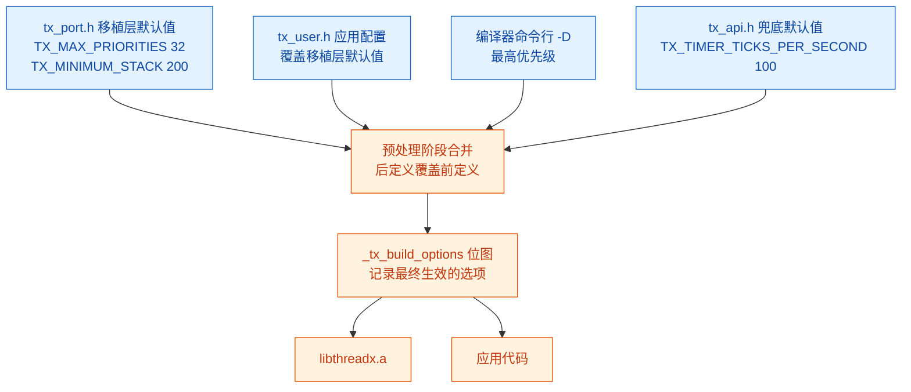
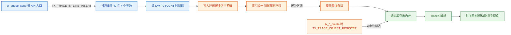

# ThreadX 源码详解 07：移植与调优指南

> 涉及文件：
> - `common/inc/tx_user_sample.h`（305 行）—— 配置模板，复制为 `tx_user.h`
> - `common/inc/tx_trace.h`（562 行）—— TraceX 事件记录格式
> - `common/inc/tx_thread.h:393-426` —— `_tx_build_options` 位定义
> - `CMakeLists.txt`（5650 字节）—— 构建入口与 `TX_USER_FILE` 机制
> - `ports/<arch>/<toolchain>/inc/tx_port.h` —— 移植默认值
> - `utility/benchmarks/`、`utility/execution_profile_kit/` —— 测量工具

---

## 1. 配置的四个层次

ThreadX 的配置不是一个文件，而是**四层叠加**：



为什么有这么多层？因为 `tx_port.h` 是移植者写的（它知道芯片有多少 RAM），
`tx_user.h` 是应用作者写的（他知道产品需求），命令行是构建系统写的（它知道这次编的是
debug 还是 release）。三者视角不同，不能合并。

### 1.1 `tx_user.h` 怎么生效

```c
/* common/inc/tx_user_sample.h:43-44 */
/*    This file contains user defines for configuring ThreadX in specific */
/*    ways. This file will have an effect only if the application and     */
/*    ThreadX library are built with TX_INCLUDE_USER_DEFINE_FILE defined. */
```

两个条件缺一不可：

1. 编译时定义 `TX_INCLUDE_USER_DEFINE_FILE`；
2. 工程里有一个叫 `tx_user.h` 的文件在 include path 上。

CMake 构建自动处理这两件事：

```cmake
# CMakeLists.txt:105-117
if (NOT TX_USER_FILE)
    set(TX_USER_FILE ${CMAKE_CURRENT_LIST_DIR}/${TX_COMMON_DIR}/inc/tx_user_sample.h)
else
    message(STATUS "Using custom tx_user.h file from ${TX_USER_FILE}")
endif()
configure_file(${TX_USER_FILE} ${CUSTOM_INC_DIR}/tx_user.h COPYONLY)
...
target_compile_definitions(${PROJECT_NAME} PUBLIC "TX_INCLUDE_USER_DEFINE_FILE" )
```

注意 `configure_file(... COPYONLY)`：它把 `tx_user_sample.h` **原样复制**成 `tx_user.h`。
所以直接改 `tx_user_sample.h` 也能生效，但那样会污染仓库（`git diff` 里会看到）。
正确做法是用 `-DTX_USER_FILE=/path/to/your/tx_user.h` 指向自己的文件。

---

## 2. 配置项分类与取舍

`tx_user_sample.h` 把配置分成五类。下面按"能省多少 / 失去什么"重新组织：

### 2.1 尺寸优化（省 Flash / RAM）

| 宏 | 默认 | 打开后节省 | 失去什么 |
|---|---|---|---|
| `TX_DISABLE_ERROR_CHECKING` | 关 | `.text` 约 10~20% | 参数校验、ID 魔数校验全没 |
| `TX_DISABLE_PREEMPTION_THRESHOLD` | 关 | 约 1~2KB + 第二套位图 128 字节 | 抢占阈值功能（`tx_thread_preemption_change` 返回错误） |
| `TX_DISABLE_NOTIFY_CALLBACKS` | 关 | 每个对象 4 字节 + 若干判断 | 队列/信号量/事件标志/线程的通知回调 |
| `TX_DISABLE_REDUNDANT_CLEARING` | 关 | 启动时几百条指令 + `.bss` 清零代码 | 依赖启动代码清 `.bss` |
| `TX_NO_FILEX_POINTER` | 关 | 每线程 4 字节 | FileX 集成 |
| `TX_TIMER_PROCESS_IN_ISR` | 关 | 1204 字节（栈+TCB） | 定时器回调不能在 ISR 里阻塞 |
| `TX_NO_TIMER` | 关 | 整个定时器组件 | 所有超时、睡眠、应用定时器 |

`TX_DISABLE_PREEMPTION_THRESHOLD` 的节省值得单独算：关掉后会少
`_tx_thread_preempted_maps[TX_MAX_PRIORITIES/32]`（4 字节）、
`_tx_thread_preempted_map_active`（4 字节），以及 `tx_thread_system_resume.c` 和
`tx_thread_system_suspend.c` 里各约 40 行条件编译代码。**代码尺寸省得比数据多**。

### 2.2 性能优化（用空间换时间）

| 宏 | 默认 | 效果 | 代价 |
|---|---|---|---|
| `TX_INLINE_THREAD_RESUME_SUSPEND` | 关 | resume/suspend 内联，省函数调用 | `.text` 增大 2~4KB |
| `TX_REACTIVATE_INLINE` | 关 | 定时器重激活内联 | `.text` 增大约 500 字节 |
| `TX_NOT_INTERRUPTABLE` | 关 | 服务内部不反复开关中断 | **中断关断时间变长** |
| `TX_ENABLE_RANDOM_NUMBER_STACK_FILLING` | 关 | 栈填充用随机值 | 需要 `TX_RAND()` 实现 |

`TX_NOT_INTERRUPTABLE` 是一个容易误判的选项。它把"关中断 → 改链表 → 开中断 → 再关"
的模式改成"一次关中断做完所有事"，代码更短、更快，但**临界区长度增加**。
在 Cortex-M 上，这会把原来 1~2 微秒的中断延迟拉到 5~10 微秒。
硬实时系统（电机控制、电源环路）不要开。

### 2.3 调试与观测

| 宏 | 默认 | 作用 | 开销 |
|---|---|---|---|
| `TX_ENABLE_STACK_CHECKING` | 关 | 每次 API 调用检查栈哨兵 `0xEF` | 每线程 8 字节 + 每次调用几十周期 |
| `TX_ENABLE_EVENT_TRACE` | 关 | 记录事件到环形缓冲区，TraceX 可视化 | 缓冲区（通常 4~32KB）+ 每次事件约 20 周期 |
| `TX_THREAD_ENABLE_PERFORMANCE_INFO` 等 | 关 | 每组件计数器 | 每对象 4~40 字节 |
| `TX_ENABLE_EXECUTION_CHANGE_NOTIFY` | 关 | 执行时间统计钩子 | 每次切换 2 次函数调用 |

栈检查的实现（`tx_thread.h:210-236`）值得看一眼：

```c
#define TX_THREAD_STACK_CHECK(thread_ptr)                                                                                       \
    {                                                                                                                           \
    TX_INTERRUPT_SAVE_AREA                                                                                                      \
        TX_DISABLE                                                                                                              \
        if (((thread_ptr)) && ((thread_ptr) -> tx_thread_id == TX_THREAD_ID))                                                   \
        {                                                                                                                       \
            if (((ULONG *) (thread_ptr) -> tx_thread_stack_ptr) < ((ULONG *) (thread_ptr) -> tx_thread_stack_highest_ptr))      \
            {                                                                                                                   \
                (thread_ptr) -> tx_thread_stack_highest_ptr =  (thread_ptr) -> tx_thread_stack_ptr;                             \
            }                                                                                                                   \
            if ((*((ULONG *) (thread_ptr) -> tx_thread_stack_start) != TX_STACK_FILL) ||                                        \
                (*((ULONG *) (((UCHAR *) (thread_ptr) -> tx_thread_stack_end) + 1)) != TX_STACK_FILL) ||                        \
```

它在**每次** ThreadX API 调用时检查栈顶和栈底的两个哨兵字。如果栈溢出到
`stack_start` 之前，第一个字会被覆盖；如果溢出到 `stack_end` 之后，最后一个字会被覆盖。
一旦发现不等，调用 `_tx_thread_stack_error_handler`。

注意 `stack_end + 1` 这个写法：`stack_end` 指向"栈的最后一个字节"，+1 是为了
拿到"越界一个字"的位置，那里也写了哨兵，用于检测向下增长栈的反方向溢出。
这个 `+1` 对 `UCHAR*` 是加 1 字节，再转成 `ULONG*` 读取——依赖 `stack_end` 是
4 字节对齐的（`tx_thread_create` 保证了）。

### 2.4 中间件适配

| 宏 | 作用 |
|---|---|
| `TX_TIMER_TICKS_PER_SECOND` | 告知 FileX/NetX/USBX 一个 tick 是多少 |
| `TX_QUEUE_MESSAGE_MAX_SIZE` | 队列单条消息的最大 ULONG 数，默认 `TX_16_ULONG` |
| `TX_ENABLE_CONST_NAMES` | 对象名变成 `const char *`，省 RAM 但改变 ABI |
| `TX_NO_FILEX_POINTER` | 去掉每线程的 FileX 指针 |

`TX_QUEUE_MESSAGE_MAX_SIZE` 的默认值 `TX_16_ULONG`（`tx_api.h:278-280`）意味着
**单条消息最大 64 字节**。要传更大的结构必须显式改大，否则 `tx_queue_create`
返回 `TX_SIZE_ERROR`。这个限制来自 `TX_QUEUE_MESSAGE_COPY` 宏的展开方式——
它按 `message_size` 生成固定次数的拷贝，太大会让每个队列操作都变得很长。

### 2.5 确认配置真的生效

`_tx_thread_initialize` 把最终配置编码进 `_tx_build_options`：

```c
/* common/src/tx_thread_initialize.c:388-390 */
    _tx_build_options =  _tx_build_options
                            | (((ULONG) (TX_MAX_PRIORITIES/32)) << 24)
#ifdef TX_NOT_INTERRUPTABLE
                            | (((ULONG) 1) << 31)
#endif
```

位定义在 `tx_thread.h:393-424`：

| 位 | 含义 |
|---|---|
| 31 | `TX_NOT_INTERRUPTABLE` |
| 30 | `TX_INLINE_THREAD_RESUME_SUSPEND` |
| 29-24 | 优先级组数（1 → 32，2 → 64，…） |
| 23 | `TX_TIMER_PROCESS_IN_ISR` |
| 22 | `TX_REACTIVATE_INLINE` |
| 21 | `TX_DISABLE_STACK_FILLING` |
| 20 | `TX_ENABLE_STACK_CHECKING` |
| 19 | `TX_DISABLE_PREEMPTION_THRESHOLD` |
| 18 | `TX_DISABLE_REDUNDANT_CLEARING` |
| 17 | `TX_DISABLE_NOTIFY_CALLBACKS` |
| 16-9 | 各组件 performance info |
| 8 | `TX_ENABLE_EVENT_TRACE` |
| 7 | `TX_ENABLE_EXECUTION_CHANGE_NOTIFY` |
| 6-0 | port specific |

**运行时读这个变量就能确认库是怎么编的**。用 `tx_thread_info_get` 拿不到它，
要直接 `extern ULONG _tx_build_options;` 然后打印。这个技巧在排查
"为什么 `tx_thread_sleep` 精度不对"（可能是 `TX_TIMER_TICKS_PER_SECOND` 不一致）
时非常有用——虽然 tick 频率不在这个位图里，但至少能确认其他选项。

---

## 3. RAM 估算方法

### 3.1 逐项清单

| 项 | 公式 | 默认值（Cortex-M4，32 位） |
|---|---|---|
| 内核全局变量 | 固定 | 约 400 字节（含 32 槽时间轮 128 + 位图 4 + 指针数组 128） |
| 系统定时器线程 | TCB + 栈 | 180 + 1024 = 1204 |
| 每个线程 | TCB + 栈 | 180 + 栈大小 |
| 每个队列 | 控制块 + 缓冲区 | 60 + `capacity × message_size × 4` |
| 每个块池 | 控制块 + 内存 | 48 + `pool_size` |
| 每个字节池 | 控制块 + 内存 | 52 + `pool_size` |
| 每个信号量 | 控制块 | 32 |
| 每个互斥量 | 控制块 | 52 |
| 每个事件标志组 | 控制块 | 40 |
| 每个应用定时器 | 控制块 | 44 |

### 3.2 一个具体例子

需求：6 个线程、2 个队列（各 8 条 4-ULONG 消息）、1 个信号量、2 个互斥量、
1 个事件标志组、3 个应用定时器、1 个 4KB 字节池（做栈分配）、1 个 2KB 块池（32 字节块）。

| 项 | 计算 | 字节 |
|---|---|---|
| 内核全局 | 固定 | 400 |
| 定时器线程 | 180 + 1024 | 1204 |
| 6 个线程 TCB | 6 × 180 | 1080 |
| 6 个线程栈 | 6 × 1024 | 6144 |
| 2 个队列 | 2 × (60 + 8×4×4) | 376 |
| 信号量 | 1 × 32 | 32 |
| 互斥量 | 2 × 52 | 104 |
| 事件标志 | 1 × 40 | 40 |
| 应用定时器 | 3 × 44 | 132 |
| 块池 | 48 + 2048 | 2096 |
| 字节池 | 52 + 4096 | 4148 |
| **合计** | | **约 15.7KB** |

这还不含应用的全局变量、主栈（MSP）、堆。一个 20KB RAM 的 Cortex-M0 芯片
基本跑不动这个配置；Cortex-M4 的 64KB/128KB 型号绰绰有余。

### 3.3 栈大小怎么定

ThreadX 提供 `tx_thread_stack_analyze()`：它从栈顶向下扫描，找最后一个
不等于 `0xEFEFEFEF` 的字，算出"历史最深使用量"。

```c
/* 用法：线程跑一段时间后，在别的线程里调用 */
tx_thread_stack_analyze(&thread_1);
/* 然后读 thread_1.tx_thread_stack_highest_ptr 与 stack_start 的差 */
```

注意它只能测"**曾经**用到多深"，不能预测未来。经验做法：

1. 先给一个宽松值（如 2048）；
2. 跑遍所有功能路径（包括错误路径、日志打印、浮点运算）；
3. 用 `tx_thread_stack_analyze` 测峰值；
4. 峰值 × 1.5 作为最终值（留中断嵌套和编译器优化的余量）。

**不要**用"峰值 + 32 字节"这种紧巴巴的余量：中断嵌套可能在任何时刻插入，
最深的中断路径（比如 HardFault handler 里调 printf）可能比主路径深得多。

---

## 4. Trace：不用调试器的时序分析

### 4.1 原理

`TX_ENABLE_EVENT_TRACE` 打开后，每个 ThreadX API 在入口处往一个**环形缓冲区**写一条记录：

```c
/* common/inc/tx_trace.h:459-490 */
#define TX_TRACE_IN_LINE_INSERT(i,a,b,c,d,e) \
    ...
                trace_event_ptr -> tx_trace_buffer_entry_time_stamp =           (ULONG) TX_TRACE_TIME_SOURCE; \
```

每条约 16~32 字节，记录：事件 ID、4 个参数、时间戳、当前线程指针。
缓冲区的格式（`tx_trace.h:100-120`）是：

```
[Trace Control Header              ]
[Trace Object Registry - Entry 0   ]
        ...
[Trace Object Registry - Entry n   ]
[Trace Buffer - Entry 0            ]
        ...
[Trace Buffer - Entry n            ]
```

"Object Registry"记录所有创建过的对象（名字、地址、类型），
"Trace Buffer"记录事件。两者分开是为了让工具能"先建符号表，再回放事件"。

### 4.2 时间戳从哪来

```c
/* common/inc/tx_trace.h:83-85 */
#ifndef TX_TRACE_TIME_SOURCE
#define TX_TRACE_TIME_SOURCE                    ++_tx_trace_simulated_time
#endif
```

默认是"模拟时间"——一个每次自增的计数器，只保证单调，不保证真实时间。
Cortex-M 的 `tx_port.h` 覆盖成 DWT 周期计数：

```c
/* ports/cortex_m4/gnu/inc/tx_port.h:160-162 */
#ifndef TX_TRACE_TIME_SOURCE
#define TX_TRACE_TIME_SOURCE                    *((volatile ULONG *) 0xE0001004)
#endif
```

`0xE0001004` 是 `DWT->CYCCNT`，每个 CPU 周期加一。168MHz 下 32 位会约 **25.6 秒**回绕一次。
`TX_TRACE_TIME_MASK` 默认 `0xFFFFFFFF`（`tx_port.h:169`），所以分析工具必须自己处理回绕。
长时间录 trace（>25 秒）会出现时间戳"倒流"，TraceX 会画错时序。

**解法**：把 `TX_TRACE_TIME_MASK` 改成 `0x00FFFFFF`（约 100ms 回绕），
或者干脆用低频时钟源（比如 1MHz 的 TIM）。

### 4.3 开销估算

| 项 | 每条事件 |
|---|---|
| 读时间戳 | 1 次内存映射读（DWT 是外设空间，可能 2~4 周期） |
| 写 6 个字段 | 6 次 store |
| 更新索引 + 回绕判断 | 约 5 条指令 |
| **合计** | **约 20~30 周期** |

在 168MHz 上约 0.15 微秒/事件。如果系统每秒 10 万次 API 调用，trace 开销约 1.5% CPU。
**只在调试时开**，量产必须关。

### 4.4 数据流



---

## 5. 性能信息：比 trace 更轻的观测

打开 `TX_*_ENABLE_PERFORMANCE_INFO` 后，每个组件维护一组计数器。
以线程为例（`tx_thread.h:439-515`）：

| 全局计数器 | 含义 | 能诊断什么 |
|---|---|---|
| `_tx_thread_performance_resume_count` | 线程恢复次数 | 同步频率 |
| `_tx_thread_performance_suspend_count` | 线程挂起次数 | 同上 |
| `_tx_thread_performance_solicited_preemption_count` | 服务调用触发的抢占 | 主动让出频率 |
| `_tx_thread_performance_interrupt_preemption_count` | 中断触发的抢占 | 中断驱动程度 |
| `_tx_thread_performance_priority_inversion_count` | 优先级反转次数 | 锁设计问题 |
| `_tx_thread_performance_time_slice_count` | 时间片轮转次数 | 同优先级竞争 |
| `_tx_thread_performance_timeout_count` | 超时次数 | 等待时间不足 |
| `_tx_thread_performance_idle_return_count` | 回到 idle 的次数 | CPU 空闲程度 |

**诊断口诀：**

- `idle_return_count / (resume_count + 1)` 低 → CPU 忙，考虑降频或优化热点；
- `interrupt_preemption_count >> solicited_preemption_count` → 系统由中断驱动，
  检查是否有中断风暴；
- `priority_inversion_count > 0` 且 `mutex` 的 inheritance 次数为 0 → 有锁没开 `TX_INHERIT`；
- `timeout_count` 高 → 等待时间设太短，或者生产者太慢。

读取方式：

```c
ULONG resume, suspend, solicited, interrupt_preempt, inversion, time_slice;
ULONG relinquish, timeout, wait_abort, idle_return, non_idle_return;

tx_thread_performance_system_info_get(&resume, &suspend, &solicited, &interrupt_preempt,
                                      &inversion, &time_slice, &relinquish, &timeout,
                                      &wait_abort, &idle_return, &non_idle_return);
```

**开销**：每个计数器就是一次 `++`（在已经关中断的临界区里），几乎免费。
代价是 RAM（每线程 11 个 `ULONG` = 44 字节，全局 11 个）。

---

## 6. 移植清单与验收

### 6.1 最小可运行移植

| 步骤 | 检查项 | 验收方法 |
|---|---|---|
| 1 | `tx_port.h` 定义了 `TX_MAX_PRIORITIES` | 编译不报 `#error` |
| 2 | `tx_initialize_low_level` 设了 `_tx_initialize_unused_memory` | 在 `tx_application_define` 里打印非 0 |
| 3 | SysTick 频率与 `TX_TIMER_TICKS_PER_SECOND` 一致 | `tx_thread_sleep(100)` 实测 1000ms ± 10ms |
| 4 | PendSV 优先级最低 | 读 `SHPR3` 低字节 = 0xFF |
| 5 | 向量表指向 `PendSV_Handler` / `SysTick_Handler` | `.map` 里符号地址在 ThreadX 段 |
| 6 | `tx_thread_stack_build` 的帧大小与 `tx_thread_schedule` 对称 | 第一个线程能跑起来 |
| 7 | 第一个线程能 `tx_thread_sleep` 后再醒 | tick 与切换都正常 |
| 8 | 两个同优先级线程能轮转 | 时间片生效 |
| 9 | 高优先级线程能被信号量唤醒 | 抢占路径正常 |
| 10 | 中断里调 `tx_queue_send` 不崩 | ISR 路径正常 |

### 6.2 常见"能跑但不对"的症状表

| 症状 | 最可能的原因 | 定位方法 |
|---|---|---|
| 第一个线程跑飞 | `xPSR` 的 T 位没置 1 | 检查 `tx_thread_stack_build` 的 `0x01000000` |
| 切换后寄存器乱 | `STMDB/LDMIA` 顺序不对称 | 对比保存和恢复的寄存器列表 |
| 浮点结果错乱 | `__ARM_FP` 没定义但代码用了浮点 | 看编译选项 `-mfloat-abi` |
| 睡眠时间差 10 倍 | tick 频率与宏不一致 | 示波器量 SysTick 周期 |
| 偶发 HardFault | PendSV 优先级不是最低 | 读 `SHPR3` |
| 中断里调 API 后死机 | 用了 BASEPRI 但 ISR 优先级太高 | 检查 `TX_PORT_BASEPRI` 与 NVIC 配置 |
| 定时器不触发 | `TX_TIMER_PROCESS_IN_ISR` 下回调阻塞 | 检查回调是否调了 `tx_thread_sleep` |

---

## 7. 调优实战：三个典型场景

### 7.1 场景 A：中断延迟超标

**现象**：电机控制中断要求 < 2 微秒响应，实测 8 微秒。

**排查顺序**：

1. 量"中断触发到 ISR 第一条指令"——如果这一步就 5 微秒，是硬件/优先级问题，
   与 ThreadX 无关。检查是否有更高优先级中断在跑，或 flash 等待周期没配。
2. 如果这一步正常，量"ISR 里调 ThreadX API 的耗时"——`TX_DISABLE` 到 `TX_RESTORE`
   之间的时间。Cortex-M4 上 `tx_semaphore_put` 快路径约 1~2 微秒。
3. 如果 API 耗时过长，检查是否开了 `TX_NOT_INTERRUPTABLE`（关掉它），
   或是否有长临界区（`tx_byte_allocate` 的搜索可能很长——不要在中 interrupt 路径上用）。
4. 考虑 `TX_PORT_USE_BASEPRI`：让电机中断的优先级高于 BASEPRI 阈值，
   它就不会被 ThreadX 的临界区屏蔽。**前提是该 ISR 里不调 ThreadX API**。

### 7.2 场景 B：RAM 不够

**优先级顺序**（从"最不影响功能"到"最影响"）：

1. `TX_NO_FILEX_POINTER`：每线程省 4 字节，不用 FileX 就开。
2. `TX_DISABLE_NOTIFY_CALLBACKS`：每对象省 4 字节 + 代码。
3. 缩小 `TX_TIMER_THREAD_STACK_SIZE`：默认 1024，实测用 `tx_thread_stack_analyze`
   看系统定时器线程的实际用量，通常 512 够。
4. `TX_DISABLE_PREEMPTION_THRESHOLD`：省 8 字节 + 1~2KB 代码，但失去阈值功能。
5. `TX_TIMER_PROCESS_IN_ISR`：省 1204 字节，代价是 ISR 变长。
6. 缩小线程栈：每个线程用 `tx_thread_stack_analyze` 实测后 × 1.5。
7. `TX_DISABLE_ERROR_CHECKING`：省代码不省 RAM（但能让链接器去掉 `txe_*.o`，省 Flash）。

**不要**为了省 RAM 把 `TX_MAX_PRIORITIES` 从 32 降到 16——它必须是 32 的倍数，
16 不合法，会编译失败。

### 7.3 场景 C：切换次数过多

**现象**：`_tx_thread_performance_resume_count` 每秒几十万次，CPU 占用 60%。

**可能原因与对策**：

| 原因 | 证据 | 对策 |
|---|---|---|
| 轮询式等待 | `timeout_count` 高，`resume_count` 高 | 改成事件驱动（信号量/事件标志） |
| 队列太浅 | `queue` 的 `full_suspension_count` 高 | 加深队列，或加快消费者 |
| 锁竞争 | `mutex` 的 `suspension_count` 高 | 缩小临界区，拆分锁 |
| 时间片太短 | `time_slice_count` 高 | 增大时间片或关掉同优先级轮转 |
| 中断风暴 | `interrupt_preemption_count` 远大于 solicited | 中断合并/降频，或改用 DMA |

---

## 8. 构建系统速查

`CMakeLists.txt` 的用法：

```bash
cmake -B build -DTHREADX_ARCH=cortex_m4 -DTHREADX_TOOLCHAIN=gnu \
      -DTX_USER_FILE=$(pwd)/my_tx_user.h
cmake --build build
```

关键变量：

| 变量 | 作用 | 默认 |
|---|---|---|
| `THREADX_ARCH` | 选择 `ports/<arch>/` | 必填 |
| `THREADX_TOOLCHAIN` | 选择 `ports/<arch>/<toolchain>/` | 必填 |
| `THREADX_SMP` | 用 `common_smp` + `ports_smp` | OFF |
| `TX_USER_FILE` | 自定义 `tx_user.h` 路径 | `tx_user_sample.h` |
| `TX_RISCV_SMODE` | RISC-V 用 S 模式 CSR | OFF |

目录结构对应的选择逻辑（`CMakeLists.txt:35-49`）：

```cmake
    set(TX_PORT_DIR "ports_smp")
    set(TX_COMMON_DIR "common_smp")
    set(TX_ARCH_DIR "${THREADX_ARCH}_smp")
...
    set(TX_PORT_DIR "ports")
    set(TX_COMMON_DIR "common")
    set(TX_ARCH_DIR "${THREADX_ARCH}")
```

注意 SMP 版的架构目录名带 `_smp` 后缀（`cortex_m4_smp`？实际上 `ports_smp/` 下的目录名
与 `ports/` 相同，代码先试 `${THREADX_ARCH}_smp` 再回退到 `${THREADX_ARCH}`）。
这个"先试带后缀、失败回退"的逻辑在 `CMakeLists.txt:42-44`。

---

## 9. 陷阱与实测建议

**陷阱 1：改了 `tx_user_sample.h` 而不是自己的 `tx_user.h`。**
CMake 会把它复制成 `tx_user.h`，所以改了**能生效**——但下次 `git pull` 会冲突，
而且你的改动会被提交进仓库。用 `-DTX_USER_FILE`。

**陷阱 2：`TX_INCLUDE_USER_DEFINE_FILE` 只在应用侧定义。**
这个宏必须**同时**在编译 ThreadX 库和编译应用时定义。CMake 用
`target_compile_definitions(... PUBLIC ...)` 保证传播，但手工 Makefile 容易漏。
漏了的表现是：应用看到的 `tx_user.h` 配置与库编译时不一致，
比如应用以为 `TX_MAX_PRIORITIES == 64` 而库里是 32，结构体大小对不上，内存越界。

**陷阱 3：`TX_THREAD_ENABLE_PERFORMANCE_INFO` 只在一半文件里定义。**
这个宏影响 `TX_THREAD` 结构体大小。如果 `tx_thread_create.c` 编译时没定义、
`tx_thread_info_get.c` 编译时定义了，两者对 `sizeof(TX_THREAD)` 的理解不同，
`_txe_thread_create` 传的 size 校验会失败。**必须整个库统一**。

**陷阱 4：trace 缓冲区放在栈上。**
`TX_TRACE_BUFFER_SIZE` 定义的是"条目数"，实际字节数 = 条目数 × 每条大小
（约 40 字节含对象注册表）。32KB 的 trace 缓冲区不能放栈上，
必须 `static` 或放 `.bss`。放栈上会直接栈溢出。

**陷阱 5：用 `TX_ENABLE_STACK_CHECKING` 但关掉 `TX_DISABLE_STACK_FILLING` 的逻辑搞反了。**
`tx_port.h:210-214` 有一段：

```c
#ifndef TX_MISRA_ENABLE
#ifdef TX_ENABLE_STACK_CHECKING
#undef TX_DISABLE_STACK_FILLING
#endif
#endif
```

打开栈检查会**强制取消** `TX_DISABLE_STACK_FILLING`——因为检查依赖 `0xEF` 填充。
如果你在 `tx_user.h` 里同时定义了这两个，实际生效的是"填充开启"，
`TX_DISABLE_STACK_FILLING` 被悄悄 undef 了。这不是 bug，但会让"我明明关了填充"的预期落空。

**陷阱 6：把 `TX_TIMER_PROCESS_IN_ISR` 和 `TX_NO_TIMER` 一起用但没改汇编。**
`TX_NO_TIMER` 要求把 `tx_initialize_low_level.S` 里对 `_tx_timer_interrupt` 的调用注释掉
（`tx_user_sample.h:192-194` 明确说了）。忘了改会导致链接失败（找不到 `_tx_timer_interrupt`）
或者更糟——链接到旧的目标文件，运行时访问已释放的时间轮。

**实测建议：** 建立一个"配置矩阵"测试：至少跑 `debug`（全开检查）和 `release`
（全关优化）两套配置，确保行为一致。很多 ThreadX 的坑只在 `TX_DISABLE_ERROR_CHECKING`
打开后才暴露——因为参数校验层被去掉了，非法参数直接改坏内存。

---

## 10. 读码路径小结

```
tx_user_sample.h:36-46       官方推荐的"最快配置"清单
tx_user_sample.h:89-104      覆盖 tx_port.h 默认值的入口
tx_user_sample.h:135          TX_TIMER_PROCESS_IN_ISR
tx_user_sample.h:178          TX_DISABLE_PREEMPTION_THRESHOLD
tx_user_sample.h:239          TX_ENABLE_EVENT_TRACE
tx_thread.h:393-424           _tx_build_options 位定义（确认配置生效）
tx_thread.h:210-236           栈检查宏（含 stack_end + 1 的细节）
tx_trace.h:83-85              时间戳来源（默认模拟时间）
tx_trace.h:459-490            事件写入宏
CMakeLists.txt:105-117        TX_USER_FILE 机制
ports/cortex_m4/gnu/inc/tx_port.h:160-169  DWT 时间戳与掩码
```

上一篇：[06-中断与移植层.md](06-中断与移植层.md) ｜ 回到：[00-总览与架构.md](00-总览与架构.md)
